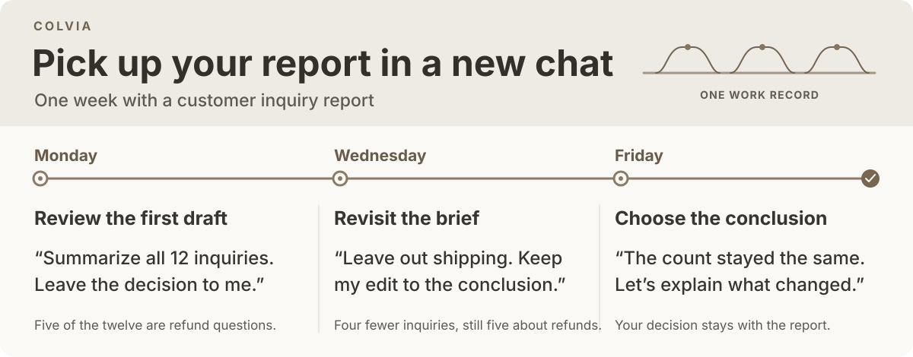
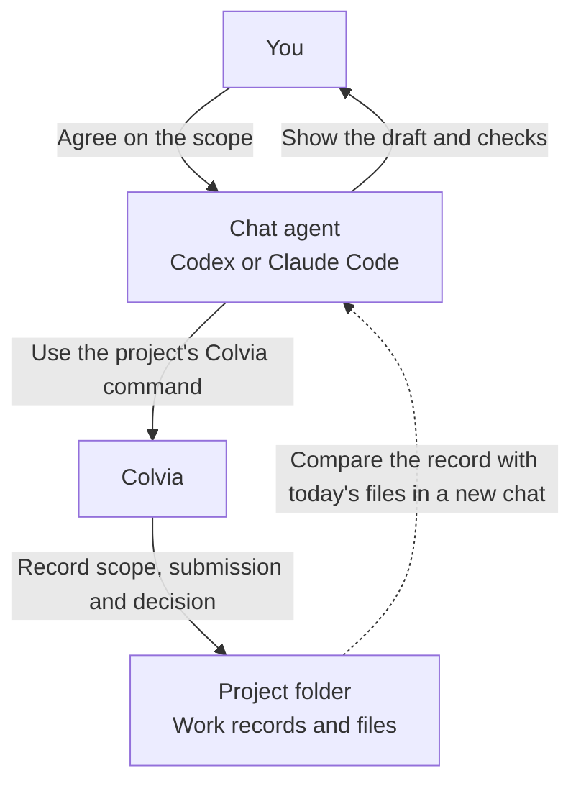

# Colvia

[한국어](../README.ko.md) · English

**Your agent does the work. You decide what to keep. Your project remembers.**

Colvia is a local tool for picking up work with Codex or Claude Code in a fresh chat. Your project keeps what you asked for, what the agent submitted and which result you accepted. Chat messages and file contents you share with your agent follow that service’s settings.

> Pick up from the report I reviewed on Monday. Keep my edit to the conclusion. Show me how the numbers change if we leave out shipping questions.

In the new chat, the agent can compare Monday’s reviewed draft with today’s file. Keep your own edit to the conclusion and review just the changes prompted by your manager’s feedback.

## Get started

[Write your first inquiry report](../manual/en/getting-started.md) with the sample data. Open a fresh chat in the same project to try the next day’s review right away. The public download is in preparation.

Already using Colvia in a project? Open it and ask **“Is anything waiting for my review?”** [User guide](../manual/en/README.md)

## When your coding agent edits several files

One request can change several files. When you come back to the code, start with the changes you reviewed and the cases you actually tested.

- **Fixing duplicate orders.** “Yesterday we checked what happens when I upload the same file twice. Did we also test an interrupted upload that resumes?” Read the checks submitted with the fix to see which case still needs a test.
- **Reworking payments.** “Start from the payment change I accepted yesterday. Which files have changed since, and what do I need to look at again?” Compare what you reviewed with later edits. [Working with a coding agent](../manual/en/work-guide.md#coding-en)

## What does a fresh chat pick up?

Codex or Claude Code edits the report. You choose which draft to accept. Colvia connects the agreed scope, the submitted changes and your decision in a project record called a Work.

**Stepping away?** “The draft is ready. Submit it for review and notify me on this device.” Once you confirm, Colvia runs that step locally and files the prepared result in the project inbox. Submission needs no model call. Keep the device awake and stay signed in. When you return, ask “Is the report ready for review?” You can decide even if you missed the alert. [Inbox and notifications](../manual/en/resume.md#handoff)

## Questions worth asking in a fresh chat

| What you need | What to ask |
| --- | --- |
| An earlier decision | “Show me the report I accepted on Monday. Which sentences have changed since?” |
| A change of scope | “How would dropping shipping change our original agreement? Show me the new scope before editing.” |
| A decision still to make | “Which results are waiting for me, and what still needs checking?” |

Colvia can refuse a submission containing changes outside the agreed files. Other programs can still edit the files. A fresh chat picks up the time and attempts recorded against the same task.

## What you can use today

Revise and check one task, review its result, or hand off a single step such as a status summary or submission of a prepared draft. Grouping child tasks, working in parallel checkouts and delegating acceptance of a particular result are advanced reference workflows. An optional macOS document runner requires separate authorization. [Feature guide](../manual/en/work-guide.md)

Opening a notification to reach the matching task was checked in isolated Mac and Windows ARM64 environments. Final checks for each chat agent on the public distribution are pending. Installation and the first task have been checked on an Apple silicon Mac and a designated Windows 11 ARM64 system. A Windows 11 x64 development build exists. Final checks on an x64 system are pending.

## Add Colvia to your project

Preview what will change in the folder you choose. The manager on your device and the copy installed in each project are updated separately. Disconnecting preserves the task and acceptance records. Reconnecting that folder with its history is currently unsupported. If an update stops partway, keep the request and files and check the recovery or rollback options first. [Install, update or disconnect](../manual/en/project-setup.md)

## What’s next

For the first Preview, we plan to report what worked on each platform from download through the first task and notification. Beyond that, we’re exploring how to reconnect projects with their history and which additional steps make sense to hand off while you’re away.

[User guide](../manual/en/README.md) · [Supported tasks](../manual/en/work-guide.md) · [Architecture](../manual/en/architecture.md) · [Contributing](../CONTRIBUTING.md) · [Apache License 2.0](../LICENSE)
