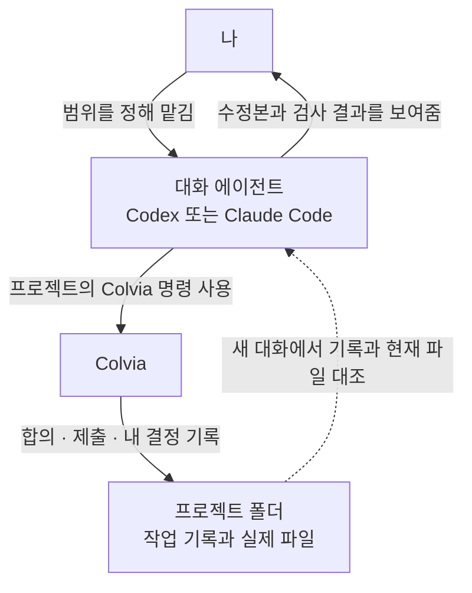

# Colvia

한국어 · [English](.github/README.md)

**AI가 일하고, 내가 결정하고, 프로젝트가 기억합니다.**

Colvia는 AI에게 맡긴 일과 내가 받아들인 결과를 프로젝트 폴더에 기록하는 로컬 도구입니다. 어제 Codex에 맡긴 보고서라면, 오늘은 Claude Code에서 같은 프로젝트를 열고 “어느 초안까지 검토했지? 내가 결정할 게 뭐가 남았어?”라고 물어보세요. 대화나 파일 내용을 에이전트에 전달할 때는 사용 중인 서비스의 설정이 적용됩니다.

> 월요일에 검토한 보고서에서 이어가자. 내가 고친 결론은 그대로 두고, 배송 문의를 빼면 숫자가 어떻게 달라지는지 보여줘.

새 대화의 에이전트가 월요일에 검토한 초안과 지금 파일을 비교합니다. 내가 손본 결론을 살리면서 팀장 피드백으로 달라진 부분만 다시 검토할 수 있습니다.

## 시작하기

처음이라면 [고객 문의 보고서로 첫 작업 따라 하기](manual/ko/getting-started.md)에서 자료를 받아 보고서를 맡겨 보세요. 연습할 때는 다음 날을 기다릴 필요 없이 같은 프로젝트에서 새 대화를 열면 됩니다. 공개 다운로드는 준비 중입니다.

이미 Colvia를 적용한 프로젝트라면 에이전트에게 **“지금 내 검토를 기다리는 결과가 있어?”** 하고 물어보세요. [사용 설명서](manual/ko/README.md)

## 코딩 에이전트에게 여러 파일을 맡길 때

AI 코딩에서는 한 번의 요청으로 여러 파일이 달라집니다. 새 대화에서 이어갈 때는 어떤 변경을 검토했고 어디까지 시험했는지부터 찾아보세요.

- **중복 주문 수정** · “어제 같은 파일을 두 번 올려도 주문이 하나만 생기는 건 확인했지? 업로드가 끊겼다가 재개되는 경우도 검사했어?” 지난 수정본에 남은 검사 결과를 보고 아직 시험할 조건을 고를 수 있습니다.
- **결제 모듈 개편** · “어제 받아들인 결제 변경에서 이어가자. 그 뒤 달라진 파일과 내가 다시 볼 부분을 보여줘.” 새 대화에서도 검토한 변경과 그 뒤의 편집을 구분할 수 있습니다. [코딩 에이전트와 작업하기](manual/ko/work-guide.md#coding-ko)

## 새 대화는 어디서 이어갈까요?

보고서를 고치는 일은 Codex나 Claude Code가 맡고, 어느 초안을 받아들일지는 내가 정합니다. Colvia는 합의한 범위와 제출된 변경, 내 결정을 한 작업의 기록(Work)으로 연결합니다.

**자리를 비울 때** · “초안은 준비됐어. 검토용으로 제출하고 이 기기에서 알려줘.” 단계를 확인하면 이 기기에서 Colvia가 준비된 결과를 수신함에 제출합니다. 이 단계에는 AI 모델을 쓰지 않습니다. 기기를 깨어 있는 상태로 두고 로그인 세션을 유지하세요. 돌아와서 “보고서 검토할 게 있어?”라고 물어보면 알림을 놓쳐도 결과를 찾아 직접 결정할 수 있습니다. [수신함과 알림](manual/ko/resume.md#handoff)

## 이렇게 물어보세요

| 궁금한 일 | 프로젝트에서 물어볼 말 |
| --- | --- |
| 이전 결정 | “월요일에 내가 받아들인 보고서를 보여줘. 그 뒤 달라진 문장은 어디야?” |
| 바뀐 범위 | “배송 문의를 빼면 지난번 합의와 뭐가 달라져? 고치기 전에 새 범위를 보여줘.” |
| 남은 검토 | “지금 내 결정을 기다리는 결과와 아직 확인하지 않은 항목을 보여줘.” |

범위를 벗어난 파일 변경이 섞이면 Colvia는 제출을 거부할 수 있습니다. 다른 프로그램이 파일을 편집하는 것까지 막지는 않습니다. 같은 작업을 새 대화에서 이어갈 때는 그 작업에 기록한 시간과 시도 횟수도 이어집니다.

## 지금 쓸 수 있는 범위

한 작업에서 수정·검사를 반복하고 결과를 검토하거나, 현황 정리나 준비된 결과 제출 한 단계를 맡길 수 있습니다. 여러 하위 작업의 결과를 모으거나 별도 작업 공간을 병렬로 쓰는 방법, 특정 결과의 수락 위임은 고급 참고 기능입니다. macOS에는 별도 승인이 필요한 선택형 문서 실행기도 있습니다. [기능별 안내](manual/ko/work-guide.md)

알림을 눌러 해당 작업을 여는 흐름은 격리된 Mac과 Windows ARM64에서 확인했습니다. 공개 배포 경로와 에이전트별 최종 확인은 남아 있습니다. 기기 설치와 첫 작업은 Apple silicon Mac과 지정 Windows 11 ARM64 환경에서 확인했습니다. Windows 11 x64는 개발 빌드가 있으며 실제 x64 기기의 최종 확인이 남았습니다.

## 내 프로젝트에 Colvia 적용하기

폴더를 적용 대상으로 지정하면 무엇이 생기는지 먼저 볼 수 있습니다. 기기의 관리 도구와 각 프로젝트의 설치본은 따로 갱신합니다. 연결을 해제하면 작업과 수락 기록은 남지만 같은 폴더를 그 이력과 함께 다시 연결하는 기능은 아직 없습니다. 갱신 도중 멈췄다면 원래 요청과 파일을 보존하고 복구하거나 이전 버전으로 돌아갈 수 있는지부터 확인하세요. [설치·갱신·연결 해제](manual/ko/project-setup.md)

## 앞으로의 방향

첫 Preview에서는 실제 다운로드부터 첫 작업과 알림까지 플랫폼별로 확인한 범위를 안내할 예정입니다. 그다음에는 기존 기록을 살려 프로젝트에 다시 연결하는 방법과, 자리를 비운 동안 맡길 수 있는 일의 범위를 검토합니다.

[사용 설명서](manual/ko/README.md) · [지원 범위](manual/ko/work-guide.md) · [구조와 역할](manual/ko/architecture.md) · [기여 안내](CONTRIBUTING.ko.md) · [Apache License 2.0](LICENSE)
