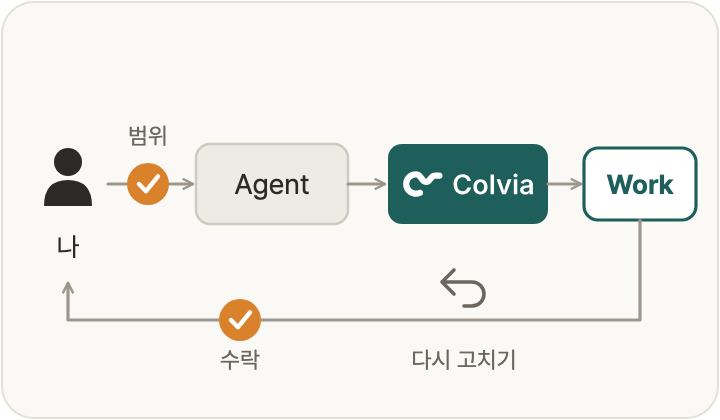
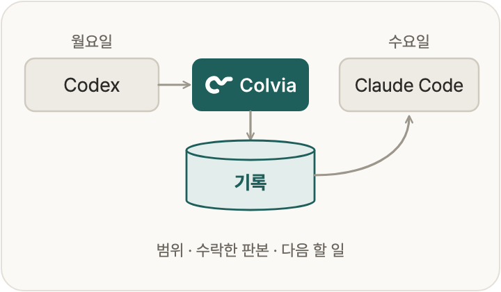
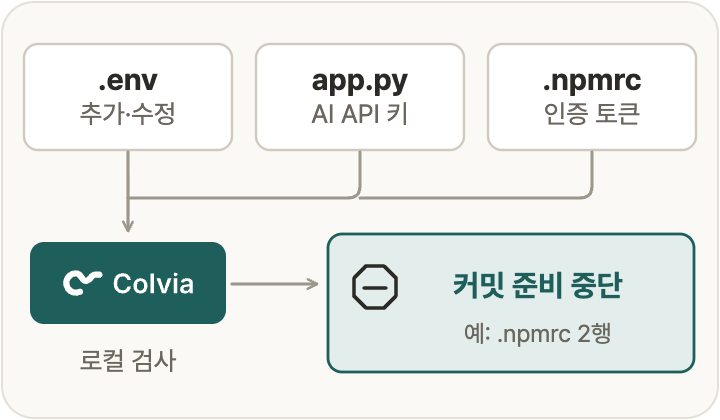
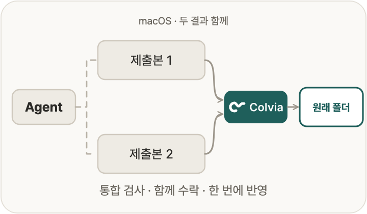

  <picture>
    <source media="(prefers-color-scheme: dark)" srcset="assets/brand/logo-hero-dark.svg">
    
  </picture>

**Colvia는 사람과 AI가 함께 일하는 로컬 워크플로 도구입니다.**

한국어 · [English](README.md)

[설치와 프로젝트 연결](manual/ko/install.md) · [따라 하기](manual/ko/tutorial.md) · [사용 안내](manual/ko/README.md) · [Colvia 한눈에 보기](manual/ko/overview.md) · [지원 환경](manual/ko/reference.md#environments) · [릴리스 노트와 다운로드](https://github.com/colvia/downloads/releases)

**[↓ 공식 설치 페이지](https://colvia.github.io/downloads/#ko)**

Codex나 Claude Code가 제안한 작업 범위를 승인하고, 결과를 검토해 받아들일지 결정합니다. Colvia는 승인 내역과 제출본을 내 기기에 보관합니다. 같은 프로젝트를 열면 새 대화나 다른 에이전트에서도 작업을 이어갈 수 있습니다.

Colvia는 결과를 제출할 때 파일 변경을 승인한 작업 범위와 대조합니다. 범위 밖 변경 때문에 제출이 거부돼도 작업한 파일은 폴더에 그대로 남아, 무엇이 바뀌었는지 확인할 수 있습니다.

코드 작성에 익숙하지 않아도, 설치를 마치면 평소 쓰는 채팅에서 폴더를 연결하고 일을 맡길 수 있습니다. 개발 프로젝트라면 기존 저장소와 프로젝트 규칙을 활용할 수 있습니다.

> [!NOTE]
> Colvia(콜비아)는 산봉우리 사이의 고개를 뜻하는 *col*과 라틴어로 길을 뜻하는 *via*를 합친 이름입니다. 일을 시작한 목적과 그동안 내린 결정을 다음 작업으로 이어 간다는 뜻을 담았습니다.

## 설치하고 첫 작업 시작하기

먼저 Codex 또는 Claude Code를 설치하고 로그인하세요.

1. Colvia를 사용할 운영체제 계정으로 로그인한 뒤 [공식 설치 페이지](https://colvia.github.io/downloads/#ko)에서 운영체제에 맞는 명령을 복사해 실행하세요. Colvia가 배포 파일을 내려받아 검증하고 전용 Python을 준비합니다. Windows에서는 표준 사용자로 시작 메뉴에서 일반 PowerShell을 여세요. 준비가 끝나면 [설치한 버전을 확인하세요](manual/ko/install.md#check-installed-version).
2. Codex 또는 Claude Code에서 작업할 폴더를 여세요. Git을 쓰는 프로젝트라면 아직 등록하지 않은 Git의 [등록을 에이전트에게 요청](manual/ko/git.md#git-register)하고, 저장소의 최상위 폴더를 여세요. 이어서 “이 폴더에 Colvia를 연결해 주세요.”라고 요청하세요. 미리보기에 나온 폴더, 추가할 파일, 기록 저장 위치가 맞으면 연결을 승인하세요. 빈 폴더나 기존 자료가 있는 폴더를 처음 연결할 때 Git 선택이 표시되면, 일반 폴더로 쓰거나 Git을 시작할 수 있습니다.
3. 연결을 마치면 지금 대화에서 하려던 일을 짧게 알려주세요. 빈 폴더에서 시작한다면 “보고서를 쓰고 싶어요”나 “웹앱을 만들고 싶어요”처럼 하려는 일을 한두 문장으로 말해 보세요. 이미 작업 중인 프로젝트에도 연결할 수 있습니다. 에이전트는 앞서 설명한 목적과 기존 README, 프로젝트 규칙을 참고해 작업안을 제안합니다.

일반 폴더에서는 보고서·기획안·회의 자료를 맡기고, 제출본을 검토하거나 현재 파일과 비교할 수 있습니다.

이미 설치했다면 에이전트에게 Colvia 업데이트를 요청하거나, 설치한 계정에서 공식 설치 페이지의 같은 명령을 다시 실행하세요.

[Git 등록 안내](manual/ko/git.md#git-register) · [업데이트와 복구](manual/ko/maintenance.md#update) · [프로젝트 연결 해제](manual/ko/maintenance.md#disconnect)

<picture><source media="(prefers-color-scheme: dark)" srcset="manual/assets/gallery/overview-dark.png"></picture> 
<em>폴더를 연결하고 작업 범위를 승인한 뒤, 결과를 검토하고 다음 할 일을 정하는 흐름입니다.</em>

## 맡긴 일을 검토하고 결정하기

고객 문의를 모아 둔 파일이 있다면 이렇게 요청해 보세요.

> 문의 유형과 자주 나오는 불편 사항을 정리해 회의용 보고서를 만들어 주세요. 개선 우선순위는 제가 정할게요.

1. **범위를 승인합니다.** 에이전트가 살펴볼 자료, 만들 파일과 확인 기준을 제안합니다. Colvia는 어느 계획을 승인했는지 기록합니다. 계획을 기록하면, 승인 전이라도 계획에 적은 기존 파일의 본문이 Colvia 기록과 백업에 남습니다. 필요한 파일만 범위에 넣으세요.
2. **제출본과 검사 결과를 봅니다.** 에이전트가 보고서를 제출하고 검사에서 통과한 것, 실패한 것, 확인하지 못한 것을 알려줍니다. Colvia는 검토용 제출 시 승인 범위를 확인해 범위 밖 변경이 있으면 제출을 막습니다. 제출이 거부되면 이미 바뀐 파일은 작업 폴더에 남습니다. 변경을 확인한 뒤 정리해 다시 제출하세요.
3. **수락하거나 수정을 요청합니다.** Colvia는 어느 제출본을 수락했는지 기록합니다. 기존 승인이 유효하고 수정할 내용이 그 범위 안에 있으면 같은 Work에서 이어갑니다.
4. **필요할 때 다음 일을 기록합니다.** 예를 들어 “다음에는 반복 문의에 대한 답변 예시를 정리하자”라고 남기면, 새 대화에서 보고서와 함께 그 결정을 찾을 수 있습니다.

첫 제출 전에 같은 목표로 파일이 더 필요해지면 [같은 Work에서 추가할 파일만 승인](manual/ko/work.md#scope-change)할 수 있습니다. 예를 들어 표 수정과 부록 생성을 함께 승인한 뒤 한 번에 검토하세요.

Colvia는 목표, 파일 범위, 검사, 제출본과 결정을 **Work(작업 단위)** 하나에 남깁니다. 짧은 질문과 자료 조회는 허용된 범위에서 바로 요청할 수 있습니다.

직접 요청한 오탈자·띄어쓰기·문장부호 교정은 새 Work 없이 처리할 수 있습니다. 프로젝트 규칙과 허용한 접근 범위 안에서 뜻과 동작이 유지되고, 별도 결과 검토나 보존, 인계가 필요 없을 때에만 해당합니다. 기존 Work에 속한 수정이라면 해당 Work의 승인 범위와 기록을 확인해 이어갑니다. [작업을 맡기고 검토하기](manual/ko/work.md#review)

## 대화를 바꿔도 이어가기

첫 제출 전에 자리를 비울 때는 “여기까지 기록해 줘”라고 하세요. 같은 폴더에서 새 대화를 열고 “하던 일 이어가자”라고 하면, 마지막 메모와 그 뒤 바뀐 파일을 확인할 수 있습니다. 중간 메모를 지원하는 버전에서 쓸 수 있습니다. [중간 메모 사용법](manual/ko/work.md#progress-note)

이 기능을 지원하는 실행기에서는 A를 두고 B를 하거나, 잠시 멈춘 A를 같은 단계에서 이어갈 수 있습니다. [다른 Work로 전환하거나 멈추고 다시 시작하기](manual/ko/work.md#work-lifecycle)

같은 프로젝트를 새 대화에서 열고 “아까 맡긴 보고서에서 제가 확인할 부분만 보여 주세요”라고 물어보세요. 에이전트가 작업 폴더와 Colvia 기록에 접근할 수 있으면 승인 범위, 마지막 제출본, 현재 파일과 달라진 부분, 기록해 둔 후속 결정을 확인할 수 있습니다.

Codex와 Claude Code를 모두 이용 중이라면 같은 프로젝트에서 두 에이전트를 번갈아 쓸 수 있습니다. 예를 들어 Codex에서 하던 일을 Claude Code로 이어갈 때는 Claude Code가 작업 폴더와 Colvia 기록을 읽을 수 있는지 확인하세요. 기존 승인이 유효하고 작업 폴더와 범위가 맞으면 그 Work에서 이어갈 수 있습니다. [기록한 후속 작업 찾기](manual/ko/work.md#follow-up)

<table>
<tr>
<td width="33%" align="center" valign="top">
<picture><source media="(prefers-color-scheme: dark)" srcset="manual/assets/gallery/scope-dark.png"></picture> 
<strong>범위를 정하고 결과 검토하기</strong>
</td>
<td width="33%" align="center" valign="top">
<picture><source media="(prefers-color-scheme: dark)" srcset="manual/assets/gallery/switch-dark.png"></picture> 
<strong>대화나 에이전트를 바꿔 이어가기</strong>
</td>
<td width="33%" align="center" valign="top">
<picture><source media="(prefers-color-scheme: dark)" srcset="manual/assets/gallery/drift-dark.png"></picture> 
<strong>수락한 제출본과 현재 파일 비교하기</strong> 
수락한 제출본과 현재 파일을 비교해 그 뒤에 무엇이 바뀌었는지 확인할 수 있습니다.
</td>
</tr>
</table>

### 코드를 고친 결과도 이어서 보기

> 제가 수락한 파일 업로드 변경 이후에 달라진 파일과 다시 볼 부분을 보여 주세요. 업로드가 끊겼다가 재개되는 경우는 검사했나요?

에이전트가 현재 파일과 수락한 제출본을 대조하고, 기록된 검사에서 통과·실패·확인 불가를 구분하고, 해당 검사 기록이 없으면 그 점을 알려 줄 수 있습니다.

## Git, 백업, 폴더 이동

- **Git에 결과 반영하기.** 수락한 제출본은 Colvia에 남으므로, 임시 커밋(WIP 커밋)을 만들지 않아도 나중에 현재 파일과 비교할 수 있습니다. 결과를 수락한 뒤 커밋할 변경과 스테이징 상태를 검토하고 별도로 승인합니다. Colvia는 다른 파일에 스테이징한 변경을 보존합니다. 선택한 파일의 스테이징 내용이 현재 커밋과 수락한 결과 중 어느 쪽에도 맞지 않으면, 스테이징한 변경을 보호하기 위해 Git 반영을 멈춥니다. [Git에 결과 반영하기](manual/ko/git.md#git-integration)

### Git에 반영하기 전 자격증명 검사 · v0.2.0

Colvia로 Git에 반영할 때는 내 기기에서 변경 내용을 먼저 검사합니다. 소스에 직접 적은 API 키나 토큰을 알아보거나, 변경에 `.env` 같은 보호 파일의 추가·수정이 포함되면 이번 변경의 Git 객체를 만들기 전에 멈춥니다. 안내에서 값을 드러내지 않고 고칠 위치를 짚어 줍니다.

<picture><source media="(prefers-color-scheme: dark)" srcset="manual/assets/gallery/credential-dark.png"></picture>

PNG 로고나 글꼴처럼 지원되는 이미지·글꼴은 확장자와 파일 서명이 일치하면 함께 반영할 수 있습니다. 이 파일 안의 자격증명은 검사하지 않으며, 커밋 미리보기에 경로와 형식을 표시합니다. PDF·압축 파일 등 다른 이진 파일도 커밋해야 한다면 내용을 직접 검토한 뒤 Git으로 별도 커밋하세요.

키를 코드에 직접 적었다면 환경변수를 읽도록 고치세요. 보호 파일은 반영 대상에서 빼세요. 파일을 고친 뒤에는 수정본을 다시 제출하고 수락한 다음 Git 반영을 준비합니다. 검사에 통과하면 커밋할 변경을 검토하고 별도로 승인합니다. [검사 범위와 해결 방법](manual/ko/git.md#git-credential-check)

### 기록 백업과 폴더 이동

- **기록 백업과 복원.** Work 기록, 승인, 제출 본문과 설정을 내보낼 수 있습니다. 백업에 작업 전 본문과 제출본이 담기므로 프로젝트 자료와 같은 기준으로 보관하세요. 프로젝트 파일은 따로 백업하세요. Colvia 기록을 복원할 때는 Work와 보존 본문을 함께 확인합니다. [기록 백업과 복원](manual/ko/records.md#backup)
- **프로젝트 폴더 이동.** 같은 로컬 볼륨에서 폴더를 옮겼다면 에이전트에게 “프로젝트 폴더를 옮겼어요. 새 위치에서 기존 Colvia 기록을 이어가게 해 주세요.”라고 요청하세요. 미리보기에서 기존 위치와 새 위치를 확인하고, 같은 폴더라는 확인이 끝나면 새 위치로 연결하는 것을 승인하세요. 지원하는 환경과 연결 조건을 확인하세요. [폴더 이동과 기존 기록 이어가기](manual/ko/records.md#move)

## 알림에서 결과 열기

<picture><source media="(prefers-color-scheme: dark)" srcset="manual/assets/gallery/notify-dark.png"></picture>

알림을 설정하고 운영체제에서 허용하세요. 알림을 사용할 수 있는 환경에서는 알림을 눌러 해당 Work의 검토 화면을 열 수 있습니다. 수락 여부는 내용을 보고 결정하세요. 알림을 놓쳤거나 결과가 열리지 않으면 같은 프로젝트에서 “검토할 결과가 있나요?”라고 물어보세요. [알림 설정하기](manual/ko/maintenance.md#notifications)

새 알림을 그만 받으려면 에이전트에게 “이 계정의 Colvia 알림을 꺼 주세요.”라고 요청하세요. 설치된 관리자의 `notice-disable` 명령을 사용합니다. 이후에도 프로젝트 대화에서 검토할 결과를 확인할 수 있습니다.

## 큰 작업을 나눠 진행하기

같은 폴더에서 큰 일을 하위 Work로 나누면 각 결과를 검토하고 수락할 수 있습니다. 격리 폴더(같은 저장소에 등록한 별도 Git 작업 폴더)의 결과를 옮길 때는 **어느 제출본을 어느 폴더에 반영할지** 확인합니다. 아직 검토 중인 제출본이라면 반영과 수락을 함께 승인하고, Colvia는 반영을 마치고 대상 파일을 확인한 뒤 그 제출본의 수락을 기록합니다. 이미 수락한 제출본은 반영만 승인합니다.

<table>
<tr>
<td width="50%" align="center" valign="top">
<picture><source media="(prefers-color-scheme: dark)" srcset="manual/assets/gallery/split-dark.png"></picture> 
<strong>하위 결과와 전체 결과 검토하기</strong>
</td>
<td width="50%" align="center" valign="top">
<picture><source media="(prefers-color-scheme: dark)" srcset="manual/assets/gallery/parallel-dark.png"></picture> 
<strong>격리 폴더의 결과를 한 건씩 반영하기</strong>
</td>
</tr>
</table>

제출본은 한 건씩 반영합니다. 대상 폴더에 승인됐거나 진행 중이거나 검토 중인 다른 Work가 없는지 확인하세요. 지정한 격리 Work의 반영과 수락은 안내에 나온 조건에서 위임할 수 있습니다. 여러 결과를 모았다면 반영된 파일과 검사 결과를 보고 전체 결과를 직접 수락하세요. 중단된 반영의 재개 조건도 상세 안내에서 확인할 수 있습니다. [하위 Work와 격리 폴더의 결과 적용](manual/ko/work.md#child-works)

## 내 프로젝트와 기록

| 주체 | 맡는 일 |
| --- | --- |
| 사용자 | 목표와 범위를 정하고, 필요한 접근을 허용하고, 결과를 수락할지 결정합니다. |
| Codex·Claude Code | 프로젝트 규칙을 읽고, 작업을 제안하고, 실제 작업과 검사를 수행합니다. |
| Colvia | 에이전트가 프로젝트의 Work를 찾아 이어가도록 안내하고, 계획·승인·제출본·결정을 내 기기에 보관합니다. |

Colvia는 운영체제의 사용자 데이터 폴더에 계획·승인·제출본·결정을 보관합니다. 프로젝트 폴더에는 실행기와 연결 정보, 안내를 둡니다. 구성요소와 기록 저장 구조가 궁금하다면 [아키텍처](manual/ko/architecture.md)를 보세요.

프로젝트에서 Colvia 사용을 그만두려면 에이전트에게 “이 폴더의 Colvia 연결 해제 미리보기를 보여 주세요.”라고 요청하세요. [연결 해제](manual/ko/maintenance.md#disconnect)를 승인해도 파일과 Work 기록은 남습니다. 나중에 다시 연결해 이전 작업을 이어갈 계획이라면 해제 전에 [기록을 백업하세요](manual/ko/records.md#backup). 설치본을 제거하고 기록을 보존하려면 에이전트에게 제거 미리보기를 요청하거나 [제거·재설치 절차](manual/ko/maintenance.md#uninstall)를 따르세요.

에이전트가 읽고 쓰는 파일과 실행할 도구는 앱이나 CLI의 권한 설정에서 정합니다. 다른 앱이나 에이전트도 권한이 있는 파일은 수정할 수 있습니다. 제출할 때 Colvia는 자신이 추적하는 파일의 변경을 승인 범위와 대조합니다. 승인 범위를 벗어난 변경이 확인되면 제출을 멈춥니다. 결과를 직접 수락할 때는 해당 폴더의 현재 파일을 검토한 제출본과 다시 대조하므로, 그사이에 파일이 바뀌었다면 변경을 확인하고 다시 제출해야 합니다. 검사 결과와 Git 반영도 각각 확인하세요.

에이전트에게 공유한 자료와 대화에는 사용 중인 AI 서비스의 데이터 처리 설정이 적용됩니다.

## Preview 지원 범위

첫 Preview의 대상은 **macOS Apple Silicon과 Windows 11 x64·ARM64**, 그리고 **Codex와 Claude Code의 CLI·데스크톱 앱**입니다. 앱·CLI와 권한 모드에 따라 프로젝트 폴더와 Colvia 기록 폴더에 별도로 접근을 허용해야 할 수 있습니다. 설치·갱신과 기록 폴더의 접근 조건은 [지원 환경](manual/ko/reference.md#environments)에서 확인하세요.

## 앞으로 보강할 방향

- **시작과 복귀를 쉽게.** 문서 작업과 개발 프로젝트에 맞는 첫 작업 안내를 보강하고, 작업에 돌아왔을 때 지금 확인할 일과 마지막 결정 이후 달라진 점을 짧게 보여 주는 방법을 검토합니다. 같은 문제로 여러 번 막히면 개선할 일로 남기는 방법도 살펴봅니다.
- **큰 작업을 계속 이어가기.** 작업 중 새로 생긴 범위만 이어서 승인하고, 여러 Work의 결과를 모아 검토하는 흐름을 넓히고자 합니다. 기록이 오래 쌓인 프로젝트에서도 조회와 백업·복원이 잘 되는지 확인하고, 설치나 작업이 멈췄을 때 어디서부터 이어갈지 더 쉽게 안내할 계획입니다.
- **사용 환경 넓히기.** Linux와 추가 에이전트, 팀의 동시 편집과 자동 병렬 실행은 검토 후보입니다. Colvia가 에이전트를 직접 호출하는 기능은 첫 Preview에서 비활성 상태입니다. 첫 Preview에서는 평소 쓰는 Codex·Claude Code 앱과 CLI에서 작업을 맡기고 검토하는 흐름에 집중합니다.

[문제가 생겼을 때](manual/ko/reference.md#problems) · [문의·버그 신고](CONTRIBUTING.ko.md#질문하거나-버그를-신고하려면) · [비공개 보안 제보](SECURITY.md) · [기여 안내](CONTRIBUTING.ko.md) · [Apache License 2.0](LICENSE)
