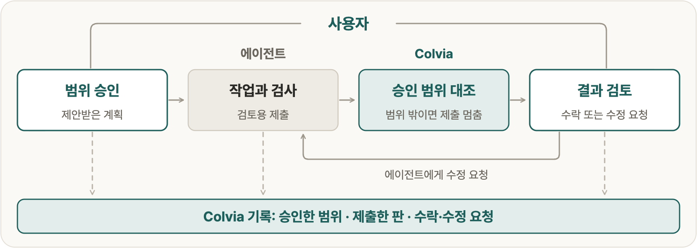
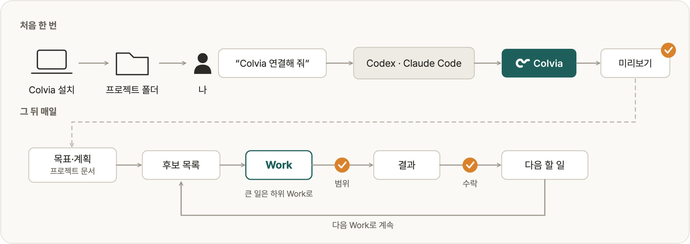
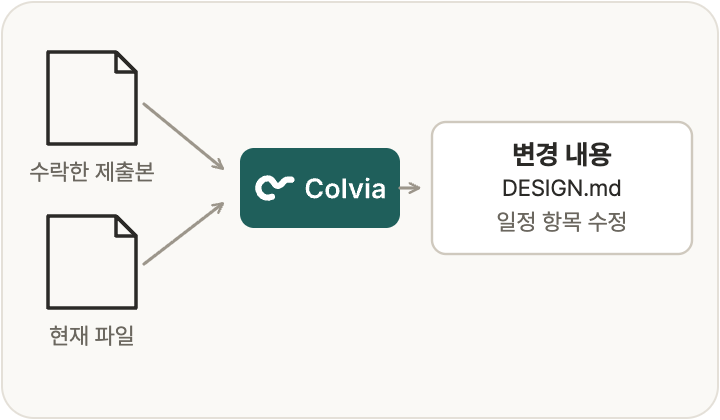
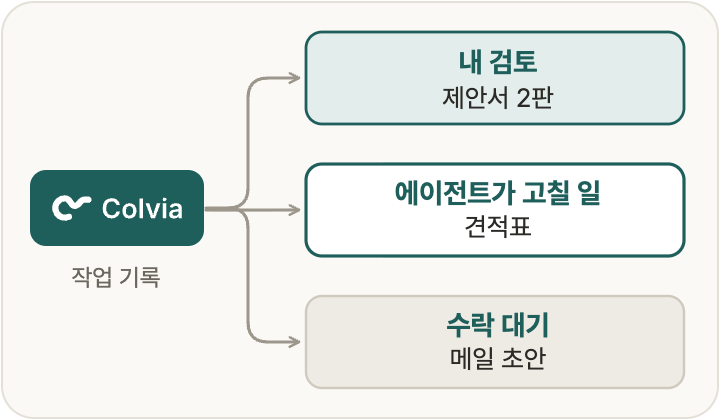
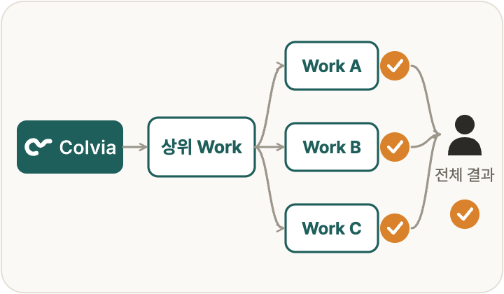
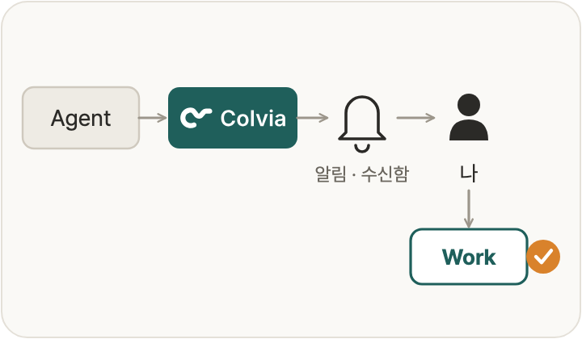
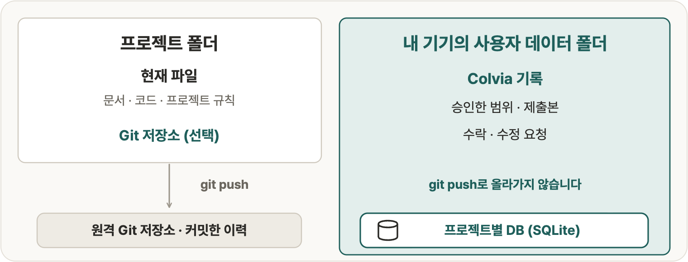

  <picture>
    <source media="(prefers-color-scheme: dark)" srcset="assets/brand/logo-hero-dark.svg">
    
  </picture>

**Colvia는 사람과 AI가 함께 일하는 로컬 워크플로 도구입니다.**

한국어 · [English](README.md)

[설치와 프로젝트 연결](manual/ko/install.md) · [따라 하기](manual/ko/tutorial.md) · [사용 안내](manual/ko/README.md) · [Colvia 한눈에 보기](manual/ko/overview.md) · [지원 환경](manual/ko/reference.md#environments) · [릴리스 노트와 다운로드](https://github.com/colvia/downloads/releases)

**[↓ 공식 설치 페이지](https://colvia.github.io/downloads/#ko)**

Codex나 Claude Code가 제안한 작업 범위를 승인하고, 결과를 검토해 받아들일지 결정합니다. Colvia는 승인 내역과 제출본을 내 기기에 보관합니다. 같은 프로젝트를 열면 새 대화나 다른 에이전트에서도 작업을 이어갈 수 있습니다.

Colvia는 결과를 제출할 때 파일 변경을 승인한 작업 범위와 대조합니다. 범위 밖 변경 때문에 제출이 거부돼도 작업한 파일은 폴더에 그대로 남아, 무엇이 바뀌었는지 확인할 수 있습니다.

코드 작성에 익숙하지 않아도, 설치를 마치면 평소 쓰는 채팅에서 폴더를 연결하고 일을 맡길 수 있습니다. 개발 프로젝트라면 기존 저장소와 프로젝트 규칙을 활용할 수 있습니다.

> [!NOTE]
> Colvia(콜비아)는 산봉우리 사이의 고개를 뜻하는 *col*과 라틴어로 길을 뜻하는 *via*를 합친 이름입니다. 일을 시작한 목적과 그동안 내린 결정을 다음 작업으로 이어 간다는 뜻을 담았습니다.

## 한 작업을 맡기면 누가 무엇을 결정하나요?

<picture><source media="(prefers-color-scheme: dark)" srcset="manual/assets/gallery/workflow-dark.png"></picture>

에이전트가 제안한 계획을 보고 **어디까지 맡길지** 정합니다. 결과가 오면 검사 결과와 제출본을 읽고 **그 판을 받아들일지** 정합니다. 고칠 부분이 있으면 에이전트에게 수정을 요청하세요. 이 계획과 승인, 제출본, 검토 내역을 한데 모은 작업 단위가 Work입니다.

## 설치하고 첫 작업 시작하기

먼저 사용하는 Codex 또는 Claude Code 앱(또는 CLI)에 로그인하세요.

1. Colvia를 사용할 운영체제 계정으로 로그인한 뒤 [공식 설치 페이지](https://colvia.github.io/downloads/#ko)에서 운영체제에 맞는 명령을 복사해 실행하세요. Colvia가 배포 파일을 내려받아 검증하고 전용 Python을 준비합니다. Windows에서는 표준 사용자로 시작 메뉴에서 일반 PowerShell을 여세요. 준비가 끝나면 [설치한 버전을 확인하세요](manual/ko/install.md#check-installed-version).
2. 새 작업은 빈 폴더에서 시작해도 되고, 기존 자료가 있는 폴더를 연결해도 됩니다. Git을 쓰지 않아도 Colvia를 사용할 수 있습니다. Codex 또는 Claude Code에서 사용할 폴더를 열고 “이 폴더에 Colvia를 연결해 주세요.”라고 요청하세요.

   Git 저장소를 연결한다면 최상위 폴더에서 시작하세요. 이때 Git이 아직 등록되지 않았다면 연결 미리보기가 멈추고 먼저 등록하도록 안내합니다. [등록 내용을 확인하고 승인](manual/ko/git.md#git-register)한 뒤 연결 미리보기를 요청하세요.

   미리보기에 나온 폴더, 추가할 파일, 기록 저장 위치가 맞으면 연결을 승인하세요. 처음 연결할 때 Git 선택이 표시되면 일반 폴더로 계속 쓰거나 Git을 시작할 수 있습니다. 일반 폴더로 쓰다가 미완료 Work를 마친 뒤 [기존 기록을 보존하면서 Git으로 전환](manual/ko/git.md#adopt-git)할 수도 있습니다.
3. 폴더를 연결하면 같은 대화에서 원하는 결과와 완료 조건을 함께 말해 보세요. 예를 들어 “할 일 앱을 만들어 주세요. 할 일을 추가하고 완료로 표시할 수 있어야 하고, 앱을 다시 열어도 목록이 남아야 해요”라고 요청할 수 있습니다. 에이전트는 만들거나 고칠 파일과 그 조건을 확인할 검사를 한 계획으로 제안합니다. 기존 프로젝트라면 README와 프로젝트 규칙도 참고합니다. 범위가 맞으면 계획을 한 번에 승인하세요.
4. 에이전트가 앱을 만들고 계획한 검사를 실행합니다. 문제가 드러나면 승인한 범위 안에서 고치고 같은 검사를 다시 실행할 수 있습니다. 계획에 없던 파일이 필요하거나 검사 기준을 바꿔야 하면 멈추고 바뀔 내용을 제안해 승인을 기다립니다. 검사를 마치면 에이전트가 앱과 검사 결과를 검토용으로 제출합니다. Colvia에는 승인한 범위와 제출본이 남습니다. 제출본과 검사 결과를 보고 수락할지, 수정을 요청할지 정하세요. [맡기고 검토하기](manual/ko/work.md#review)

일반 폴더에서는 보고서·기획안·회의 자료를 맡기고, 제출본을 검토하거나 현재 파일과 비교할 수 있습니다.

이미 설치했다면 에이전트에게 Colvia 업데이트를 요청하거나, 설치한 계정에서 공식 설치 페이지의 같은 명령을 다시 실행하세요.

[Git 등록 안내](manual/ko/git.md#git-register) · [업데이트와 복구](manual/ko/maintenance.md#update) · [프로젝트 연결 해제](manual/ko/maintenance.md#disconnect)

<picture><source media="(prefers-color-scheme: dark)" srcset="manual/assets/gallery/overview-dark.png"></picture> 
<em>Colvia는 사용할 계정에 한 번 설치하고, 작업할 폴더마다 연결을 승인합니다. 연결한 뒤에는 새 일을 맡기거나 같은 폴더에서 하던 일을 이어가세요.</em>

## 오늘 내가 볼 건 뭐지?

어제 사업 제안서를 읽고 에이전트에게 시장 규모의 출처를 보강해 달라고 했습니다. 오늘 같은 폴더에서 새 대화를 열면 어디서부터 이어가면 될까요? “오늘 내가 볼 건 뭐지?”라고 물어보세요. 후보의 순위를 정하거나 별도 목록을 만들지 않아도 에이전트가 조회한 작업 중 검토할 일을 먼저 알려 줍니다.

채팅에서는 이런 답을 받을 수 있습니다.

> **내 검토 1건 · 사업 제안서 2판.** 에이전트가 2판을 제출했습니다. 시장 규모 수치에 출처가 붙었는지 확인해 주세요.
>
> **에이전트가 고칠 일 · 견적표.** 검토자가 에이전트에게 금액 옆에 통화 단위를 표시해 달라고 요청했습니다.
>
> **제안서 수락 대기 · 메일 초안.** 메일 초안은 제안서 수락을 기다리도록 연결돼 있습니다. 제안서 2판을 수락하면 메일 초안을 시작할 조건이 갖춰집니다.

같은 대화에서 **“제안서 2판 보여 줘.”** 하고 이어가세요. 에이전트가 방금 목록에서 본 판을 엽니다. [현황에서 이어가기](manual/ko/work.md#project-status) · [기다리는 결과 확인하기](manual/ko/work.md#work-dependencies)

## Colvia로 할 수 있는 일

<table>
<tr>
<td width="33%" valign="top" align="center">
<picture><source media="(prefers-color-scheme: dark)" srcset="manual/assets/gallery/switch-dark.png"></picture> 
<strong><a href="manual/ko/work.md#follow-up">대화를 바꿔 이어가기</a></strong> 
같은 기록을 열어 다른 에이전트와 이어갑니다.
</td>
<td width="33%" valign="top" align="center">
<picture><source media="(prefers-color-scheme: dark)" srcset="manual/assets/gallery/drift-dark.png"></picture> 
<strong><a href="manual/ko/work.md#review">수락한 결과와 비교하기</a></strong> 
수락한 뒤 현재 파일에서 바뀐 내용을 봅니다.
</td>
<td width="33%" valign="top" align="center">
<picture><source media="(prefers-color-scheme: dark)" srcset="manual/assets/gallery/credential-dark.png"></picture> 
<strong><a href="manual/ko/git.md#git-credential-check">Git 반영 전 자격증명 검사</a></strong> 
Colvia로 커밋할 때 보호 파일의 추가·수정과 알려진 키 패턴을 확인합니다.
</td>
</tr>
<tr>
<td width="33%" valign="top" align="center">
<picture><source media="(prefers-color-scheme: dark)" srcset="manual/assets/gallery/status-dark.png"></picture> 
<strong><a href="manual/ko/work.md#project-status">오늘 볼 일 확인하기</a></strong> 
내가 볼 일, 에이전트가 고칠 일, 수락을 기다리는 일을 구분합니다.
</td>
<td width="33%" valign="top" align="center">
<picture><source media="(prefers-color-scheme: dark)" srcset="manual/assets/gallery/split-dark.png"></picture> 
<strong><a href="manual/ko/work.md#child-works">하위 Work로 나눠 검토하기</a></strong> 
하위 결과를 검토한 뒤 전체 결과를 따로 수락합니다.
</td>
<td width="33%" valign="top" align="center">
<picture><source media="(prefers-color-scheme: dark)" srcset="manual/assets/gallery/notify-dark.png"></picture> 
<strong><a href="manual/ko/maintenance.md#notifications">알림에서 결과 열기</a></strong> 
알림을 허용하면 검토할 작업을 바로 열 수 있습니다.
</td>
</tr>
</table>

## 맡긴 일을 검토하고 결정하기

고객 문의를 모아 둔 파일이 있다면 이렇게 요청해 보세요.

> 문의 유형과 자주 나오는 불편 사항을 정리해 회의용 보고서를 만들어 주세요. 개선 우선순위는 제가 정할게요.

1. **범위를 승인합니다.** 에이전트가 살펴볼 자료, 만들 파일과 확인 기준을 제안합니다. Colvia는 어느 계획을 승인했는지 기록합니다. 계획을 기록하면, 승인 전이라도 계획에 적은 기존 파일의 본문이 Colvia 기록과 백업에 남습니다. 필요한 파일만 범위에 넣으세요.
2. **제출본과 검사 결과를 봅니다.** 에이전트가 보고서를 제출하고 검사에서 통과한 것, 실패한 것, 확인하지 못한 것을 알려줍니다. Colvia는 검토용 제출 시 승인 범위를 확인해 범위 밖 변경이 있으면 제출을 막습니다. 제출이 거부되면 이미 바뀐 파일은 작업 폴더에 남습니다. 변경을 확인한 뒤 정리해 다시 제출하세요.
3. **수락하거나 수정을 요청합니다.** Colvia는 어느 제출본을 수락했는지 기록합니다. 기존 승인이 유효하고 수정할 내용이 그 범위 안에 있으면 같은 Work에서 이어갑니다.
4. **필요할 때 다음 일을 기록합니다.** 예를 들어 “다음에는 반복 문의에 대한 답변 예시를 정리하자”라고 남기면, 새 대화에서 보고서와 함께 그 결정을 찾을 수 있습니다.

첫 제출 전에 같은 목표로 파일이 더 필요하면 [같은 Work에서 추가할 파일만 승인](manual/ko/work.md#scope-change)할 수 있습니다. 표 수정과 부록 생성을 함께 승인한 뒤 한 번에 검토할 수 있습니다. 검토자가 수정을 요청한 뒤에도 파일을 추가로 승인할 수 있습니다.

짧은 질문과 자료 조회는 허용된 범위에서 바로 요청할 수 있습니다.

“README의 작업 목록 보기 예시를 현재 명령에 맞춰 줘”처럼 수정할 곳을 짚어 주세요. 답을 바로 확인할 수 있고 프로젝트 규칙과 허용한 접근 범위에 맞으면, 별도 검토·기록·인계가 필요 없는 독립된 수정은 새 Work 없이 처리할 수 있습니다. 기존 결과를 다시 고칠 때는 승인 범위 안에서 같은 Work로 이어갑니다. [작은 수정과 기존 Work의 후속 수정](manual/ko/work.md#without-work)

### 코드를 고친 결과도 이어서 보기

> 제가 수락한 파일 업로드 변경 이후에 달라진 파일과 다시 볼 부분을 보여 주세요. 업로드가 끊겼다가 재개되는 경우는 검사했나요?

에이전트가 현재 파일과 수락한 제출본을 대조하고, 기록된 검사에서 통과·실패·확인 불가를 구분하고, 해당 검사 기록이 없으면 그 점을 알려 줄 수 있습니다.

## Work가 쌓여도 흐름을 잃지 않기

첫 제출 전에 자리를 비울 때는 “여기까지 기록해 줘”라고 하세요. 같은 폴더에서 새 대화를 열고 “하던 일 이어가자”라고 하면, 마지막 메모와 그 뒤 바뀐 파일을 확인할 수 있습니다. [중간 메모 사용법](manual/ko/work.md#progress-note)

급한 일이 생기면 하던 Work를 일시정지하고 다른 Work로 전환하세요. 나중에 멈춘 단계에서 재개할 수 있습니다. [다른 Work로 전환하거나 멈추고 다시 시작하기](manual/ko/work.md#work-lifecycle)

같은 프로젝트를 새 대화에서 열고 “아까 맡긴 보고서에서 제가 확인할 부분만 보여 주세요”라고 물어보세요. 에이전트가 작업 폴더와 Colvia 기록에 접근할 수 있으면 승인 범위, 마지막 제출본, 현재 파일과 달라진 부분, 기록해 둔 후속 결정을 확인할 수 있습니다.

급한 작업을 하다 Codex 사용 한도에 도달했나요? Claude Code에서 같은 Colvia 프로젝트 폴더를 열고 “하던 작업 이어가자”라고 말해 보세요. Claude Code가 작업 폴더와 Colvia 기록을 읽을 수 있고 기존 승인이 유효하면, 별도 인계 문서 없이 같은 Work를 승인된 범위에서 이어갈 수 있습니다. [새 대화나 다른 에이전트에서 이어가기](manual/ko/work.md#resume)

### 그때 왜 고쳐 달라고 했지?

“제안서에서 시장 규모 수치를 왜 뺐지?”라고 물으면 어느 판을 보고 어떤 수정을 요청했는지, 나중에 어느 판을 수락했는지 찾을 수 있습니다. 수정 요청에 이유를 적어 두었다면 그 이유까지 찾습니다. 이유 없이 “수치를 빼 주세요”만 남았다면 요청은 확인되지만 이유는 알 수 없습니다. 매번 이유를 적을 필요는 없습니다. [결정 이력](manual/ko/work.md#decision-history)

### 다음에 무엇부터 할까요?

먼저 해 보고 싶은 일에 우선순위를 매기고, 결과를 수락한 뒤 이어서 할 일을 고르세요. 다른 작업의 결과가 먼저 필요하다면, 그 결과가 수락될 때까지 기다리도록 두 작업을 연결할 수 있습니다.

| 정할 항목 | 질문 예시 | 지시 예시 |
| --- | --- | --- |
| 후보의 순위 | 다음에 무엇부터 해 볼까? | “동료 체험 후보를 높음으로 해 줘” |
| 후속 선택 | 이 결과를 수락하고 무엇을 이어가기로 했지? | “이제 안내문을 쓰자” |
| 기다리는 결과 | 이 일은 어떤 결과의 수락을 기다리지? | “메일 초안은 제안서를 수락할 때까지 기다리게 해 줘” |

언제 시작할지는 여전히 사용자가 정합니다. 수락한 제안서에 다시 수정을 요청하면 메일 초안은 다시 수락을 기다립니다. [작업 사이의 조건](manual/ko/work.md#work-dependencies) · [후보의 순위](manual/ko/work.md#candidate-priority)

## 큰 작업을 나눠 진행하기

큰 일에 서로 다른 파일을 독립적으로 바꿀 작업이 두세 개 있다면 “나눠서 할 수 있는 부분은 병렬로 진행해 줘”라고 말해 보세요. 예를 들어 견적 화면을 만들 때, 서버에서 CSV를 생성하는 기능과 화면에서 그 CSV를 내려받는 기능을 따로 맡길 수 있습니다. 조정 에이전트가 각 Work의 파일 범위와 합친 결과를 검사할 방법을 제안합니다. 같은 Git 저장소에 등록한 Work별 작업 폴더와 반영 대상 폴더가 필요하며, 시작할 때 파일 상태와 Git 설정이 일치해야 합니다.

macOS의 Claude Code CLI 또는 Codex CLI에서는 조정 에이전트가 같은 CLI의 작업자를 각각 권한이 제한된 별도 폴더에서 실행하고 제출본을 모읍니다. 작업자를 시작하려면 CLI에 로그인되어 있어야 하며, 도구 사용 승인이 필요할 수 있습니다. 검증한 흐름에서는 조정 에이전트 한 개가 **작업자 세션을 동시에 최대 두 개** 실행합니다. 조정 에이전트는 별도 세션에서 실행되며 작업자 두 개에 포함되지 않습니다. 일이 세 개면 두 개를 시작하고, 하나의 결과를 회수한 뒤 세 번째를 시작합니다.

Windows 11 x64에서도 두 Work의 범위를 한 번 승인해 작업자 둘을 시작할 수 있습니다. Claude 둘, 또는 Claude 하나와 Codex 하나를 쓸 때는 Claude Code CLI에서 분담 내용을 보고 Bash 실행을 한 번 허용하세요. Codex 둘을 쓸 때는 Codex에 분담안을 요청하고 Colvia 콘솔에서 두 범위를 승인하세요. 각 제출본은 해당 Work로 돌아오며 파일 기반 통합 검사 결과와 함께 검토할 수 있습니다.

작업자 실행은 Claude Code CLI와 Codex CLI가 맡고, Colvia는 제출본을 기록하고 통합 검사를 실행한 뒤 수락한 결과를 반영합니다.

제출본 2~8건의 묶음 수락·반영은 macOS와 Windows 11 x64에서 지원합니다. Windows 11 ARM64에서는 제출본을 개별 수락·반영합니다. 한 묶음에는 Work마다 제출본 한 건을 넣습니다. Colvia는 승인한 계획과 제출본을 기록하고, 합친 파일의 별도 사본에서 통합 검사를 실행합니다. 각 Work에서 제출한 정확한 판과 변경 내용, 반영 대상, 검사 결과를 함께 검토하세요. 모두 수락하면 Colvia가 원래 폴더에 반영한 뒤 수락을 기록합니다. 필수 검사가 실패하거나 실행되지 못하면 수락을 보류합니다. Git 커밋과 push는 별도로 결정합니다.

<picture><source media="(prefers-color-scheme: dark)" srcset="manual/assets/gallery/parallel-dark.png"></picture>

그림은 조정 에이전트가 작업자를 시작하는 macOS CLI 흐름입니다.

2~8건 형식을 처음 사용하기 전에 새로 검증한 기록 백업을 보관하고 작업 파일도 따로 보존하세요. 이전에 두 건 묶음을 사용했어도 새 백업이 필요합니다. 두 건만 지원하는 버전을 포함한 구버전은 변경된 프로젝트 기록과 이후 백업을 열 수 없습니다. [2~8개 제출본을 함께 수락·반영하기](manual/ko/work.md#grouped-acceptance)

격리 폴더의 결과를 개별 승인·반영하거나, 큰 목표를 하위 Work로 나누고 상위 결과를 따로 검토하는 흐름도 사용할 수 있습니다. [기존 개별 진행 방법](manual/ko/work.md#child-works)

## Git과 함께 쓰기

### Git에 결과 반영하기

결과를 수락한 뒤 커밋할 변경과 스테이징 상태를 검토하고 별도로 승인합니다. Colvia는 다른 파일에 스테이징한 변경을 보존합니다. 선택한 파일의 스테이징 내용이 현재 커밋과 수락한 결과 중 어느 쪽에도 맞지 않으면, 스테이징한 변경을 보호하기 위해 Git 반영을 멈춥니다. [Git에 결과 반영하기](manual/ko/git.md#git-integration)

### Git에 파일 이력이 남는데, Colvia 기록이 따로 필요한가요?

Git에는 커밋한 변경이 남습니다. Colvia에는 내가 어디까지 일을 맡겼고, 어떤 버전을 보고 수락하거나 수정을 요청했는지가 남습니다. 어제 에이전트가 고친 파일을 수락하고 오늘 다시 수정했다면, 어제 커밋하지 않았어도 그때 수락한 버전과 현재 파일을 비교할 수 있습니다.

나중에 커밋하면 같은 파일 내용이 Git에도 남습니다. Colvia의 승인·수락 기록은 프로젝트 폴더 밖에 보관되며 `git push`로 공유되지 않습니다. [Git과 함께 쓰기](manual/ko/git.md#git-and-colvia-records)

### Git에 반영하기 전 자격증명 검사

Colvia로 Git에 반영할 때는 내 기기에서 변경 내용을 먼저 검사합니다. 소스에 직접 적은 API 키나 토큰을 알아보거나, 변경에 `.env` 같은 보호 파일의 추가·수정이 포함되면 이번 변경의 Git 객체를 만들기 전에 멈춥니다. 안내에서 값을 드러내지 않고 고칠 위치를 짚어 줍니다.

PNG 로고나 글꼴처럼 지원되는 이미지·글꼴은 확장자와 파일 서명이 일치하면 함께 반영할 수 있습니다. 이 파일 안의 자격증명은 검사하지 않으며, 커밋 미리보기에 경로와 형식을 표시합니다. PDF·압축 파일 등 다른 이진 파일도 커밋해야 한다면 내용을 직접 검토한 뒤 Git으로 별도 커밋하세요.

키를 코드에 직접 적었다면 환경변수를 읽도록 고치세요. 보호 파일은 반영 대상에서 빼세요. 파일을 고친 뒤에는 수정본을 다시 제출하고 수락한 다음 Git 반영을 준비합니다. 검사에 통과하면 커밋할 변경을 검토하고 별도로 승인합니다. [검사 범위와 해결 방법](manual/ko/git.md#git-credential-check)

## 기록은 어디에 남나요?

<picture><source media="(prefers-color-scheme: dark)" srcset="manual/assets/gallery/system-dark.png"></picture>

| 주체 | 맡는 일 |
| --- | --- |
| 사용자 | 원하는 결과를 설명하고 필요한 접근을 허용합니다. 에이전트가 제안한 범위를 승인하고, 나중에 제출된 결과를 검토해 수락하거나 수정을 요청합니다. |
| Codex·Claude Code | 프로젝트 규칙을 읽고, 만들거나 고칠 파일과 결과를 확인할 방법을 제안합니다. 범위를 승인받으면 작업하고 검사 결과와 함께 제출합니다. |
| Colvia | 에이전트가 프로젝트의 Work를 찾아 이어가도록 안내하고, 계획·승인·제출본·결정을 내 기기에 보관합니다. |

Colvia는 운영체제의 사용자 데이터 폴더에 계획·승인·제출본·결정을 보관합니다. 프로젝트 폴더에는 실행기와 연결 정보, 안내를 둡니다. 구성요소와 기록 저장 구조가 궁금하다면 [아키텍처](manual/ko/architecture.md)를 보세요.

프로젝트에서 Colvia 사용을 그만두려면 에이전트에게 “이 폴더의 Colvia 연결 해제 미리보기를 보여 주세요.”라고 요청하세요. [연결 해제](manual/ko/maintenance.md#disconnect)를 승인해도 파일과 Work 기록은 남습니다. 나중에 다시 연결해 이전 작업을 이어갈 계획이라면 해제 전에 [기록을 백업하세요](manual/ko/records.md#backup). 설치본을 제거하고 기록을 보존하려면 에이전트에게 제거 미리보기를 요청하거나 [제거·재설치 절차](manual/ko/maintenance.md#uninstall)를 따르세요.

에이전트가 읽고 쓰는 파일과 실행할 도구는 앱이나 CLI의 권한 설정에서 정합니다. 다른 앱이나 에이전트도 권한이 있는 파일은 수정할 수 있습니다. 제출할 때 Colvia는 자신이 추적하는 파일의 변경을 승인 범위와 대조합니다. 승인 범위를 벗어난 변경이 확인되면 제출을 멈춥니다. 결과를 직접 수락할 때는 해당 폴더의 현재 파일을 검토한 제출본과 다시 대조하므로, 그사이에 파일이 바뀌었다면 변경을 확인하고 다시 제출해야 합니다. 검사 결과와 Git 반영도 각각 확인하세요.

에이전트에게 공유한 자료와 대화에는 사용 중인 AI 서비스의 데이터 처리 설정이 적용됩니다.

### 기록 백업과 폴더 이동

- **기록 백업과 복원.** Work 기록, 승인, 제출 본문과 설정을 내보낼 수 있습니다. 백업에 작업 전 본문과 제출본이 담기므로 프로젝트 자료와 같은 기준으로 보관하세요. 프로젝트 파일은 따로 백업하세요. Colvia 기록을 복원할 때는 Work와 보존 본문을 함께 확인합니다. [기록 백업과 복원](manual/ko/records.md#backup)
- **프로젝트 폴더 이동.** 같은 로컬 볼륨에서 폴더를 옮겼다면 에이전트에게 “프로젝트 폴더를 옮겼어요. 새 위치에서 기존 Colvia 기록을 이어가게 해 주세요.”라고 요청하세요. 미리보기에서 기존 위치와 새 위치를 확인하고, 같은 폴더라는 확인이 끝나면 새 위치로 연결하는 것을 승인하세요. 지원하는 환경과 연결 조건을 확인하세요. [폴더 이동과 기존 기록 이어가기](manual/ko/records.md#move)

## Preview 지원 범위

이 Preview의 대상은 **macOS Apple Silicon과 Windows 11 x64·ARM64**, 그리고 **Codex와 Claude Code의 CLI·데스크톱 앱**입니다. 앱·CLI와 권한 모드에 따라 프로젝트 폴더와 Colvia 기록 폴더에 별도로 접근을 허용해야 할 수 있습니다. 설치·갱신과 기록 폴더의 접근 조건은 [지원 환경](manual/ko/reference.md#environments)에서 확인하세요.

macOS와 Windows 11 x64에서 작업자를 자동으로 시작할 수 있습니다. [Work 매뉴얼에서 CLI 조합과 승인 방법을 확인하세요](manual/ko/work.md#grouped-acceptance). 제출본 2~8건의 묶음 수락·반영은 macOS와 Windows 11 x64에서 지원합니다. Windows 11 ARM64에서는 제출본을 개별 수락·반영합니다.

Linux는 현재 지원 대상에 포함되지 않습니다. Colvia를 사용할 때는 평소 쓰는 Codex나 Claude Code에서 작업을 시작하세요. Colvia가 에이전트를 직접 호출하는 기능은 비활성 상태이며, 팀 동시 편집은 지원하지 않습니다.

## Colvia가 가려는 방향

사람은 무엇을 맡기고 무엇을 받아들일지 정하고, 그 판단은 대화나 에이전트를 바꿔도 이어져야 합니다. Colvia는 이 방향으로 다음을 살펴보고 있습니다.

- **덜 묻되 놓치지 않기.** 디버깅을 하다 보면 고칠 파일이 뒤늦게 드러납니다. 이런 작업이나 확인이 쉬운 작은 수정에서는 범위 승인과 결과 수락을 지키면서 승인을 주고받는 횟수를 줄이려 합니다.
- **기존 프로젝트 방식 그대로.** 평소 쓰는 검사 명령, 문서 관례, 리뷰 절차를 그대로 따르면서도 에이전트에게 맡긴 범위와 수락한 결과는 Colvia에서 바로 찾을 수 있게 하려 합니다.
- **그때의 판단을 한 장으로.** 현재도 Work별 결정 이력과 당시 검토한 버전을 조회할 수 있습니다. 앞으로는 결정 순서에 맞춰 당시 기록한 결정 내용과 사후 추가 설명을 한 화면에서 구분해 볼 수 있도록 개선하려 합니다.
- **팀으로.** 팀 저장소에서도 내 승인·수락 기록은 내 기기에 두고 작업 결과만 팀 커밋에 담는 방법부터 안내하려 합니다. 이어서 팀원들이 각자 에이전트에게 맡긴 일과 수락한 결과를 함께 확인하는 방법을 검토합니다.

Linux·추가 에이전트 지원, 여러 프로젝트와 외부 도구를 연결하는 방법도 살펴보고 있습니다. 배포한 기능은 [릴리스 노트](https://github.com/colvia/downloads/releases)에서 확인하세요.

## 프로젝트 이력

- `2026-08-10`: 저장소 생성.
- `2026-11-17`: 소스 저장소 공개 및 Preview 배포.

[문제가 생겼을 때](manual/ko/reference.md#problems) · [문의·버그 신고](CONTRIBUTING.ko.md#질문하거나-버그를-신고하려면) · [비공개 보안 제보](SECURITY.md) · [기여 안내](CONTRIBUTING.ko.md) · [Apache License 2.0](LICENSE)
