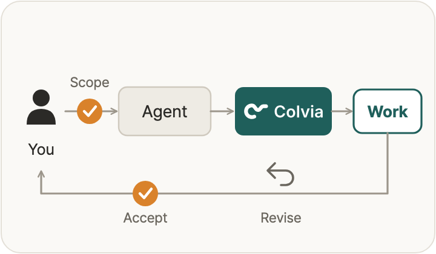
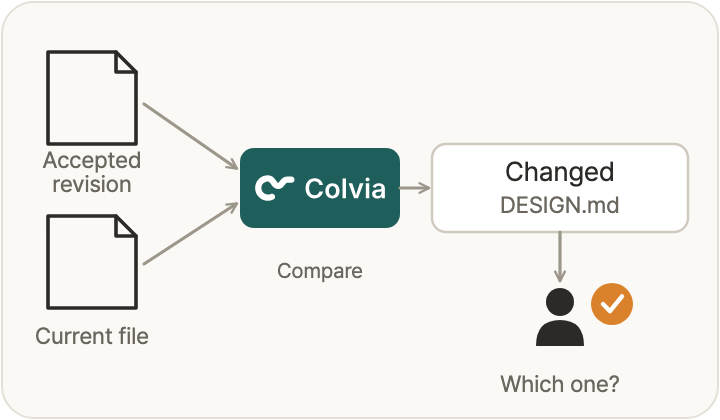
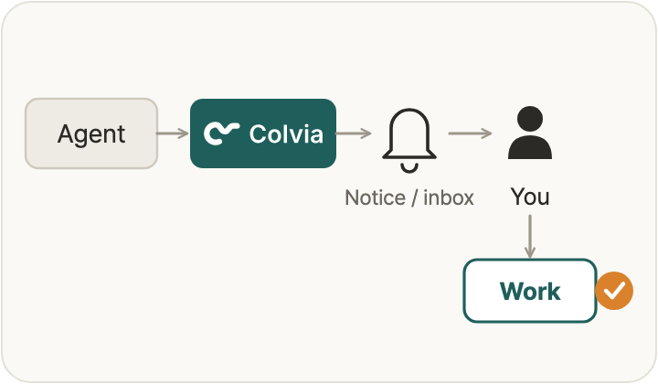

  <picture>
    <source media="(prefers-color-scheme: dark)" srcset="assets/brand/logo-hero-dark.svg">
    
  </picture>

**Your agent does the work. You decide what to keep. Your project remembers.**

[한국어](README.ko.md) · English

[SQLite Preview guide](manual/en/foundation-preview.md) · [Earlier profile guide](manual/en/README.md) · [Contribute](CONTRIBUTING.md#make-your-first-change) · [SQLite candidate evidence](docs/development/product-evidence-and-followups.md#record-foundation-verification)

Colvia is a local tool that keeps the scope you agreed on, the revision your agent registered with Colvia for review, and the result you accepted for each project. Move from Codex yesterday to Claude Code today, compare those records with the current files, and decide where to pick up.

Chat messages and file contents you share with your agent follow that service’s settings.

## What does it help with?

<table>
<tr>
<td width="33%" align="center" valign="top">
<picture><source media="(prefers-color-scheme: dark)" srcset="manual/assets/gallery/scope-en-dark.png"></picture> 
<strong>Agree on the scope</strong> 
Agree with your agent on the files to change and the checks that matter. When a result is ready, you decide whether to accept it or ask for changes.
</td>
<td width="33%" align="center" valign="top">
<picture><source media="(prefers-color-scheme: dark)" srcset="manual/assets/gallery/switch-en-dark.png"></picture> 
<strong>Pick up with another agent</strong> 
Open the same project and ask your new agent, “What did I review?” The agent uses the Colvia records to tell you about earlier decisions and unfinished work.
</td>
<td width="33%" align="center" valign="top">
<picture><source media="(prefers-color-scheme: dark)" srcset="manual/assets/gallery/drift-en-dark.png"></picture> 
<strong>See what changed</strong> 
“What changed since my review?” Ask your agent to compare the recorded revision with the files you have now.
</td>
</tr>
</table>

### Your role, the agent’s role, and Colvia

Once you approve the scope, the agent edits and checks the files, then asks Colvia to register a revision for your review. You decide whether to accept that revision or ask the agent for changes. Colvia keeps the agreed scope, registered revision and your decision with the project’s records. Passing checks, accepting a result and committing to Git are separate steps. [Architecture and roles](manual/en/architecture.md)

## Install and start

The SQLite Preview keeps a Work from scope approval through submission and acceptance. For example, ask your agent to compare inquiry types in `inquiries.csv`. Approve the report files and checks, inspect the submitted revision, and decide whether to accept it. You can also record a follow-up or leave the work complete. In a new chat, ask what you accepted and what you decided to do next. [Work and follow-up in the Preview](manual/en/foundation-preview.md#find-a-recorded-next-step)

The [SQLite Preview guide](manual/en/foundation-preview.md) covers installation, connecting a project and starting your first Work. The public installation command for each platform will be published with the Preview. Installation over private HTTPS was verified on one Windows x64 device and on Windows and macOS ARM64 test VMs. See [what was verified](docs/development/product-evidence-and-followups.md#record-foundation-verification) for the exact candidates and limits.

### Installation examples for the earlier profile

<picture><source media="(prefers-color-scheme: dark)" srcset="manual/assets/gallery/overview-en-dark.png"></picture>

The [earlier profile’s setup guide](manual/en/project-setup.md) and [twelve-inquiry exercise](manual/en/getting-started.md) apply to earlier `.hrn/` builds. For the SQLite Preview, follow the guide above.

## Step away and find the result in your inbox

This example uses the earlier `.hrn/` profile. For notifications in the SQLite Preview, see [the current installation guide](manual/en/foundation-preview.md#notifications-and-disconnection).

<table>
<tr>
<td width="42%" align="center" valign="middle">
<picture><source media="(prefers-color-scheme: dark)" srcset="manual/assets/gallery/notify-en-dark.png"></picture>
</td>
<td width="58%" valign="middle">
<blockquote>
The draft is ready. Submit it for review and notify me on this device.
</blockquote>

Once you confirm the step and deadline, Colvia submits the prepared revision to the project inbox for your review. This submission step does not use an AI model.

Keep the device awake and stay signed in. When you return, ask your agent, “Is anything ready for review?” You can find the result in the inbox even if you missed the notification or it did not open the submission.

Acceptance stays with you. <a href="manual/en/resume.md#handoff">Inbox and notifications</a>

</td>
</tr>
</table>

## For coding tasks across several files, too

- **Resume from a review** · “Show me the files that changed since the payment update I accepted, and what I need to review again.”
- **Find the remaining checks** · “We checked that uploading the same file twice creates only one order. Did we test an interrupted upload that resumes?”

Your agent asks Colvia to register a revision for your review. Colvia can reject that request if the revision includes file changes outside the agreed scope. Colvia does not prevent other programs from editing files, and rejecting a registration request does not undo existing edits. A new chat can pick up the same Work and its recorded approval when the scope and workspace still match. [Work and review in the SQLite Preview](manual/en/foundation-preview.md#delegate-and-review)

## Advanced reference · related tasks and working copies

These examples show advanced workflows from the earlier `.hrn/` profile. See [the SQLite Preview guide](manual/en/foundation-preview.md) for the current capabilities and their conditions.

<table>
<tr>
<td width="50%" align="center" valign="top">
<picture><source media="(prefers-color-scheme: dark)" srcset="manual/assets/gallery/split-en-dark.png"></picture> 
<strong>Review related tasks together</strong> 
Even after you accept each task’s result, you review the combined result separately.
</td>
<td width="50%" align="center" valign="top">
<picture><source media="(prefers-color-scheme: dark)" srcset="manual/assets/gallery/parallel-en-dark.png"></picture> 
<strong>Prepare in separate working copies</strong> 
Workers prepare revisions in their own working copies, and you review each result separately. Results are integrated into the main copy one at a time.
</td>
</tr>
</table>

You can also appoint a delegate to accept one specific result on your behalf. The earlier macOS profile also has a document executor with separate setup and approval. [Conditions for the earlier workflows](manual/en/work-guide.md)

## Your project and its records

The SQLite Preview keeps each project’s work records in your operating system’s user-data folder. [Export and restore through Colvia](manual/en/foundation-preview.md#retained-contents-and-backups) to back up records, retained contents, settings and acceptance history. A Git commit or clone does not back up those records. [Disconnecting](manual/en/foundation-preview.md#notifications-and-disconnection) preserves your files and work history. If you move a connected folder, see [how to check its new location](manual/en/foundation-preview.md#continue-after-moving-a-project-folder).

[Earlier profile guide](manual/en/README.md) · [SQLite Preview environments](manual/en/foundation-preview.md#target-platforms-and-verification-status) · [Contribute](CONTRIBUTING.md) · [Apache License 2.0](LICENSE)
