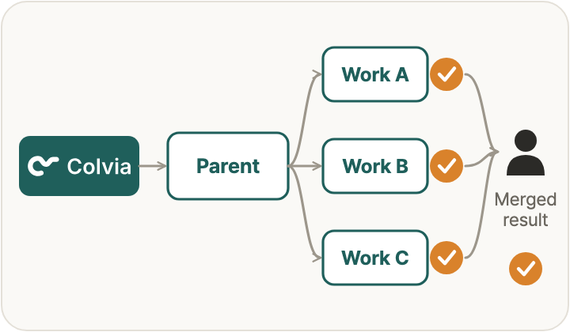

  <picture>
    <source media="(prefers-color-scheme: dark)" srcset="assets/brand/logo-hero-dark.svg">
    
  </picture>

**Colvia is a local workflow tool for working with AI agents.**

[한국어](README.ko.md) · English

[Install and connect a project](manual/en/install.md) · [Follow along](manual/en/tutorial.md) · [User guide](manual/en/README.md) · [Colvia at a glance](manual/en/overview.md) · [Supported environments](manual/en/reference.md#environments) · [Release notes and downloads](https://github.com/colvia/downloads/releases)

**[↓ Official installation page](https://colvia.github.io/downloads/#en)**

Approve the scope proposed by Codex or Claude Code, then review the result and decide whether to accept it. Colvia keeps approvals and submissions on your device. Open the same project to pick up the work in a new chat or with another agent.

When you submit work for review, Colvia checks file changes against the scope you approved. If an out-of-scope change blocks submission, your files stay in place so you can see what changed.

You don’t need to know how to code to get started. Once Colvia is installed, you can ask in your usual chat to connect a folder and start a task. For software projects, you can use your existing repository and project rules.

> [!NOTE]
> Colvia combines *col*, a pass between mountain peaks, and *via*, Latin for a path. The name reflects how the purpose and decisions behind your work carry into what you do next.

## Install and start your first task

Install Codex or Claude Code and sign in before starting.

1. In the operating-system account that will use Colvia, copy and run the command for your platform from the [official installation page](https://colvia.github.io/downloads/#en). Colvia downloads and verifies the release files and prepares its own Python runtime. On Windows, open regular PowerShell from the Start menu as a standard user. When setup completes, [check the installed version](manual/en/install.md#check-installed-version).
2. Open the project folder in Codex or Claude Code. If it uses Git and you haven’t registered it with Colvia yet, [ask the agent to register Git](manual/en/git.md#git-register) first and open the repository root. Then ask, “Connect this folder to Colvia.” Review the folder, the files Colvia will add, and where it will keep the records. Approve the connection if the preview looks right. When the first-connection preview offers Git, choose whether to keep the folder plain or start using Git. Both choices work with empty folders and existing files. Once you have finished any open Work, you can [start using Git later and keep your Work](manual/en/git.md#adopt-git).
3. Once the folder is connected, tell the agent what you want to do here in the current chat. In an empty folder, describe what you want to do, such as writing a report or building a web app, in a sentence or two. You can also connect a project you already work in. The agent uses any goal you’ve shared, along with the existing README and project rules, to propose a plan.

In a regular folder, you can assign a report, proposal, or meeting brief, then review the submitted version or compare it with the current files.

Already installed? Ask your agent to update Colvia, or rerun the same command from the official installation page using the account that installed it.

[Git registration guide](manual/en/git.md#git-register) · [Updates and recovery](manual/en/maintenance.md#update) · [Disconnect a project](manual/en/maintenance.md#disconnect)

<picture><source media="(prefers-color-scheme: dark)" srcset="manual/assets/gallery/overview-en-dark.png"></picture> 
<em>Connect a folder, approve the work scope, then review the result and decide what comes next.</em>

## Assign work and review the result

Here’s what you can ask when you have a file of customer inquiries.

> Summarize the types of customer inquiries and the complaints that come up most often in a report for our meeting. I’ll decide which improvements to prioritize.

1. **Approve the scope.** The agent proposes source material, files to create or change, and checks for the result. Colvia records which plan you approved. As soon as you save a plan, Colvia keeps the existing contents of the files in the plan and includes them in backups, even before you approve the plan. List only the files the work needs.
2. **Review the submission and checks.** The agent submits the report and tells you which checks passed, failed, or could not be run. Colvia checks scope at submission and blocks results that include changes outside it. If Colvia blocks a submission, the changes already made stay in the work folder. Check those changes and resolve the issue before submitting again.
3. **Accept the result or ask for changes.** Colvia records which submission you accepted. If the approval is still valid and the requested changes fit the approved scope, continue in the same Work.
4. **Record the next step when it helps.** For example, record a decision to draft sample replies for common inquiries. You can find that decision with the report in a new chat.

Before the first submission or while revising a result you sent back, you can [approve extra files in the same Work](manual/en/work.md#scope-change) when they serve the same goal. For example, approve editing a table and creating an appendix together, then review one submission.

Colvia keeps the goal, file scope, checks, submission, and decisions together in a **Work**, a single recorded task. You can ask short questions and look up files within the access already granted.

You can skip creating a Work for a typo, spacing, or punctuation correction you explicitly request. The edit must follow your project rules and granted access, preserve meaning and behavior, and need no separate result review, retention, or handoff. If the edit belongs to an existing Work, check that Work’s approved scope and continue with its records. [Assign and review work](manual/en/work.md#review)

## Pick up in a new chat

Stepping away before the first submission? Ask the agent to save your progress. In a new chat in the same folder, say “Pick up where we left off” to see the latest note and which files have changed since. Requires a build with progress notes. [Using progress notes](manual/en/work.md#progress-note)

With a launcher that supports Work lifecycle decisions, you can switch to B or pause A and return to the same stage. [Switch Work, pause and resume](manual/en/work.md#work-lifecycle)

Open the same project and ask, “What do I need to review in the report I assigned earlier?” When the agent can access the project folder and Colvia records, it can find the approved scope, the last submission, differences from the current files, and any recorded next step.

If you use both Codex and Claude Code, you can switch between them in the same project. For example, before picking up work from Codex in Claude Code, check that Claude Code can read the project folder and Colvia records. You can continue the same Work if its approval is still valid and the workspace and scope still match. [Find a recorded next step](manual/en/work.md#follow-up)

<table>
<tr>
<td width="33%" align="center" valign="top">
<picture><source media="(prefers-color-scheme: dark)" srcset="manual/assets/gallery/scope-en-dark.png"></picture> 
<strong>Agree on scope and review the result</strong>
</td>
<td width="33%" align="center" valign="top">
<picture><source media="(prefers-color-scheme: dark)" srcset="manual/assets/gallery/switch-en-dark.png"></picture> 
<strong>Pick up in a new chat or with another agent</strong>
</td>
<td width="33%" align="center" valign="top">
<picture><source media="(prefers-color-scheme: dark)" srcset="manual/assets/gallery/drift-en-dark.png"></picture> 
<strong>Compare the accepted submission with current files</strong> 
Compare the version you accepted with your current files to see what’s changed since then.
</td>
</tr>
</table>

### Pick up a coding task

> “Show me what changed since the file-upload update I accepted and what I need to review again. Did we test resuming an interrupted upload?”

The agent can compare current files with the accepted submission and show which checks passed, failed, or could not be run. If a check was never recorded, the agent can tell you that.

## Git, backups, and moving folders

- **Put an accepted result into Git.** Review the changes to commit and the current staging area, then approve the integration separately. Colvia preserves changes staged for other files. To protect your staged changes, Colvia stops if the staged content for a selected file matches neither the current commit nor the accepted result. [Put an accepted result into Git](manual/en/git.md#git-integration)

### Git keeps a file history. Why does Colvia keep records too?

Git records the changes you commit. Colvia records the changes you approved for the agent and which version you accepted or asked it to revise. If you accepted an edit yesterday and changed the file again today, you can compare the current file with the version you accepted, even if you didn’t commit it yesterday.

If you later commit that version, Git keeps the same file content too. Colvia stores your approvals and review decisions outside the project folder, so `git push` doesn’t share them. [Working with Git](manual/en/git.md#git-and-colvia-records)

### Check for credentials before a Git commit · v0.2.0

When you prepare a commit through Colvia, it checks the changes on your device. If it recognizes a hardcoded API key or token, or finds a protected file such as `.env` among the additions or edits, it stops before writing Git objects for those changes. The message points to the location without displaying the value.

<picture><source media="(prefers-color-scheme: dark)" srcset="manual/assets/gallery/credential-en-dark.png"></picture>

Supported images and fonts can be included when the filename extension matches the file signature. Colvia lists their paths and formats in the preview and skips credential checks inside those files. If you need to commit other binary files, such as PDFs or archives, review their contents yourself and commit them separately with Git.

If a key is hardcoded, change the code to read an environment variable. Leave protected files out of the proposed changes. After correcting a file, submit and accept the revision, then prepare the commit again. Once the check passes, review the candidate and approve the commit separately. [What Colvia checks and how to resolve a finding](manual/en/git.md#git-credential-check)

### Backups and moving folders

- **Back up and restore records.** Export Work records, approvals, submitted contents, and settings. Backups include the file contents Colvia kept before changes and at submission, so store them as you would your project data. Back up project files separately. When restoring Colvia records, check both the Work and its retained contents. [Back up and restore records](manual/en/records.md#backup)
- **Move a project folder.** After moving a folder on the same local volume, ask your agent, “I moved this project folder. Help me continue with its existing Colvia records.” Review the old and new paths in the preview. Once Colvia verifies it is the same folder, approve updating the connection. See the guide for verified environments and connection requirements. [Moving a folder and keeping its records](manual/en/records.md#move)

## Open a result from a notification

<picture><source media="(prefers-color-scheme: dark)" srcset="manual/assets/gallery/notify-en-dark.png"></picture>

Set up Colvia notifications and allow them in your operating system. Where notifications are supported, click one to open the Work for review. You decide whether to accept it after reviewing it. If you miss a notification or it doesn’t open the result, ask in that project, “Is anything waiting for my review?” [Set up notifications](manual/en/maintenance.md#notifications)

To stop new notifications, ask your agent, “Turn off Colvia notifications for this account.” The installed manager uses `notice-disable`. You can still check for results to review in the project chat.

## Break larger tasks into smaller pieces

Split a larger task into child Works in the same folder to review and accept each result. To apply a result from an isolated folder (a registered Git worktree of the same repository), check **the exact submission and its destination**. If the submission is still under review, approve both applying and accepting it. Colvia records acceptance after applying the files and checking the destination. If you already accepted the submission, approve the application alone.

<table>
<tr>
<td width="50%" align="center" valign="top">
<picture><source media="(prefers-color-scheme: dark)" srcset="manual/assets/gallery/split-en-dark.png"></picture> 
<strong>Review child results and the combined result</strong>
</td>
<td width="50%" align="center" valign="top">
<picture><source media="(prefers-color-scheme: dark)" srcset="manual/assets/gallery/parallel-en-dark.png"></picture> 
<strong>Apply results from isolated folders one at a time</strong>
</td>
</tr>
</table>

Apply one submission at a time. Check that the destination has no other Work that is approved, in progress, or under review. You can delegate applying and accepting a specific isolated Work under the conditions in the guide. Review the combined files and checks before accepting the parent Work yourself. The guide also covers when you can resume an interrupted application. [Child Works and results from isolated folders](manual/en/work.md#child-works)

## Your project and its records

| Who | What they do |
| --- | --- |
| You | Choose the goal and scope, grant necessary access, and decide whether to accept the result. |
| Codex and Claude Code | Read the project rules, propose a task, do the work, and run the checks. |
| Colvia | Helps the agent find the project’s Work and keeps plans, approvals, submissions, and decisions on your device. |

Colvia keeps plans, approvals, submissions, and decisions in the operating system’s user data folder. It puts the launcher, connection information, and guidance in the project folder. To see how the components and record storage fit together, read the [architecture guide](manual/en/architecture.md).

To stop using Colvia in a project, ask your agent, “Show me how Colvia would disconnect this folder.” [Disconnecting the project](manual/en/maintenance.md#disconnect) preserves your files and Work records. If you plan to reconnect and continue the work later, [back up the records](manual/en/records.md#backup) before disconnecting. To remove the installation and keep your records, ask your agent to show a removal preview or follow the [removal and reinstall instructions](manual/en/maintenance.md#uninstall).

Use the app or CLI’s permissions to control what the agent can read, write, or run. Apps and agents can edit files they have permission to change. At submission, Colvia checks changes in the files it tracks against the approved scope and stops the submission if it finds a change outside that scope. Before recording ordinary Work acceptance, Colvia compares the current files in that Work’s folder with the submission you reviewed. If the files have changed, review the changes and submit again. Review check results and any Git integration separately.

Messages and materials you share with an agent follow the AI service’s data handling settings.

## Preview support

The first Preview targets **macOS on Apple Silicon and Windows 11 on x64 and ARM64**, with **the Codex and Claude Code CLI and desktop apps**. Depending on the app, CLI and permission mode, you may need to grant separate access to the project and Colvia record folders. See [supported environments](manual/en/reference.md#environments) for installation, update and access requirements.

## What we want to improve

- **Make it easier to start and pick up again.** We want first-task guidance for both document and software projects, a short summary of what needs attention and what has changed since your last decision, and a way to record recurring problems as work to consider.
- **Keep larger projects moving.** We plan to explore approving only newly discovered scope and reviewing results from several Works together. We also want to test how quickly records can be retrieved and how reliably backups restore as records grow, and to provide clearer next steps when setup or work is interrupted.
- **Explore more ways to use Colvia.** Linux, more agents, simultaneous team editing, and automatic parallel execution are candidates for future work. Colvia’s direct invocation of agents is disabled in the first Preview. The initial focus is work in the regular Codex and Claude Code apps and CLIs.

[When something goes wrong](manual/en/reference.md#problems) · [Questions and bug reports](CONTRIBUTING.md#questions-and-bug-reports) · [Report a security issue privately](SECURITY.md#english) · [Contributing](CONTRIBUTING.md) · [Apache License 2.0](LICENSE)
