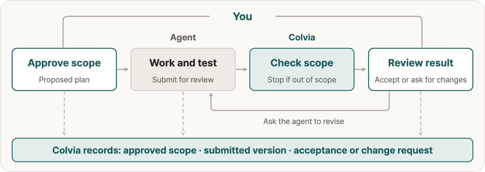
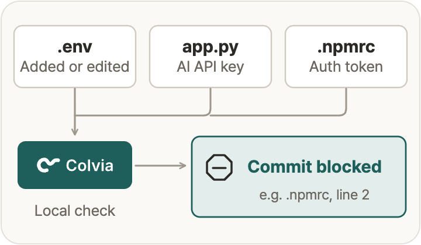
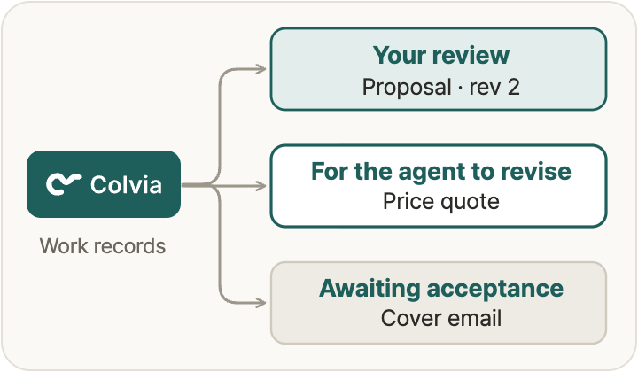
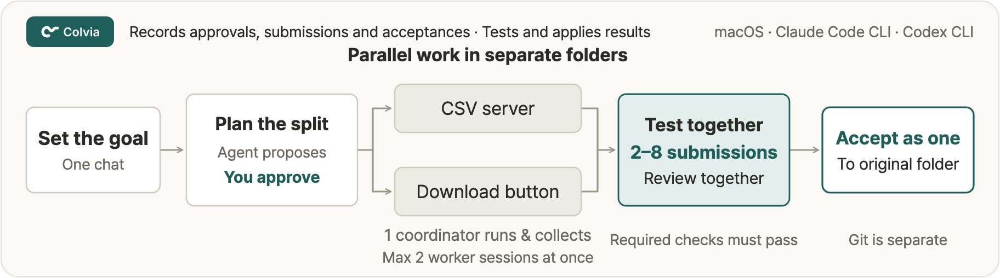
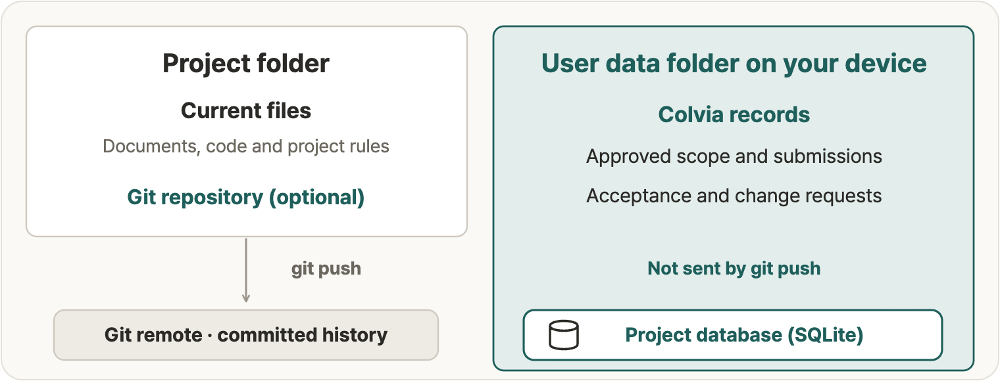

  <picture>
    <source media="(prefers-color-scheme: dark)" srcset="assets/brand/logo-hero-dark.svg">
    
  </picture>

**Colvia is a local workflow tool for working with AI agents.**

[한국어](README.ko.md) · English

[Install and connect a project](manual/en/install.md) · [Follow along](manual/en/tutorial.md) · [User guide](manual/en/README.md) · [Colvia at a glance](manual/en/overview.md) · [Supported environments](manual/en/reference.md#environments) · [Release notes and downloads](https://github.com/colvia/downloads/releases)

**[↓ Official installation page](https://colvia.github.io/downloads/#en)**

Approve the scope proposed by Codex or Claude Code, then review the result and decide whether to accept it. Colvia keeps approvals and submissions on your device. Open the same project to pick up the work in a new chat or with another agent.

When you submit work for review, Colvia checks file changes against the scope you approved. If an out-of-scope change blocks submission, your files stay in place so you can see what changed.

You don’t need to know how to code to get started. Once Colvia is installed, you can ask in your usual chat to connect a folder and start a task. For software projects, you can use your existing repository and project rules.

> [!NOTE]
> Colvia combines *col*, a pass between mountain peaks, and *via*, Latin for a path. The name reflects how the purpose and decisions behind your work carry into what you do next.

## Who decides what happens to a task?

<picture><source media="(prefers-color-scheme: dark)" srcset="manual/assets/gallery/workflow-en-dark.png"></picture>

First, read the plan your agent proposes and decide **what it can change**. When the result is ready, review the submission and its checks, then **accept that version** or ask the agent for changes. Colvia keeps the plan, approvals, submissions and review decisions together in one recorded task, called a Work.

## Install and start your first task

First, sign in to the Codex or Claude Code app or CLI you use.

1. In the operating-system account that will use Colvia, copy and run the command for your platform from the [official installation page](https://colvia.github.io/downloads/#en). Colvia downloads and verifies the release files and prepares its own Python runtime. On Windows, open regular PowerShell from the Start menu as a standard user. When setup completes, [check the installed version](manual/en/install.md#check-installed-version).
2. Start a new task in an empty folder, or connect a folder that already contains your files. You can use Colvia without Git. Open the folder in Codex or Claude Code and ask, “Connect this folder to Colvia.”

   If you are connecting a Git repository, start at its root. If Git is not registered yet, the connection preview stops and asks you to register it first. [Review and approve the registration](manual/en/git.md#git-register), then ask for the connection preview.

   Review the folder, the files Colvia will add, and where it will keep the records. Approve the connection if the preview looks right. When the first connection offers a Git choice, you can keep using a regular folder or start using Git. If you start without Git, finish any open Work before you [switch to Git and keep your records](manual/en/git.md#adopt-git).
3. After connecting the folder, use the same chat to describe what you want and how you’ll know it works. For example, you could say, “Please build a to-do app. I want to add tasks, mark them complete, and still see them when I reopen the app.” The agent proposes one plan covering the files it will create or change and how it will check that the app works. In an existing project, it also consults the README and project rules. If the scope looks right, approve the plan in one go.
4. The agent builds the app and runs the planned checks. If a check reveals a problem, the agent can fix it within the scope you approved and rerun the same check. If it needs another file or a change to the check criteria, it stops, proposes the change, and waits for your approval. When it finishes checking, the agent submits the app for review with the check results. Colvia keeps the scope you approved and the submitted version. Review the submitted version and its check results, then decide whether to accept it or ask for changes. [Delegate and review](manual/en/work.md#review)

In a regular folder, you can assign a report, proposal, or meeting brief, then review the submitted version or compare it with the current files.

Already installed? Ask your agent to update Colvia, or rerun the same command from the official installation page using the account that installed it.

[Git registration guide](manual/en/git.md#git-register) · [Updates and recovery](manual/en/maintenance.md#update) · [Disconnect a project](manual/en/maintenance.md#disconnect)

<picture><source media="(prefers-color-scheme: dark)" srcset="manual/assets/gallery/overview-en-dark.png"></picture> 
<em>Install Colvia once in the account you use, then approve the connection for each folder. In a connected folder, start a new task or pick up where you left off.</em>

## What needs my attention today?

Yesterday you asked your agent to add a source for the market estimate in a proposal. Today, open a new chat in the same folder and ask “What needs my attention today?” Your agent puts items awaiting review first among the tasks it checked. You can ask without ranking anything or keeping a separate list.

An example reply in your chat:

> **For your review · Business proposal, revision 2.** Your agent submitted the revision. Please check the source for the market estimate.
>
> **For the agent to revise · Price quote.** The reviewer asked the agent to add the currency next to each amount.
>
> **Waiting for the proposal · Cover email.** The cover email is linked to acceptance of the proposal. Once you accept revision 2, the prerequisite for drafting the email is met.

In the same chat, ask **“Show me revision 2 of the proposal.”** Your agent opens the version you just saw in the list. [Continue from the summary](manual/en/work.md#project-status) · [See what a task depends on](manual/en/work.md#work-dependencies)

## What you can do with Colvia

<table>
<tr>
<td width="33%" valign="top" align="center">
<picture><source media="(prefers-color-scheme: dark)" srcset="manual/assets/gallery/switch-en-dark.png"></picture> 
<strong><a href="manual/en/work.md#follow-up">Resume in a new chat</a></strong> 
Pick up the same records with another agent.
</td>
<td width="33%" valign="top" align="center">
<picture><source media="(prefers-color-scheme: dark)" srcset="manual/assets/gallery/drift-en-dark.png"></picture> 
<strong><a href="manual/en/work.md#review">Compare with the accepted version</a></strong> 
See what changed since you accepted the result.
</td>
<td width="33%" valign="top" align="center">
<picture><source media="(prefers-color-scheme: dark)" srcset="manual/assets/gallery/credential-en-dark.png"></picture> 
<strong><a href="manual/en/git.md#git-credential-check">Check credentials before committing</a></strong> 
Colvia checks proposed commits for protected file additions or edits and known key patterns.
</td>
</tr>
<tr>
<td width="33%" valign="top" align="center">
<picture><source media="(prefers-color-scheme: dark)" srcset="manual/assets/gallery/status-en-dark.png"></picture> 
<strong><a href="manual/en/work.md#project-status">See what needs attention</a></strong> 
See what needs review, revision or a prior result.
</td>
<td width="33%" valign="top" align="center">
<picture><source media="(prefers-color-scheme: dark)" srcset="manual/assets/gallery/split-en-dark.png"></picture> 
<strong><a href="manual/en/work.md#child-works">Review a large task as child Works</a></strong> 
Review the parts, then accept the combined result separately.
</td>
<td width="33%" valign="top" align="center">
<picture><source media="(prefers-color-scheme: dark)" srcset="manual/assets/gallery/notify-en-dark.png"></picture> 
<strong><a href="manual/en/maintenance.md#notifications">Open a result from a notification</a></strong> 
Enable notifications to open the task awaiting review.
</td>
</tr>
</table>

## Assign work and review the result

Here’s what you can ask when you have a file of customer inquiries.

> Summarize the types of customer inquiries and the complaints that come up most often in a report for our meeting. I’ll decide which improvements to prioritize.

1. **Approve the scope.** The agent proposes source material, files to create or change, and checks for the result. Colvia records which plan you approved. As soon as you save a plan, Colvia keeps the existing contents of the files in the plan and includes them in backups, even before you approve the plan. List only the files the work needs.
2. **Review the submission and checks.** The agent submits the report and tells you which checks passed, failed, or could not be run. Colvia checks scope at submission and blocks results that include changes outside it. If Colvia blocks a submission, the changes already made stay in the work folder. Check those changes and resolve the issue before submitting again.
3. **Accept the result or ask for changes.** Colvia records which submission you accepted. If the approval is still valid and the requested changes fit the approved scope, continue in the same Work.
4. **Record the next step when it helps.** For example, record a decision to draft sample replies for common inquiries. You can find that decision with the report in a new chat.

Before the first submission, you can [approve extra files in the same Work](manual/en/work.md#scope-change) when they serve the same goal. For example, approve editing a table and creating an appendix together, then review one submission. You can also approve extra files after a reviewer requests changes.

You can ask short questions and look up files within the access already granted.

Try “Update the list-work example in the README to use the current command.” If the example has one verifiable correction, your agent can make it within your project rules and granted access. An independent edit needs no Work when there’s no separate review, record or handoff to keep. For a change to an existing result, continue in the same Work within its approved scope. [Small corrections and follow-up edits](manual/en/work.md#without-work)

### Pick up a coding task

> “Show me what changed since the file-upload update I accepted and what I need to review again. Did we test resuming an interrupted upload?”

The agent can compare current files with the accepted submission and show which checks passed, failed, or could not be run. If a check was never recorded, the agent can tell you that.

## Keeping track as work adds up

Stepping away before the first submission? Ask the agent to save your progress. In a new chat in the same folder, say “Pick up where we left off” to see the latest note and which files have changed since. [Using progress notes](manual/en/work.md#progress-note)

If something urgent comes up, pause the current Work and switch to another. When you return, you can resume where you left off. [Switch Work, pause and resume](manual/en/work.md#work-lifecycle)

Open the same project and ask, “What do I need to review in the report I assigned earlier?” When the agent can access the project folder and Colvia records, it can find the approved scope, the last submission, differences from the current files, and any recorded next step.

Hit your Codex usage limit in the middle of an urgent task? Open the same Colvia project folder in Claude Code and say, “Let’s pick up where we left off.” If Claude Code can read the project folder and Colvia records and the existing approval is still valid, it can continue the same Work within the approved scope without a separate handoff document. [Pick up in a new chat or with another agent](manual/en/work.md#resume)

### Why did we ask for that change?

Ask “Why did we remove the market estimate from the proposal?” You can find the version the reviewer read, the change they requested, and the version they later accepted. If they recorded a reason, you can read it too. A request to remove the figure on its own only tells you what they wanted changed. [Review the decision history](manual/en/work.md#decision-history)

### What should I tackle next?

Set priorities for the work you’d like to tackle first. After accepting a result, choose what to work on next. If a task depends on another result, link the two Works so the task waits until that result is accepted.

| What to decide | Example question | Example instruction |
| --- | --- | --- |
| Candidate priority | What would I like to tackle first? | Give the colleague trial high priority. |
| Next step after acceptance | What did we decide to do next? | Draft an invitation. |
| A result another task needs | What is the email waiting for? | Link the cover email to acceptance of the proposal. |

You still decide when to start the work. If the reviewer reopens the accepted proposal for changes, the email goes back to waiting for acceptance. [Work dependencies](manual/en/work.md#work-dependencies) · [Candidate priority](manual/en/work.md#candidate-priority)

## Break larger tasks into smaller pieces

When a large task has two or three parts that can change different files independently, try saying, “Run the parts that can be done independently in parallel.” For example, when building a quote screen, you can assign server-side CSV generation and the screen’s CSV download feature separately. The coordinating agent proposes each Work’s file scope and how to check the combined result. Use separate registered working folders and a separate destination in the same Git repository, with matching starting files and Git settings.

On macOS, a coordinator in Claude Code CLI or Codex CLI starts workers from the same CLI in separate, restricted folders and collects their submissions. To start workers, you need to be signed in to the CLI. You may also be asked to approve tool use. In the workflow we verified, one coordinator runs **up to two worker sessions at a time**. The coordinator has a separate session and does not count toward the two workers. For three tasks, it starts two and starts the third after collecting one result.

On native Windows 11 x64, you can start two workers with one scope approval. For two Claude workers or one Claude and one Codex worker, review the assignments in Claude Code CLI and approve the one-time Bash request. For two Codex workers, ask Codex for the split and approve both scopes in the Colvia console. Each submission returns to its own Work for review with the file-based integration checks.

Claude Code CLI and Codex CLI run the workers. Colvia records their submissions, runs the integration checks, and applies the accepted results.

On macOS and Windows 11 x64, you can accept and apply 2–8 submissions together. On Windows 11 ARM64, you accept and apply submissions individually. Each Work contributes one submission to a group. Colvia records the approved plans and submissions and runs integration checks on a separate copy of the combined files. Review each exact submitted version and its changes, the destination, and the check results. When you accept all submissions, Colvia applies them to the original folder and then records the acceptance. A required check that fails or cannot run keeps acceptance on hold. Git commit and push remain separate decisions.

<picture><source media="(prefers-color-scheme: dark)" srcset="manual/assets/gallery/parallel-en-dark.png"></picture>

The diagram shows the macOS CLI workflow, where the coordinator starts the workers.

Before first using the 2–8-member format, keep a new verified record backup and preserve working files separately, even if you used two-member groups before. Older versions, including those supporting only two-member groups, cannot open the upgraded project or later backups. [Accept and apply 2–8 submissions together](manual/en/work.md#grouped-acceptance)

You can also approve and apply isolated results individually, or split a large goal into child Works and review the parent result separately. [Existing individual workflow](manual/en/work.md#child-works)

## Working with Git

### Put an accepted result into Git

Review the changes to commit and the current staging area, then approve the integration separately. Colvia preserves changes staged for other files. To protect your staged changes, Colvia stops if the staged content for a selected file matches neither the current commit nor the accepted result. [Put an accepted result into Git](manual/en/git.md#git-integration)

### Git keeps a file history. Why does Colvia keep records too?

Git records the changes you commit. Colvia records the changes you approved for the agent and which version you accepted or asked it to revise. If you accepted an edit yesterday and changed the file again today, you can compare the current file with the version you accepted, even if you didn’t commit it yesterday.

If you later commit that version, Git keeps the same file content too. Colvia stores your approvals and review decisions outside the project folder, so `git push` doesn’t share them. [Working with Git](manual/en/git.md#git-and-colvia-records)

### Check for credentials before a Git commit

When you prepare a commit through Colvia, it checks the changes on your device. If it recognizes a hardcoded API key or token, or finds a protected file such as `.env` among the additions or edits, it stops before writing Git objects for those changes. The message points to the location without displaying the value.

Supported images and fonts can be included when the filename extension matches the file signature. Colvia lists their paths and formats in the preview and skips credential checks inside those files. If you need to commit other binary files, such as PDFs or archives, review their contents yourself and commit them separately with Git.

If a key is hardcoded, change the code to read an environment variable. Leave protected files out of the proposed changes. After correcting a file, submit and accept the revision, then prepare the commit again. Once the check passes, review the candidate and approve the commit separately. [What Colvia checks and how to resolve a finding](manual/en/git.md#git-credential-check)

## Where are my records kept?

<picture><source media="(prefers-color-scheme: dark)" srcset="manual/assets/gallery/system-en-dark.png"></picture>

| Who | What they do |
| --- | --- |
| You | Describe the result you want, grant the access needed, and approve the scope your agent proposes. When the agent submits the result, review it and either accept it or ask for changes. |
| Codex and Claude Code | Read the project rules and propose which files to create or change and how to check the result. Once you approve the scope, do the work and submit it with the check results. |
| Colvia | Helps the agent find the project’s Work and keeps plans, approvals, submissions, and decisions on your device. |

Colvia keeps plans, approvals, submissions, and decisions in the operating system’s user data folder. It puts the launcher, connection information, and guidance in the project folder. To see how the components and record storage fit together, read the [architecture guide](manual/en/architecture.md).

To stop using Colvia in a project, ask your agent, “Show me how Colvia would disconnect this folder.” [Disconnecting the project](manual/en/maintenance.md#disconnect) preserves your files and Work records. If you plan to reconnect and continue the work later, [back up the records](manual/en/records.md#backup) before disconnecting. To remove the installation and keep your records, ask your agent to show a removal preview or follow the [removal and reinstall instructions](manual/en/maintenance.md#uninstall).

Use the app or CLI’s permissions to control what the agent can read, write, or run. Apps and agents can edit files they have permission to change. At submission, Colvia checks changes in the files it tracks against the approved scope and stops the submission if it finds a change outside that scope. Before recording ordinary Work acceptance, Colvia compares the current files in that Work’s folder with the submission you reviewed. If the files have changed, review the changes and submit again. Review check results and any Git integration separately.

Messages and materials you share with an agent follow the AI service’s data handling settings.

### Backups and moving folders

- **Back up and restore records.** Export Work records, approvals, submitted contents, and settings. Backups include the file contents Colvia kept before changes and at submission, so store them as you would your project data. Back up project files separately. When restoring Colvia records, check both the Work and its retained contents. [Back up and restore records](manual/en/records.md#backup)
- **Move a project folder.** After moving a folder on the same local volume, ask your agent, “I moved this project folder. Help me continue with its existing Colvia records.” Review the old and new paths in the preview. Once Colvia verifies it is the same folder, approve updating the connection. See the guide for verified environments and connection requirements. [Moving a folder and keeping its records](manual/en/records.md#move)

## Preview support

Colvia Preview supports **macOS on Apple Silicon and Windows 11 on x64 and ARM64**, with **the Codex and Claude Code CLI and desktop apps**. Depending on the app, CLI and permission mode, you may need to grant separate access to the project and Colvia record folders. See [supported environments](manual/en/reference.md#environments) for installation, update and access requirements.

Automatic worker launch is available on macOS and native Windows 11 x64 with the [CLI combinations and approval steps in the Work manual](manual/en/work.md#grouped-acceptance). On macOS and Windows 11 x64, you can accept and apply 2–8 submissions together. On Windows 11 ARM64, you accept and apply submissions individually.

Linux is outside the current support range. Start work in your usual Codex or Claude Code chat. Direct agent invocation is disabled, and simultaneous team editing is unsupported.

## Where Colvia is headed

You decide what to delegate and which results to accept. We want those decisions to remain useful when you switch chats or agents. Here are the directions we’re exploring.

- **Fewer interruptions, with the same say in the outcome.** Debugging often reveals another file that needs a change. For that kind of work, and for small edits that are easy to verify, we’re looking for ways to reduce approval round trips while keeping scope approval and result acceptance in your hands.
- **Keep the way your project already works.** We want it to be easier to use your usual checks, documentation conventions and review process, and still find the scope you approved and the result you accepted in Colvia.
- **See the decisions behind one task on a single page.** You can already look up each Work’s decision history and the versions reviewed at the time. We aim to improve the view so you can follow the decisions in order on one screen and distinguish the decision statements recorded at the time from explanations added later.
- **Working as a team.** We plan to start with a guide to using Colvia in a shared repository: keep your approvals and acceptance decisions on your device and commit the work you want to share. Then we’ll explore how teammates can see what each person delegated to an agent and which results they accepted.

We’re also exploring support for Linux and additional agents, and ways to connect projects and external tools. See the [release notes](https://github.com/colvia/downloads/releases) for features that have shipped.

## Project history

- `2026-08-10`: Repository created.
- `2026-11-17`: Source repository made public.

[When something goes wrong](manual/en/reference.md#problems) · [Questions and bug reports](CONTRIBUTING.md#questions-and-bug-reports) · [Report a security issue privately](SECURITY.md#english) · [Contributing](CONTRIBUTING.md) · [Apache License 2.0](LICENSE)
