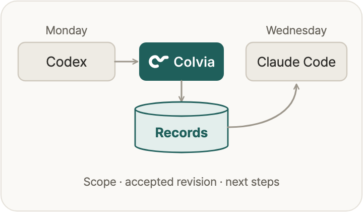
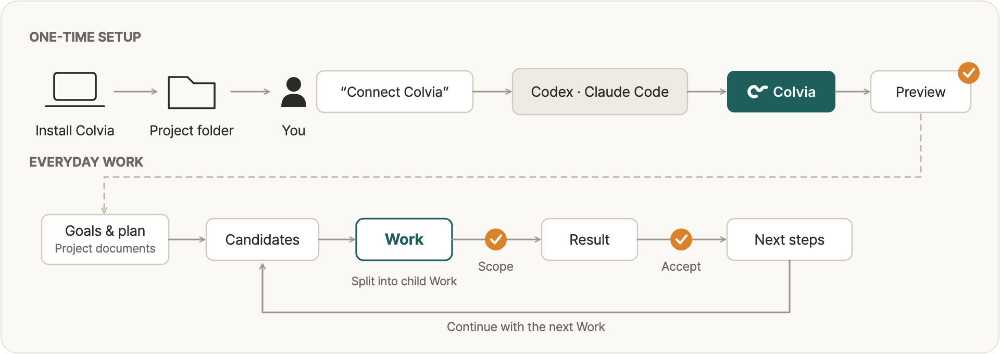

<a id="english"></a>
<a id="한국어"></a>

<div align="center">
  <picture>
    <source media="(prefers-color-scheme: dark)" srcset="assets/brand/logo-hero-dark.svg">
    
  </picture>

**Your agent does the work. You decide what to keep. Your project remembers.**

[한국어](README.ko.md) · English

[Next Preview guide](manual/en/foundation-preview.md) · [Earlier profile guide](manual/en/README.md) · [Contribute](CONTRIBUTING.md#make-your-first-change) · [Verification](docs/development/product-evidence-and-followups.md#record-foundation-verification)

</div>


Colvia is a local tool that keeps the scope you agreed on, the revision your agent registered with Colvia for review, and the result you accepted for each project. Move from Codex yesterday to Claude Code today, compare those records with the current files, and decide where to pick up.

Chat messages and file contents you share with your agent follow that service’s settings.

## What does it help with?

<table>
<tr>
<td width="33%" align="center" valign="top">
<picture><source media="(prefers-color-scheme: dark)" srcset="manual/assets/gallery/scope-en-dark.png"></picture><br>
<strong>Agree on the scope</strong><br>
Agree with your agent on the files to change and the checks that matter. When a result is ready, you decide whether to accept it or ask for changes.
</td>
<td width="33%" align="center" valign="top">
<picture><source media="(prefers-color-scheme: dark)" srcset="manual/assets/gallery/switch-en-dark.png"></picture><br>
<strong>Pick up with another agent</strong><br>
Open the same project and ask your new agent, “What did I review?” The agent uses the Colvia records to tell you about earlier decisions and unfinished work.
</td>
<td width="33%" align="center" valign="top">
<picture><source media="(prefers-color-scheme: dark)" srcset="manual/assets/gallery/drift-en-dark.png"></picture><br>
<strong>See what changed</strong><br>
“What changed since my review?” Ask your agent to compare the recorded revision with the files you have now.
</td>
</tr>
</table>

### Your role, the agent’s role, and Colvia

Once you approve the scope, the agent edits and checks the files, then asks Colvia to register a revision for your review. You decide whether to accept that revision or ask the agent for changes. Colvia keeps the agreed scope, registered revision and your decision with the project’s records. Passing checks, accepting a result and committing to Git are separate steps. [Architecture and roles](manual/en/architecture.md)

## Install and start

<p align="center">
<picture><source media="(prefers-color-scheme: dark)" srcset="manual/assets/gallery/overview-en-dark.png"></picture>
</p>

The [next Preview guide](manual/en/foundation-preview.md) covers the candidate that stores Work records in SQLite. Public downloads and installation commands are in preparation. The first Preview requires native Windows x64 validation.

### Installation examples for the earlier profile

Use these examples with an earlier `.hrn/` build that comes with these files. Check that the distribution channel is trusted, then compare each download with the SHA-256 value for that file. Use the files for your architecture and adjust the path if you saved them outside `Downloads`.

<details>
<summary><strong>macOS · Apple silicon</strong></summary>

```sh
/bin/sh "$HOME/Downloads/bootstrap.sh"
```

This previews the destination and changes. Review them, then run the displayed `--apply --confirm` command to prepare the manager and its private Python. Connecting a project is a separate confirmation.

</details>

<details>
<summary><strong>Windows 11 · ARM64</strong></summary>

In PowerShell as a standard user, use the ARM64 manager and Python ZIP. This command prepares the tool and its private Python in the device’s Colvia store.

```powershell
& "$HOME\Downloads\colvia-manage.exe" prepare --runtime-zip "$HOME\Downloads\python-3.14.7-embed-arm64.zip"
```

</details>

<details>
<summary><strong>Windows 11 · x64</strong></summary>

In PowerShell as a standard user, use the x64 manager and Python ZIP. This command prepares the tool and its private Python in the device’s Colvia store.

```powershell
& "$HOME\Downloads\colvia-manage.exe" prepare --runtime-zip "$HOME\Downloads\python-3.14.7-embed-amd64.zip"
```

</details>

Use a local NTFS folder for Windows projects. See [installation and updates](manual/en/project-setup.md) for setup and project connection, and [environments and limits](manual/en/work-guide.md#limits-en) for other conditions.

For a first task, [write a report from twelve sample inquiries](manual/en/getting-started.md). Open a fresh chat in the same project to try resuming the next day’s work right away.

## Step away and find the result in your inbox

<table>
<tr>
<td width="42%" align="center" valign="middle">
<picture><source media="(prefers-color-scheme: dark)" srcset="manual/assets/gallery/notify-en-dark.png"></picture>
</td>
<td width="58%" valign="middle">
<blockquote><p>The draft is ready. Submit it for review and notify me on this device.</p></blockquote>
<p>Once you confirm the step and deadline, Colvia submits the prepared revision to the project inbox for your review. This submission step does not use an AI model.</p>
<p>Keep the device awake and stay signed in. When you return, ask your agent, “Is anything ready for review?” You can find the result in the inbox even if you missed the notification or it did not open the submission.</p>
<p>Acceptance stays with you. <a href="manual/en/resume.md#handoff">Inbox and notifications</a></p>
</td>
</tr>
</table>

## For coding tasks across several files, too

- **Resume from a review** · “Show me the files that changed since the payment update I accepted, and what I need to review again.”
- **Find the remaining checks** · “We checked that uploading the same file twice creates only one order. Did we test an interrupted upload that resumes?”

Your agent asks Colvia to register a revision for your review. Colvia can reject that request if the revision includes file changes outside the agreed scope. Colvia does not prevent other programs from editing files, and rejecting a registration request does not undo existing edits. A new chat does not reset the time and attempts recorded for the same Work. [Working with a coding agent](manual/en/work-guide.md#coding-en)

## Advanced reference · related tasks and working copies

These workflows are reference material outside the first Preview’s everyday scope.

<table>
<tr>
<td width="50%" align="center" valign="top">
<picture><source media="(prefers-color-scheme: dark)" srcset="manual/assets/gallery/split-en-dark.png"></picture><br>
<strong>Review related tasks together</strong><br>
Even after you accept each task’s result, you review the combined result separately.
</td>
<td width="50%" align="center" valign="top">
<picture><source media="(prefers-color-scheme: dark)" srcset="manual/assets/gallery/parallel-en-dark.png"></picture><br>
<strong>Prepare in separate working copies</strong><br>
Workers prepare revisions in their own working copies, and you review each result separately. Results are integrated into the main copy one at a time.
</td>
</tr>
</table>

You can also appoint a delegate to accept one specific result on your behalf. An optional macOS document executor requires its own setup and approval. [Conditions for each workflow](manual/en/work-guide.md)

## Your project and its records

The steps below apply to the earlier `.hrn/` profile. For the SQLite candidate’s record location and recovery, see the [next Preview guide](manual/en/foundation-preview.md).

- The manager and each project’s Colvia installation are updated separately.
- Disconnecting Colvia from a project preserves task and acceptance records. Reconnecting Colvia to the same folder while continuing that history is not yet supported. Keep the project connected to Colvia if you intend to return to the same history.
- If an update stops, preserve the original request and files and check the recovery path first.

[Setup, updates and disconnection](manual/en/project-setup.md)

[Earlier profile guide](manual/en/README.md) · [Environments and limits](manual/en/work-guide.md#limits-en) · [Contribute](CONTRIBUTING.md) · [Apache License 2.0](LICENSE)
