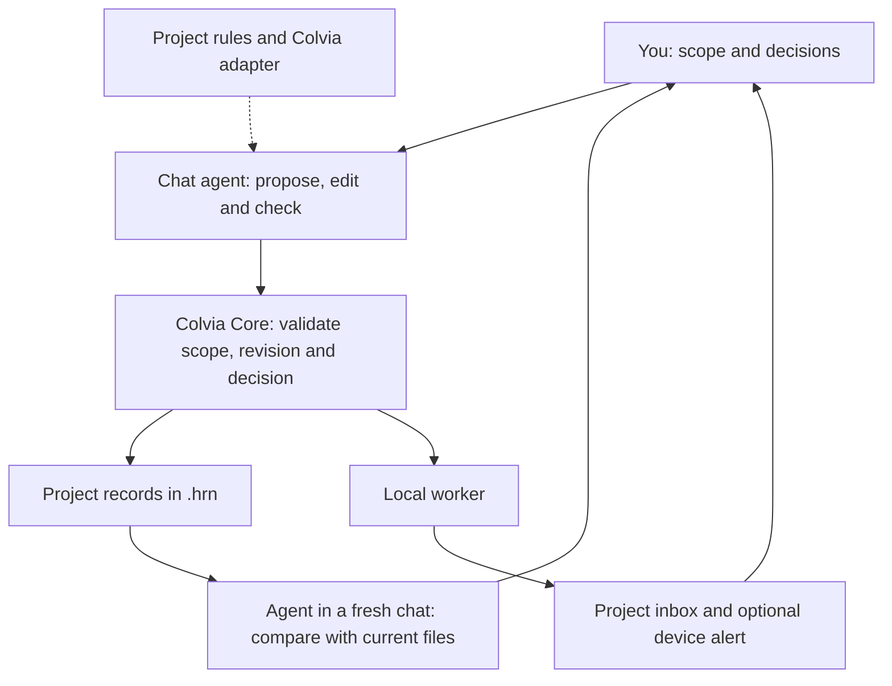
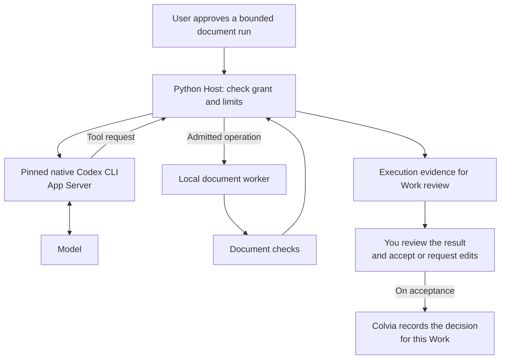

# Concepts

Use Colvia to keep a task connected to an agreed goal, the result you review and the work you choose next. An intent states the goal and boundaries; a Work records the task carried out under that accepted intent. The agent prepares the machine inputs and explains them through your existing project documents.

## What Colvia remembers

“Check the counts. Leave the choice of improvements to me.” When the report arrives, you can see which figures were checked and which decision is still yours.

In the next chat, compare the draft you reviewed with the file as it stands. If you have edited the conclusion yourself, decide whether to keep that wording before continuing.

You can revise and review a draft several times within one task. Reviewing several tasks together under a parent is an advanced workflow. See the [feature guide](README.md#features-en) for the proposed scope of the first release.

To step away, hand off one supported step, such as submitting a prepared change for review. Once you confirm, Colvia runs that step on this device. Questions and results appear in the local project inbox. When you return, check the inbox to see what was recorded, including whether a step stopped early.

[How the agent and Colvia share the work](#how-colvia-works-with-an-agent)

## How Colvia works with an agent

You can use Colvia with Codex or Claude Code to agree on a task, review the result and pick up the work in a new chat. You follow the same steps in Claude Code to set the scope and decide whether to accept the result.

The optional macOS document runner described later is a separate feature. Its Python Host calls a pinned version of the Codex CLI.

In everyday use, you agree on the scope. The agent reads the project's instructions, prepares a plan and makes the authorized changes. The adapter gives the agent a procedure for turning a request such as “show me yesterday's result” into the right project lookup. Colvia Core checks the relationship between the request, the selected revision and the acceptance decision. It keeps these records under the project's `.hrn/` directory so the next chat can find them.

Project rules tell the agent which source to use and which checks matter here. Colvia's rules govern how a proposal becomes an authorized task and how a particular result gets accepted. In the inquiry report, the manager chooses which improvement to pursue. An approval quoted in an old meeting note cannot authorize the new edit.



### From one request to the next

1. **Agree on the task.** Identify the inputs, files to change and checks. The user accepts the request.
2. **Edit and check.** A Work can go through several rounds within the agreed time, scope and attempt limits. This is the work loop. A material change of scope requires a decision.
3. **Submit and review.** The submission identifies a revision and its evidence. On resume, compare that revision to the files as they stand now.
4. **Accept or request another edit.** Review the submitted revision and decide whether to accept it. Grouping and delegation are advanced paths outside the proposed first Preview support promise. A parent Work (umbrella) can depend on specified direct children. Accepting those results and accepting the integrated result are separate steps. A narrowly scoped delegation can cover acceptance of one eligible ordinary isolated-worker result for a named delegate. Initial intent and parent acceptance remain human decisions.
5. **Choose what comes next.** Recording a candidate for follow-up gives you something to return to. Executing it needs its own authority.

### Two ways to hand off a step

**The project inbox** takes one supported step and a deadline, such as summarizing a Work or submitting a prepared change. A notice helps you find the result. If the worker stops early, check the process outcome separately from the effect on the documents.

**The optional macOS document execution path** uses a Python Host. It checks the authorized inputs, edit range and limits and talks to a pinned Codex CLI through its App Server. A local worker carries out the reads and edit admitted by the Host. After the edit, the worker checks links, Markdown structure and the required or forbidden text specified for that run. Completing the run leaves acceptance of the Work for a separate decision. This path has its own macOS profile and does not establish equivalent execution support for Windows or Claude Code.



A successful run supplies evidence for review. The user still decides whether to accept the Work result.

## The Work Cycle

```text
Choose the task, agree its scope and accept its intent
                         |
             carry out -> check -> correct
             within the approved Work and limits
                         |
Review the result and proposed plan update
                         |
Accept the exact result -> explain what is complete and what remains
                         |
Choose a follow-up, or stop and read current records when resuming
```

Pending publication or acceptance does not itself change the selected current state. A selected accepted result gives the Work its completed state. The diagram shows the default human acceptance path. The [delegation-1 candidate](#delegation-1-implementation-candidate) adds only the exact ordinary-worker accept exception; intent and parent acceptance remain human.

Inside one Work, the agent may keep checking and correcting within the approved scope, verifier and time/attempt limits. After the result, you choose what to do next. That choice may point to a proposal, an existing Work or no follow-up; it does not start another task. See [Supervised Work Iteration](GENERAL-WORK.md#supervised-work-iteration) and [Following A Result](#following-a-result).

Before result acceptance, the agent prepares proposed wording for what the plan item achieved and what remains, wherever the current scope and document-reference checks permit. After acceptance, it explains how the accepted result changes the plan and which document edits are still needed. Do not change a submitted result or accepted required input behind an existing ticket: the edit can invalidate its prerequisites. Use the applicable rework or new-acceptance path for a needed change; [Check Before Writing](REFERENCE.md#check-before-writing) explains which one.

## Five Requests To Start From

Try [revising an inquiry report](README.md#guide-en) and reviewing the result in a fresh chat.

These are examples, not command syntax. Ask in your conversation language. The agent first reads the project's current records, plan and applicable rules, and asks only for material information or decisions that are missing.

| You can ask | What the agent does | Where you decide |
| --- | --- | --- |
| “Show me the current state and what to do next.” | Reads the current Work, plan, candidates and recorded follow-up; explains progress, gaps and a recommendation. | You choose the next task. A recommendation does not record a choice or authorize execution. |
| “Let's continue the previous task.” | Reads the Work, plan, authorization and saved follow-up. Resolves an ambiguous target and explains pending recovery before ordinary editing; an ambiguous request stays read-only and saves no choice. | You resolve a real conflict or missing prerequisite. Still-valid approval for the same action and inputs need not be repeated. |
| “Implement this feature and fix issues found by the tests.” | Prepares an intent for your acceptance first if no accepted intent/Work covers the task. Establishes the scope, result, checks, execution limits and stop conditions, then works within that approved boundary. | You decide material scope or limit changes, changes to the acceptance checks, and exact acceptance. Test edits must stay within their authorized scope; this request does not permit weakening a check. Passing checks alone do not accept the result. |
| “Reflect the result in the plan and suggest what to do next.” | Drafts the plan update before acceptance, describing what would be complete and what would remain; afterward explains the accepted result, remaining work and proposed follow-up. Checks whether a document edit is allowed before saving it. | You decide result acceptance and any follow-up selection. A proposal and a saved selection have different meanings. |
| “Stop now and let's resume later.” | Preserves required inputs and recovery evidence and reports the current step, consumed limits and resume conditions. Records a handoff in the existing narrative only when authorized and permitted by [Check Before Writing](REFERENCE.md#check-before-writing); otherwise reports it as unsaved. | You decide any recovery or changed execution boundary needed on return. Stopping does not schedule an automatic restart. |

## Approval, Pause And Resume

An execution approval covers the action, target, inputs and prerequisites you agreed to. Reuse it while those conditions remain valid. Each newly prepared exact intent or result still needs its applicable acceptance; approval to implement covers the work, while result acceptance covers the submitted outcome. Verification, submission, acceptance and Git publication happen at separate steps. The agent explains the decision currently needed and reuses approval for an unchanged action.

For a new agent session in an installed project, start with `./colvia view --details` and the verified adapter it identifies. The human overview remains `./colvia view`. The agent reads the selected Work, referenced project plan and `./colvia view continuation WORK_ID`, including for a completed Work. Pending operations use their retained inputs and documented recovery path; a new session does not reset the budget or replace a pending request. See [Session Handoff And Resume](REFERENCE.md#session-handoff-and-resume) and [Operations](OPERATIONS.md#interrupted-operations).

These instructions guide a cooperating agent through its configured host. Check how that host loads the adapter, supervises work, sends notifications and handles scheduled execution before relying on those behaviors. Colvia installation does not load the adapter into every tool, start a background worker or resume a stopped session, and Colvia supplies no scheduler.

Plan and follow-up alignment are part of the workflow above. If your project also adopts a documentation-currentness rule, its own instructions identify the pages, triggers and checks. The agent follows that rule when reporting affected documentation and deferred updates. The [repository-rule example](REFERENCE.md#first-example-documentation-currentness) shows how to connect changes to the project documents that need attention. The project chooses this optional rule; Colvia adds no automatic document synchronization.

## One Authority Home

`.hrn/format.json` identifies the project authority and format. `.hrn/intents/` contains drafts, human acceptances, and selections. `.hrn/work/` contains Work identities, revisions, decisions, selections, and result manifests. Current pointers select verified references; filenames and timestamps do not determine authority.

`.hrn/product/` contains release inventories, payloads, binding, and lifecycle receipts. The root `colvia` launches the bound runtime. They can be removed by verified detach while project truth remains. `.hrn/staging/` and `.hrn/locks/` are regenerable scratch, not a second authority.

## Intent And Work

Intent records describe the goal, boundaries, evidence, and acceptance authority. Drafting proposes meaning; acceptance binds the exact draft and its prerequisites. Work refers to accepted intent and preserves the initial baseline, later submissions, rework, and human rebind history.

A result manifest binds full before/after content and exact scoped changes. Content freshness is separate from Git commit identity, so a HEAD-only commit does not invalidate unchanged content. A serial result is already present in the control checkout when submitted. For worker results, explicit human acceptance records the exact decision before applying the retained scoped changes to control; interrupted application follows the bounded recovery contract. Acceptance is supervised, and the procedure supplies no scheduler.

The human authority of a Work must agree with its referenced intent. Acceptance depends on the current intent and the applicable document-reference checks. Pending publication and failed verification remain visible. See [General Work](GENERAL-WORK.md) and [Workspace Contract](WORKSPACE-CONTRACT.md).

## Collaboration Boundary

The shared guard serializes cooperating record writers. It does not authenticate role names or prevent unrelated processes from editing files. Serial use requires one editing Work by procedure. General multi-worker efficiency, revalidation cost and usefulness still need project-specific evidence. See [Security and Support](SECURITY-AND-SUPPORT.md) for current limits and historical observations.

## Candidate Before Work

A candidate keeps an idea, reason and deferral condition before execution. The human may record one next choice; an agent recommendation is read-only. Accepted intent defines the authorized task, and Work records its actual progress and result. Candidate selection never substitutes for either. `./colvia view candidates` follows verified links to show actual Work state and labels a linked choice as consumed. See [Candidate Planning](REFERENCE.md#candidate-planning).

## Delegation-1 Implementation Candidate

Continuation-1 inherits the delegation-1 behavior described below. Follow [Continuation-1](README.md#continuation-1) for current lifecycle commands and authorization requirements. Historical versions retain their original meaning. Human authorization comes from the Owner’s actual decision; host authentication and general readiness require their own evidence.

The Owner remains the Work and intent owner. A delegate is an exact actor label declared by an Owner-accepted ordinary intent draft; it does not identify an authenticated person or model. The grant names one qualified Work, action `accept`, execution mode `isolated-worktree` and the exact scope-path set. No grant means the existing Owner-only flow.

The durable accept decision consumes the grant, before content application and selected completion. Exact recovery uses the original actor/ticket. Cancellation or later revocation does not refund that use. A new selection, request ID or same-grant baseline refresh cannot reset it. New lawful delegation requires new Owner-accepted intent content and the ordinary rebind/submission rules. Parent integration remains a separate human acceptance.

## Following A Result

A Work result answers “what was accepted?” Its continuation answers “what next did the human select?” The answer can be a proposal, an existing Work or explicit none; undecided is a different state. Choosing a proposal does not accept its intent. Choosing a Work does not start or complete it. Withdrawal returns to undecided and preserves the earlier history.

On resume, connect the project plan item → Work → accepted result → remaining items → selected follow-up. Use the existing narrative, not a second tracker. Valid candidate and Work choices can disagree; show both and let the human resolve the next action. See [Work Follow-Up](REFERENCE.md#work-follow-up) for pending, freshness and the 256-operation limit.
