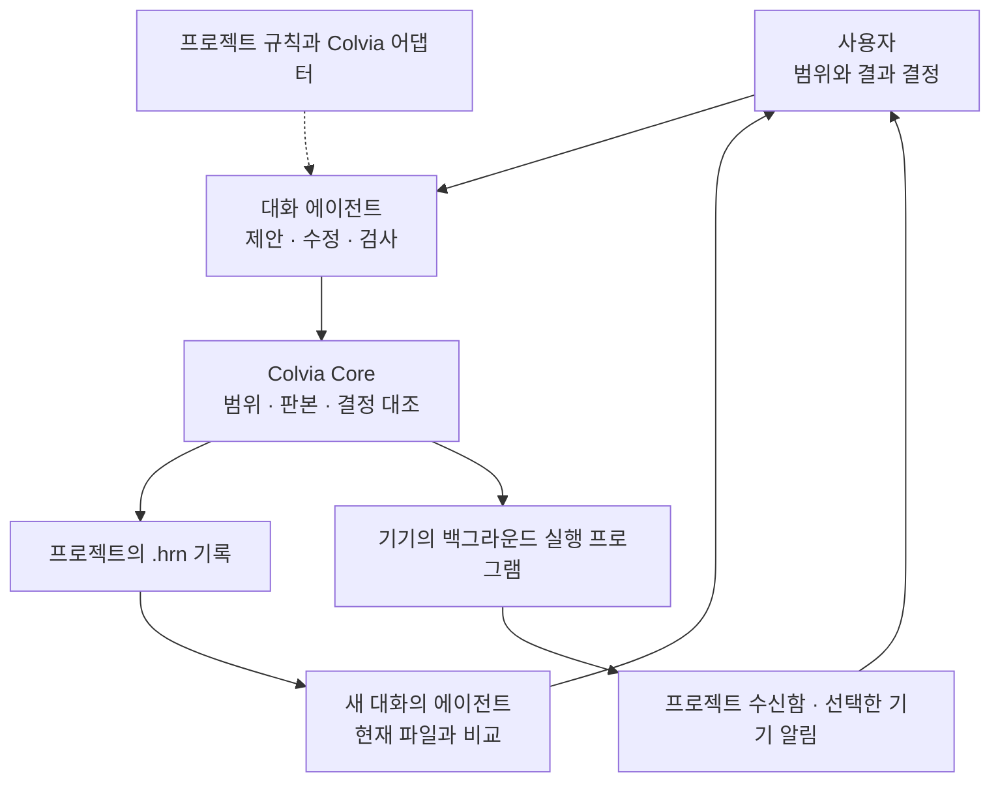
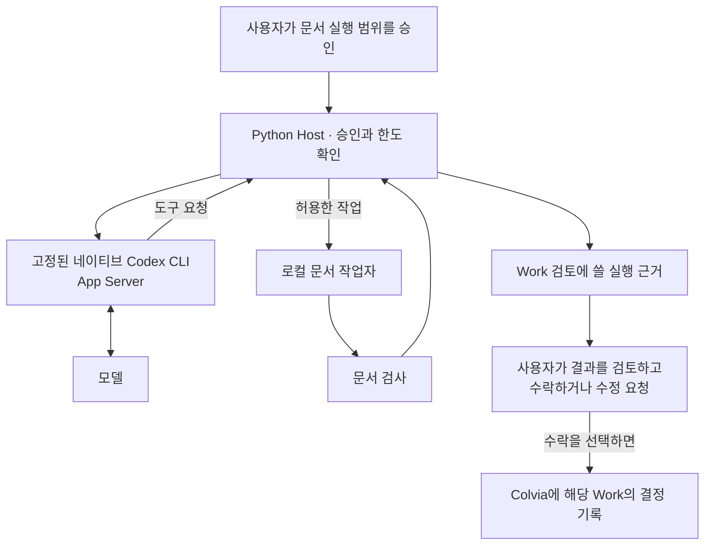

# Documentation Index

New to Colvia? [Start with the inquiry report](#guide-en). 한국어로 처음 사용한다면 [고객 문의 보고서 실습](#guide-ko)부터 보세요.

Use this index to find the instructions for this release, whether you are reading source or a verified installation. The `continuation-1` profile provides commands for writing local records, init/update/rollback, restoring an exact active release with repair, and removing the runtime with receipt-bound detach. General usability and real-project multi-worker efficiency remain unverified. [Security and Support](SECURITY-AND-SUPPORT.md) distinguishes current limits from historical observations.

Start with [the work cycle and five requests](CONCEPTS.md#the-work-cycle) to understand what to ask, what the agent can continue and where you decide. Try your first Work in [English](#guide-en) or [한국어](#guide-ko). Agents setting up or diagnosing a project should start with [project setup](GETTING-STARTED.md). Update, recovery and removal procedures are in [Operations](OPERATIONS.md).

Verified active status exposes a derived, read-only `documentation_root`. Follow that release's index rather than guessing a newer document path. Project-authored DR, brief and Work documents remain project-owned Markdown referenced by path and digest; the product does not impose their repository layout.

To hand off a prepared result and ask for it later, see [Hand off one Work item · 작업 맡기기와 결과 확인](GETTING-STARTED.md#hand-off-one-work-item).

## Installed Guidance And Execution Hosts

| What you are reading or using | What it provides |
| --- | --- |
| Verified `continuation-1` installation | The bound launcher, record and lifecycle commands, and that release's manual and adapter. |
| Agent adapter and project rules | Instructions for preparing work, reusing valid approval, explaining results and resuming from current records. The agent and host must actually follow them. |
| Source-only execution-host or provider-adapter verification | Evidence for the recorded source, configuration and tested cases. These development components are outside the 30-file managed payload; an ordinary runtime update does not install or activate them. |

A separately configured execution host needs its own setup, authorization, checks and recovery arrangements. Before use, check the exact release's evidence for your installation, host and platform, together with [Security and Support](SECURITY-AND-SUPPORT.md). Completing source development covers only its recorded scope. For Colvia source development, the trusted checkout's CONTRIBUTING entry leads to its development index and owning records; those source-only files are not required by an installed project.

## Find The Detailed Procedure

| Document | Reader and responsibility | Authority and evidence boundary |
| --- | --- | --- |
| [Product Entry](../README.md) | User orientation | Current development entry; no adoption claim |
| [Agent Entry](../AGENTS.md) and [Claude Entry](../CLAUDE.md) | Agent behavior and tool projection | AGENTS is canonical; Claude is a pointer |
| [Getting Started](GETTING-STARTED.md) | Operator setup and first serial work | Current setup procedure; general usability unverified |
| [Concepts](CONCEPTS.md) | User model and ownership | Explanation; detailed contracts govern schemas |
| [Operations](OPERATIONS.md) | Operator update/recovery/exit | Current bounded lifecycle procedure |
| [Reference](REFERENCE.md) | Exact commands, paths, diagnostics and [recording/retention rules](REFERENCE.md#records-and-retention) | Source and installed interfaces are distinct; agent recording policy does not change authority |
| [Guided Intent](GUIDED-INTENT-FORMATION.md) | Intent formation and acceptance | Typed artifacts; natural-language quality unverified |
| [General Work](GENERAL-WORK.md) | Maintainer and reviewer | Work records/content and bounded worker integration contract |
| [Workspace Contract](WORKSPACE-CONTRACT.md) | Maintainer and reviewer | Root, product and recovery contract |
| [Manual Operation](MANUAL-OPERATION.md) | Operator and auditor | Plain retained evidence; no unrestricted manual writer |
| [Security and Support](SECURITY-AND-SUPPORT.md) | Trust/runtime boundary | Bounded local evidence, no native/adopter promotion |
| [Maintaining](MAINTAINING.md) | Contributor validation and inventory | Current source procedure |

## Historical Material

Source checkouts retain `docs/GENERATION-1-CONTRACT.md`, `docs/GENERATION-2-PARALLEL-SAFETY.md`, and `receipts/` for historical audit only. They are not shipped in the managed release and do not describe supported commands, readers or upgrades. Their old paths are not single-home authority. Do not follow historical operations on a current target.

If a current document and source disagree, report the difference and preserve state. Align code and docs in the same qualified change, using evidence for that candidate. Historical receipts describe their original versions. Public version and distribution remain unassigned.

Human entry: run `./colvia view` in the project. Agents use `./colvia view --details` to read the current verified manual/adapter; the default screen also points to those technical details. [Reference](REFERENCE.md#human-review) defines command and observation boundaries.

## Entry-1 Candidate

Historical locator: the exact entry-1 technical successor was accepted and activated through source decision DR-0004. Its retained preparation labels do not make it inactive. It superseded the eleven-member M3 set recorded in DR-0002 under DR-0003; the original M3 bytes remain recoverable from source revision `a17f35cf323ffde7a8642a85501fddbec858b6de`. Those source-only records identify exact clauses and hashes; they are not shipped links or permission to use these changed candidate bytes as the effective set.

For source-contract activation, consult the exact Owner-accepted source decision records. These managed bytes and a verified installation do not replace that recorded decision. Source procedure relocation under DR-0006 does not itself change the technical contract.

## Current Candidate

The current window includes optional direct-child composition and parent acceptance checks. Before use, the exact release candidate must meet its qualification requirements; earlier observations apply only to their recorded versions. See [Direct-Child Umbrella](GENERAL-WORK.md#direct-child-umbrella) and [Continuation-1](#continuation-1).

Planning-1 introduced project-owned candidate notes, one recorded Owner selection, deferral and explicit resumption. Begin with [Candidate Planning](REFERENCE.md#candidate-planning).

The retained entry-1 window introduced the current launcher/adapter paths and paired schema2 switch/schema3 detach history. Continuation-1 keeps the paths, candidate planning, delegated ordinary acceptance and verified unchanged-CRLF exception, and writes paired schema5 lifecycle plans/receipts. [Operations](OPERATIONS.md#continuation-1) defines the exact-predecessor transition and recovery limits. Fresh-session behavior and general adoption need evidence from their own use cases.

## Delegation-1 Implementation Candidate

Continuation-1 inherits the delegation-1 behavior described below. Follow [Continuation-1](README.md#continuation-1) for current lifecycle commands and authorization requirements. Historical versions retain their original meaning.

Before actual use, the responsible Owner must separately authorize source-contract activation and the exact installation or update. Authorization comes from that actual decision. Host authentication and general readiness require their own evidence.

For source development, follow the source entry and its actual decision records. Those source-only files are not prerequisites for an installed project, and Core does not look up or enforce their activation state.

In an authorized exact installation, an Owner-accepted, exact intent-bound grant may permit only its named ordinary isolated-worker accept. Read [Delegated Ordinary Acceptance](GENERAL-WORK.md#delegation-1-implementation-candidate), [the grant shape](GUIDED-INTENT-FORMATION.md#delegation-1-implementation-candidate) and [transition/recovery](OPERATIONS.md#delegation-1-implementation-candidate). Without a grant, acceptance stays with the human. Source development result acceptance always remains human.

The retained delegation-1 window used 29 files and paired lifecycle schema 4, with a one-way transition from its exact audited entry-1 predecessor. Current continuation-1 operations follow the next section. Same-window candidates must read each other's retained project truth. A completed stored action, current content match, reviewer verdict, contract activation and Git publication are separate states.

## Continuation-1

Continuation-1 adds one Work-local follow-up record: a proposal needing a later intent, a specific existing Work, or explicit none. No selected choice means undecided; withdrawal returns to that state. The source result and target execution authority remain separate. See [Follow-up contract](GENERAL-WORK.md#continuation-1-successor-contract), [commands and resume](REFERENCE.md#work-follow-up), and the current managed adapter.

The current managed set has 30 files, including `src/hv2ref/continuation.py`; the launcher remains `colvia` and the adapter remains `adapters/colvia-work/SKILL.md`. New lifecycle records use paired schema 5. The first durable new receipt is a one-way boundary from the exact admitted delegation-1 predecessor; [Operations](OPERATIONS.md#continuation-1) gives the recovery limits. Historical membership and record versions remain readable within their original contracts.

The source decision DR-0001 accepts these successor clauses for implementation. Installed projects do not need that source-only record, and Core does not enforce an approval registry for it. Use requires qualification of the exact artifact and Owner authorization of the exact installation and requested actions. This manual describes the requirements. Synthetic execution, source result acceptance and actual user success each need their own evidence; the manual does not certify those outcomes.

## Windows-2 Integration Candidate

The separate Windows-2 window inherits the common continuation and delegated-acceptance behavior with the same 30 managed paths. Its explicit prepared launcher/profile selects windows-2, and all lifecycle action pairs use schema 6. Fresh and same-window use only are admitted; Windows-1 and other predecessors cannot migrate through this route. Follow [Windows entry](GETTING-STARTED.md#windows-2-entry), [Windows lifecycle](WORKSPACE-CONTRACT.md#windows-fresh-and-same-window-lifecycle) and [native recovery](OPERATIONS.md#windows-2-native-entry-and-recovery). The common source remains continuation-1/schema5. Matching membership, portable checks and historical Windows-1 results do not qualify this Windows-2 candidate; actual native evidence and exact Owner authorization remain separate.


<!-- First Work guides: edit manual/en or manual/ko, then run scripts/sync-first-work-guides.py --write. -->

<a id="guide-en" name="guide-en"></a>

## Write your first inquiry report

[한국어](#guide-ko) · English · [About Colvia](../README.md)

Write a short report for your manager. In the first chat, summarize a month of inquiries. In the second, return to the draft you reviewed and respond to a change in the brief. You can try both chats today.

<a id="guide-en-setup" name="guide-en-setup"></a>

### Before you begin

Open a practice folder that uses Colvia in Codex or Claude Code. On a new device, start with [Install, update or disconnect](#setup-en) and return here when the folder is ready.

<a id="guide-en-plan" name="guide-en-plan"></a>

### Yesterday · agree on the change

Save these twelve fictional inquiries as `inquiries.csv` in the practice folder. Use this sample in place of real customer data. Your chat and the material you share follow your agent provider’s settings.

```csv
category,inquiry
refund,cancelled after payment
shipping,late delivery
usage,change password
refund,partial refund terms
shipping,track parcel
refund,processing time
other,replace receipt
shipping,correct address
refund,duplicate charge
usage,notification settings
shipping,shipping delay
refund,change refund account
```

> Use inquiries.csv to write last month’s inquiry report. Check the category totals against the source. Suggest improvements, but leave the choice to me. Leave the CSV unchanged. Save the draft as `report.md`.

Approve the scope if it fits. After the edits and checks the agent shows you the draft. Compare the draft with these totals: five refunds, four shipping questions, two usage questions and one other inquiry. If it claims an increase over the previous month, ask what supports that statement. You only supplied one month of data. When you are happy to share the draft with your manager, say “I accept this draft.” Approving the scope let the agent start. Accepting the draft records your decision about the result you just read.

<a id="guide-en-review" name="guide-en-review"></a>

### Today · make the decision

Open a fresh chat in the same project. To try keeping a personal edit, first change one sentence in the conclusion and save the file.

> My manager says logistics will cover shipping. Pick up from yesterday’s reviewed draft. Show me any edits since then, and tell me what happens to the refund share if we leave shipping out.

Decide which edits to keep and agree on the narrower brief. The revised report now covers eight inquiries, after excluding four about shipping. There are still five refunds. The refund share rose from about 42% (5/12) to about 63% (5/8) because the denominator shrank. Does the report explain that? Read the figures and conclusion before accepting this draft or asking for a change. [What Colvia remembers](CONCEPTS.md#what-colvia-remembers)

<a id="update-recovery-en" name="update-recovery-en"></a>

<a id="guide-en-recovery" name="guide-en-recovery"></a>

### Update, Recovery And Removal

[Next · Return in a fresh chat](#resume-en) · [Install, update or disconnect](#maintenance-en)

<a id="setup-en" name="setup-en"></a>

## Install, update or disconnect

[한국어](#setup-ko) · English

Prepare the tools on your device, then preview the changes for each project you want to use.

| Where | What lives there |
| --- | --- |
| Your device | The manager and private Python can serve several projects. |
| Each project | Its installed copy and launcher. Preview changes for this folder before applying them. |
| The project's `.hrn/` folder | Task history, submissions and decisions. Disconnecting preserves these records. |

### Start in a new folder

Public downloads are in preparation. If you received a preview package, use the verification value supplied separately by the distributor. If Colvia is already installed, skip to connecting your practice folder.

On an Apple silicon Mac, check the bootstrap file with `shasum -a 256 "$HOME/Downloads/bootstrap.sh"`. Compare the digest with the separately supplied value. If it matches, run `/bin/sh "$HOME/Downloads/bootstrap.sh"` to preview the installation. Check the destination and run the displayed apply command with its confirmation code.

On Windows 11 ARM64, open PowerShell as a standard user. Check the manager with `Get-FileHash "$HOME\Downloads\colvia-manage.exe" -Algorithm SHA256`. If the digest matches, use the supplied ARM64 Python ZIP to prepare the tool and private Python. Adjust the paths if your downloads are elsewhere.

```powershell
& "$HOME\Downloads\colvia-manage.exe" prepare --runtime-zip "$HOME\Downloads\python-3.14.7-embed-arm64.zip"
```

Use the ZIP filename supplied with your manager. The manager checks the ZIP size and digest before preparing Python. This command is for ARM64. The public Windows 11 x64 installation path still needs native qualification.

Create an empty practice folder and open Codex or Claude Code in it. Ask “Show me what connecting this folder would change.” Check the folder and proposed changes before approving.

In an empty folder, start with what you want to make. In an existing project, ask “What would Colvia add here?” If your agent hasn’t encountered Colvia yet, give it the manager location from setup. Run the manager with `start --target "PROJECT"` to see the next step before changing any files.

### Connect an existing project

1. Ask “Show me this folder’s Colvia status and any work in progress.” If it already uses Colvia, check its installed version and manager. If it was disconnected, stop here. Keep the original folder and its `.hrn/` intact. To start over, choose a different folder. The next step is for a project that has never been connected.
2. For a new connection, preview `install` and inspect the target and files it will add. Check existing `AGENTS.md`, `CLAUDE.md` and `.gitignore` entries so team instructions and tracking rules are preserved. A symlink even inside an ignored directory can stop a Work check. If a check refuses the folder, identify the path and choose a suitable workspace while leaving existing files intact.
3. Apply the saved request and confirmation only after reviewing the changes. In the same project, ask “Show me the current work and what I should do next” to check that you can open the project view.

<a id="maintenance-en"></a>

### Update, recover or disconnect

**Update.** Verify the new distribution first. On an Apple silicon Mac, run the verified new bootstrap without options and review the apply command it displays. On Windows, prepare the new manager with its matching Python ZIP. Preparing the device leaves each project on its installed version. Check the project's status, preview `update` for that folder and review the confirmation before applying. To return to a previous version, check whether `rollback` is available. If a change stopped partway, keep the request file saved during preview and check the inputs for `repair` first.

If you use device alerts on Windows 11 ARM64, verify and prepare the new manager EXE, then run `notice-enable` with that EXE to update the existing registration. Use `notice-disable` when turning alerts off.

**Disconnect.** Reconnecting a folder with its existing Work history is currently unsupported. Leave it connected if you intend to return. Otherwise, preview and apply `remove` for that project. Afterwards, check `AGENTS.md` and `CLAUDE.md` for any Colvia instructions you added yourself. Remove only those lines.

**Remove everything.** Several projects can share the manager and its private Python. Follow these steps in order.

1. Identify the affected projects. Save the project files and hidden `.hrn/` directories you want to keep, along with original requests and sources needed for recovery. Check that the saved files are readable.
2. While the manager is still available, disconnect the affected projects one at a time. Stop here if other projects still use the tool.
3. On Windows, run `notice-disable` with the manager EXE used for registration, then delete that EXE. On Mac, preview the removal with `"$HOME/Library/Application Support/Colvia/bin/colvia-manage" remove-tool`. To apply it, repeat the command with `--apply --confirm` followed by the displayed value. The private Python and recovery files remain.
4. In Finder, use Go to Folder to open `~/Library/Application Support/Colvia`. In Windows Explorer, open `%LOCALAPPDATA%\Colvia`. On Mac, `runtimes` contains private Python, `releases` and `tools` hold software copies, and `requests` holds saved requests. On Windows, look for `python-…`, `tool-…` and `requests`. Delete only dedicated files no longer needed for any project, pending recovery or access to archived records. Check downloaded assets and requests or backups saved elsewhere separately.
5. Deleting a project's `.hrn/` also deletes its local Work and acceptance history. Decide separately whether you want to erase those records. Copies may remain in Git history or backups.

If a download or first launch is blocked, keep Gatekeeper or SmartScreen enabled and stop at the warning. To report a problem, include the asset name, operating system, step and expected result. Leave private paths and project contents out.

[Back to the user guide](../README.md#english)

<a id="features-en" name="features-en"></a>

## What can I ask Colvia to do?

[한국어](#features-ko) · English · [First Work](#guide-en) · [How Colvia works](CONCEPTS.md#how-colvia-works-with-an-agent)

Start with one change you expect to come back to. You decide what the agent may change and which revision you accept. The project keeps that agreement alongside the submitted work. If tomorrow’s files differ, you can see which checks belonged to yesterday’s revision.

#### Which workflows have been checked?

| Path | Coverage |
| --- | --- |
| Everyday tasks (1–6) | Scoped edits, checks, submission and returning to the task record. Single-step handoff and inbox delivery have also been checked on isolated Mac and Windows ARM64 systems. |
| Advanced reference (7–9) | Grouping child tasks, separate working copies and delegating one acceptance decision have narrower, case-specific evidence. |
| Installation (10–11) | A private installation was checked on an Apple silicon Mac, and installation and a first task on a designated Windows 11 ARM64 system. The x64 development build still needs final checks on Windows 11 x64. |
| Optional document execution (12) | A pinned Mac package and Codex runner were checked for normal completion and cancellation after reading. |

### Work with your agent

#### 1. Agree on the scope
“Start from the report I reviewed. Keep my conclusion and recheck the figures with shipping left out.” Agree on the source, the file to edit and the figures to verify.

#### 2. Revise and review one Work
“Go ahead. Leave the choice of improvements to me.” The agent edits and checks the report within the agreed limits, then shows you the draft. If a required check fails, it explains why. Accept the draft you reviewed or ask for a correction.

#### 3. Find the result that needs you
“What’s ready for me to review?” The project View points to a Work and the reason it needs attention. Open the submitted changes and checks before deciding. If two titles fit, identify the intended Work. Reading its status keeps the decision open. The current compact View includes Korean labels, even when you use the English guide.

<a id="resume-en" name="resume-en"></a>

#### 4. Resume in a fresh chat
“Where did we leave the inquiry report? Is the report still the version I reviewed?” In the same project the agent can compare the selected revision, your decision and the current files. If someone edited the report overnight, review that difference. If an earlier run stopped midway, inspect what reached the file and whether the process ended before deciding how to continue.

#### 5. Keep an idea for later
“Save next month’s report for later. What would we need to decide first?” A candidate records a possible follow-up. You can compare it with other ideas or link it to a Work when you choose it. Choosing a next step and authorizing its execution are separate decisions. You can start a new Work, continue a named Work, or explicitly finish with no follow-up. An undecided next step stays open.

#### 6. Step away and receive a result
“The draft is ready. Submit it for review and notify me on this device.” Check the Work, action, deadline (within 24 hours) and inbox in the preview before confirming. One active ordinary local Work can have one supported step in flight per project: a summary or submission of a prepared result. The optional macOS profile also accepts a separately approved document run. Direct runs have been tested. Running one through the handoff still needs verification. The local worker needs the device and user session to stay available. In the tested notification candidates on macOS and Windows ARM64, opening the alert led to that submission. Missed it? Ask “Does the report Work have a question or a result?” If the outcome is unclear, inspect the receipt first. The inbox leaves acceptance to you.

### Combine work when one edit is no longer enough

These advanced paths are documented for reference. They fall outside the proposed first Preview support promise.

#### 7. Review a group of related results
“Group the inquiry report and meeting summary. Show me whether the two submitted drafts agree.” A parent Work can refer to its named direct children in the same project. You review their accepted revisions and the combined check, then decide on the parent result yourself. If a child changes, compare the captured revision before refreshing it. Nested groups and groups spanning projects are outside this scope.

#### 8. Prepare separate edits in one repository
“Could the inquiry report and meeting summary be edited in separate working copies? Show me how they would be checked together.” Cooperating workers can prepare isolated results; integration into the control checkout proceeds one result at a time. If scopes overlap or the base changes, stop for comparison. Doing the edits serially remains an option. The existing evidence covers bounded synthetic cases; real-team throughput is unmeasured.

#### 9. Delegate one acceptance decision
“Show me exactly which worker, Work and files this grant would cover.” On a qualified profile, you may authorize a named delegate to accept one ordinary isolated-worker result under the accepted intent. Review the grant before choosing. If its target, scope or conditions differ, leave the decision with the owner. This grant does not cover the parent result, initial intent, publication or ordinary inbox delivery.

### Set up and operate a project

#### 10. Connect, update or disconnect
“Show me what connecting this folder changes.” Check the target and preview before applying. For an existing project, ask which installed version and recovery route apply before updating. If an update stops, preserve its request and inspect the recorded effect. Disconnecting removes the project runtime but retains project records. Removing the manager or private Python is a different operation. To take a break and return to the same history, leave the project connected.

#### 11. Use a Windows project
“Check this PC’s architecture and the dedicated Python, then show me how to start a practice Work.” Private tests on a designated Windows 11 ARM64 standard account covered preparation, first Work, View, resume and lifecycle cases. The x64 build must still be checked on Windows 11 x64. Use the matching manager/runtime pair and a supported local NTFS target. If download or first launch is blocked, note the step and warning. After an ARM64 manager update, use the verified new manager to register notifications again.

#### 12. Run a bounded document edit on macOS
“Show me the paragraph this run may change, its checks and the time limit.” The optional macOS profile uses a pinned Codex CLI (0.165.0) and a separate approval for the run. Fixed private packages have evidence for normal completion and a read followed by external cancellation. A cancellation request alone cannot establish that execution stopped or that the file stayed unchanged. Inspect both the document effect and process closure, then review the Work result. This evidence does not extend to a Windows or Claude Code execution host.

<a id="coding-en"></a>

### Working with a coding agent

“Show me what changed since the payment fix I accepted. Which cases still need a test?” Use the submitted changes and checks to choose the next scope. A submission containing changes outside the agreed files can be refused. Find out who made an unrelated edit before reverting anything. Passing tests, accepting a result and committing it to Git are separate decisions.

[Back to the user guide](../README.md#english)

## 한국어

[첫 작업 따라 하기](#guide-ko) · [쉬운 설명](#colvia는-무엇을-기억하나요) · [엔지니어를 위한 구조 안내](#에이전트와-colvia가-함께-일하는-방식)

<a id="guide-ko" name="guide-ko"></a>

## 고객 문의 보고서로 첫 작업 시작하기

한국어 · [English](#guide-en) · [제품 소개](#colvia는-무엇을-기억하나요)

팀장에게 보여줄 고객 문의 보고서를 써 봅시다. 첫 대화에서는 지난달 문의를 정리합니다. 새 대화에서는 팀장의 피드백을 받고, 이미 검토한 초안에서 다시 시작합니다. 두 대화를 오늘 바로 열어도 됩니다.

<a id="guide-ko-setup" name="guide-ko-setup"></a>

### 시작하기 전에

Colvia를 적용한 빈 연습 폴더에서 Codex나 Claude Code를 여세요. 처음 사용하는 기기라면 [설치·갱신·연결 해제](#setup-ko)에서 환경을 준비하고 돌아오세요.

<a id="guide-ko-plan" name="guide-ko-plan"></a>

### 어제 · 어디까지 맡길지 정하기

연습 폴더에 아래 예시를 `문의.csv`로 저장하세요. 실제 고객 자료 없이 연습할 수 있는 가상의 문의 12건입니다. 에이전트와 주고받는 내용은 해당 서비스의 설정과 전송 경로를 따릅니다.

```csv
유형,문의
환불,결제 직후 취소
배송,도착일 지연
사용법,비밀번호 변경
환불,부분 환불 기준
배송,송장 조회
환불,처리 기간
기타,영수증 재발행
배송,주소 수정
환불,중복 결제
사용법,알림 설정
배송,배송 지연
환불,환불 계좌 변경
```

> 문의.csv를 보고 지난달 문의 보고서를 써 줘. 문의 유형별 건수를 원본과 대조하고, 개선할 점은 후보로만 남겨 줘. 자료는 그대로 두고 초안은 `보고서.md`에 작성해 줘.

에이전트가 제시한 범위가 맞으면 진행을 승인하세요. 수정과 검사가 끝나면 에이전트가 초안을 보여줍니다. 전체 12건을 세면 환불 5건, 배송 4건, 사용법 2건, 기타 1건입니다. 초안의 수치와 비교해 보세요. 전월 자료가 없는데 “지난달보다 늘었다”고 썼다면 그 근거를 묻거나 수정을 요청하세요. 팀장에게 보여줄 만하면 “이 보고서 초안을 수락할게”라고 하세요. 처음의 승인은 일을 맡기는 결정이고, 지금의 수락은 방금 읽은 결과에 대한 결정입니다.

<a id="guide-ko-review" name="guide-ko-review"></a>

### 오늘 · 새 대화에서 결정하기

같은 프로젝트에서 새 대화를 여세요. 검토 후 직접 손본 문장까지 구분해 보고 싶다면 먼저 보고서의 결론 한 줄을 직접 바꾸고 저장하세요.

> 팀장님이 배송 문의는 물류팀에서 다룬대. 어제 검토한 보고서에서 이어가자. 그 뒤 달라진 문장은 먼저 보여주고, 배송을 빼면 환불 비율이 어떻게 달라지는지 알려줘.

지난 초안과 지금 파일 사이에 차이가 있으면 어떤 문장을 살릴지 정하세요. 바뀐 범위를 확인하고 수정을 맡기면, 다음 보고서의 기준은 전체 12건에서 배송 4건을 뺀 8건입니다. 환불은 여전히 5건입니다. 약 42%(5/12)에서 약 63%(5/8)로 바뀐 건 비교 대상이 줄었기 때문입니다. 보고서가 그 차이를 설명하나요? 숫자와 결론을 읽고 이번 초안을 수락하거나 고칠 부분을 알려 주세요. [Colvia가 기억하는 것](#colvia는-무엇을-기억하나요)

<a id="update-recovery-ko" name="update-recovery-ko"></a>

<a id="guide-ko-recovery" name="guide-ko-recovery"></a>

### 다시 쓰거나 잠시 쉴 때

[다음 · 새 대화에서 이어가기](#resume-ko) · [설치·갱신·연결 해제](#maintenance-ko)

<a id="setup-ko" name="setup-ko"></a>

## 설치·갱신·연결 해제

한국어 · [English](#setup-en)

기기의 도구를 준비한 뒤, 사용할 프로젝트마다 적용할 내용을 먼저 확인하세요.

| 위치 | 담긴 내용 |
| --- | --- |
| 기기 | 관리 도구와 전용 Python을 여러 프로젝트가 함께 씁니다. |
| 프로젝트 폴더 | 그 프로젝트에 적용된 설치본과 실행 파일이 있습니다. |
| 프로젝트의 `.hrn/` | 맡긴 일, 제출한 결과, 승인과 수락 기록이 있습니다. 연결을 해제해도 남습니다. |

### 새 폴더에서 시작하기

공개 다운로드는 준비 중입니다. 이미 설치했다면 아래에서 연습 폴더를 연결하세요.

시험용 배포 파일을 받았다면 먼저 파일 이름과 운영체제를 확인하세요. Apple silicon Mac의 터미널에서는 `shasum -a 256 "$HOME/Downloads/bootstrap.sh"`로 다운로드한 파일의 해시를 구합니다. 배포 안내에서 별도로 제공한 값과 일치하면 `/bin/sh "$HOME/Downloads/bootstrap.sh"`를 실행하세요. 어디에 무엇을 설치할지 살펴본 뒤, 미리보기에 표시된 적용 명령과 확인값을 확인한 뒤 그 명령을 실행하세요.

Windows 11 ARM64에서는 일반 사용자로 PowerShell을 열어 `Get-FileHash "$HOME\Downloads\colvia-manage.exe" -Algorithm SHA256`로 관리 파일을 확인합니다. 값이 일치하고 ARM64용 Python ZIP을 받았다면 다음 명령으로 사용자 폴더에 Colvia와 전용 Python을 준비합니다. 다운로드 폴더가 다르면 두 경로를 실제 파일 위치에 맞추세요.

```powershell
& "$HOME\Downloads\colvia-manage.exe" prepare --runtime-zip "$HOME\Downloads\python-3.14.7-embed-arm64.zip"
```

ZIP 이름은 받은 관리 도구와 함께 안내된 이름을 사용하세요. 관리 도구가 ZIP의 크기와 해시를 확인한 뒤 전용 Python을 준비합니다. 이 명령은 ARM64용입니다. Windows 11 x64에서의 공개 설치 절차는 최종 확인을 기다리고 있습니다.

처음이라면 빈 연습 폴더를 만들고 그 폴더에서 Codex나 Claude Code를 여세요. “여기에 Colvia를 적용하면 어떤 파일이 생기는지 먼저 보여줘”라고 물은 뒤 대상과 변경 내용을 확인하고 연결하세요.

빈 폴더라면 만들고 싶은 결과물부터 이야기하세요. README나 팀 규칙이 있는 폴더라면 “이 프로젝트에 Colvia를 적용하면 어떤 파일이 생겨?”라고 물어보세요. 에이전트가 처음 듣는 도구라면 준비 단계에서 안내한 관리 명령의 위치를 한 번 알려주세요. 관리 도구의 `start --target "프로젝트 경로"`는 파일을 바꾸지 않고 다음 단계를 안내합니다.

### 기존 프로젝트에 적용하기

1. 에이전트에게 “이 폴더의 Colvia 설치 상태와 작업 중인 변경부터 보여줘”라고 하세요. 이미 적용된 프로젝트는 현재 버전과 관리 도구를 확인하고, 이미 연결을 해제했다면 여기서 멈추세요. 원래 폴더와 `.hrn/`은 그대로 보존하고, 새로 시작하려면 다른 폴더를 사용하세요. 다음 설치 단계는 아직 연결한 적이 없는 프로젝트용입니다.
2. 새로 적용할 폴더에서는 `install` 미리보기로 대상과 추가될 파일을 봅니다. 기존 `AGENTS.md`, `CLAUDE.md`, `.gitignore`를 확인해 팀의 지침과 추적 규칙을 보존하세요. 무시된 폴더에서도 심볼릭 링크가 작업 검사를 막을 수 있습니다. 거부되면 어느 경로에서 멈췄는지 확인하고 기존 파일을 둔 채 적용 가능한 작업 공간을 고르세요.
3. 대상과 변경 내용이 맞을 때만 저장한 요청과 확인값으로 적용하세요. 같은 프로젝트에서 “현재 작업과 내가 다음에 할 일을 보여줘”라고 물어 조회할 수 있는지 확인하세요.

<a id="maintenance-ko"></a>

### 갱신·복구·연결 해제

**갱신** · 새 배포물의 확인값을 먼저 대조하세요. Apple silicon Mac에서는 확인한 새 bootstrap 파일을 옵션 없이 실행하고 표시된 적용 명령을 검토하세요. Windows에서는 새 관리 파일과 그 아키텍처에 맞는 Python ZIP으로 준비합니다. 관리 도구가 준비되어도 각 프로젝트의 설치본은 별도로 갱신합니다. 대상 폴더의 상태를 보고 `update` 미리보기에서 변경과 확인값을 확인한 뒤 적용하세요. 이전 버전으로 돌아가려면 `rollback`이 가능한지 먼저 확인하세요. 도중에 멈췄다면 미리보기에서 저장한 요청 파일을 보존하고 `repair`에 필요한 자료부터 확인하세요.

Windows 11 ARM64에서 기기 알림을 쓰고 있다면 새 관리 EXE의 확인값을 대조하고 준비한 뒤, 새 EXE로 `notice-enable`을 실행하세요. 기존 등록을 새 버전으로 바꾸는 절차입니다. `notice-disable`은 알림을 끌 때 사용합니다.

**연결 해제** · 기존 기록을 유지한 채 같은 폴더를 다시 연결하는 절차는 아직 지원하지 않습니다. 나중에 돌아올 예정이라면 연결을 유지하세요. 연결을 끝낼 때는 관리 도구로 대상 프로젝트의 `remove`를 미리 보고 적용하세요. 이후 `AGENTS.md`와 `CLAUDE.md`에 직접 추가한 Colvia 안내가 남았다면 해당 부분만 정리하세요.

**완전 삭제** · 여러 프로젝트가 같은 기기의 도구와 Python을 쓸 수 있습니다. 아래 순서로 진행하세요.

1. 영향을 받는 프로젝트를 확인하세요. 나중에 읽을 작업 파일과 숨김 폴더 `.hrn/`, 복구에 필요한 원래 요청과 자료를 별도로 보관하고 보존한 내용을 확인하세요.
2. 관리 도구가 있는 동안 대상 프로젝트를 하나씩 연결 해제하세요. 다른 프로젝트에서 도구를 계속 쓴다면 여기서 마치세요.
3. Windows에서는 알림을 등록한 관리 EXE로 `notice-disable`을 실행한 뒤 그 EXE를 삭제하세요. Mac에서는 터미널에서 `"$HOME/Library/Application Support/Colvia/bin/colvia-manage" remove-tool`로 대상을 미리 보고, 제거할 때만 같은 명령에 `--apply --confirm`과 방금 표시된 확인값을 붙여 실행하세요. 전용 Python과 복구 자료는 남습니다.
4. Finder의 ‘폴더로 이동’에서 `~/Library/Application Support/Colvia`를, Windows 탐색기에서는 `%LOCALAPPDATA%\Colvia`를 여세요. Mac의 `runtimes`는 전용 Python, `releases`와 `tools`는 배포본과 도구 사본, `requests`는 저장한 요청입니다. Windows에서는 `python-…`, `tool-…`, `requests`가 각각 해당합니다. 미완료 작업이나 보존 이력 조회에 필요한 파일을 남기고, 더 이상 쓰지 않는 전용 파일만 삭제하세요. 다운로드한 배포 파일과 다른 위치에 저장한 요청·백업도 따로 확인하세요.
5. 프로젝트의 `.hrn/`을 지우면 그 폴더의 작업·수락 기록까지 잃습니다. 이력까지 지울 뜻이라면 마지막에 따로 결정하세요. Git 이력이나 백업에는 사본이 남을 수 있습니다.

다운로드나 첫 실행이 막히면 보안 경고를 우회하지 말고 어느 단계에서 멈췄는지 확인하세요. 문제를 알릴 때는 배포 파일 이름, 운영체제, 멈춘 단계와 예상한 결과를 적어 주세요. 개인 경로와 프로젝트 원문은 빼 주세요.

[사용 설명서로 돌아가기](../README.md#한국어)

<a id="features-ko" name="features-ko"></a>

## Colvia로 어떤 일을 맡길 수 있나요?

한국어 · [English](#features-en) · [첫 작업](#guide-ko) · [Colvia의 구조](#에이전트와-colvia가-함께-일하는-방식)

내일 다시 검토할 일이 하나 있다면 거기서 시작해 보세요. 어디까지 고칠지는 일을 맡길 때 정하고, 어떤 수정본을 받아들일지는 결과를 읽은 뒤 결정합니다. Colvia가 프로젝트에 그 둘을 함께 남겨 두면, 다음 날 파일이 달라져도 어제의 검사가 어느 판본에 대한 것이었는지 찾을 수 있습니다.

#### 어디까지 사용할 수 있나요?

| 사용 경로 | 확인한 범위 |
| --- | --- |
| 일상적인 작업 (1–6) | 승인한 범위 안의 수정·검사와 제출, 새 대화에서 작업 기록을 찾아가는 절차입니다. 한 단계 맡기기와 수신함은 격리된 Mac과 Windows ARM64에서도 확인했습니다. |
| 고급 참고 기능 (7–9) | 상위 작업, 분리된 작업 공간, 특정 결과의 수락 위임은 제한된 사례에서 확인했습니다. |
| 설치 환경 (10–11) | Apple silicon Mac에서 비공개 설치를, 지정 Windows 11 ARM64에서 설치와 첫 작업을 확인했습니다. Windows 11 x64 개발 빌드의 실제 x64 최종 확인은 남아 있습니다. |
| 선택형 문서 실행 (12) | 고정한 macOS 패키지와 Codex 실행기로 정상 완료와 읽기 후 취소를 확인했습니다. |

### 에이전트와 함께 일하기

#### 1. 어디까지 고칠지 정하기
“지난번에 검토한 보고서에서 이어가자. 내가 고친 결론은 남기고 배송 문의를 뺀 숫자만 다시 봐 줘.” 참고할 자료와 고칠 파일, 대조할 숫자를 확인한 뒤 진행을 승인하세요.

#### 2. 한 작업 안에서 고치고 검토하기
“그 범위로 진행해. 개선안은 내가 고를게.” 에이전트가 승인한 범위 안에서 수정하고 검사한 뒤 검토할 보고서를 보여줍니다. 통과하지 못한 검사가 있다면 그 이유부터 확인하세요. 이번 초안을 받아들일지, 어디를 더 고칠지는 직접 정합니다.

#### 3. 내가 봐야 할 결과 찾기
“지금 내가 검토할 게 있어?” 작업 현황(View)에서 어떤 일에 왜 확인이 필요한지 볼 수 있습니다. 제출된 변경과 검사 결과를 열어 보고 판단하세요. 비슷한 제목이 둘이면 어느 작업인지 먼저 고릅니다. 화면을 열어 보는 것만으로 수락되지는 않습니다.

<a id="resume-ko" name="resume-ko"></a>

#### 4. 새 대화에서 이어가기
“어제 맡긴 문의 보고서 어디까지 했지? 지금 보고서도 내가 검토한 판본이야?” 같은 프로젝트에서 물으면 에이전트가 선택된 수정본과 당시 결정, 현재 파일을 대조할 수 있습니다. 밤사이 누군가 고쳤다면 달라진 부분부터 보세요. 실행이 중간에 멈췄다면 파일에 무엇이 반영됐고 프로세스가 끝났는지 확인한 뒤 다음 행동을 정합니다.

#### 5. 나중에 할 일 남기기
“다음 달 보고서는 다음 후보로 남겨줘. 다시 시작하려면 뭘 먼저 정해야 해?” 후보에는 앞으로 할 수 있는 일을 기록합니다. 다른 후보와 비교하거나, 선택한 뒤 실제 작업에 연결할 수 있습니다. 다음에 할 일을 골라도 실행하려면 그 범위에 맞는 승인이 필요합니다. 새 작업을 시작하거나, 지정한 기존 작업을 이어가거나, 후속 없이 마칠 수 있습니다. 아직 고르지 않았다면 미정으로 남겨 두세요.

#### 6. 자리를 비우고 결과 받기
“보고서 초안은 준비됐어. 검토용으로 제출하고 이 기기에서 알려줘.” 미리보기에서 작업, 맡길 단계, 기한(요청 후 24시간 이내), 결과를 받을 수신함을 확인하고 진행하세요. 프로젝트마다 진행 중인 일반 로컬 Work 하나에서 한 단계씩 맡길 수 있습니다. 현황을 정리하거나 준비된 수정본을 제출할 수 있습니다. 선택형 macOS 구성에서는 별도 승인으로 문서 실행도 요청할 수 있습니다. 실행기를 직접 호출하는 경우는 확인했으며, 이 맡기기 절차로 문서 실행까지 마치는 경우는 아직 확인이 필요합니다. 기기와 사용자 세션이 유지돼야 로컬 작업자가 계속 일합니다. 시험한 macOS·Windows ARM64 알림 후보에서는 알림을 누르면 해당 제출본이 열렸습니다. 놓쳤다면 “문의 보고서 작업에 질문이나 결과가 있어?”라고 물어보세요. 어디서 멈췄는지 불분명하면 접수 기록부터 확인합니다. 결과 수락은 사용자에게 남습니다.

### 일이 여러 갈래로 나뉠 때

다음 세 가지는 조건을 좁혀 확인한 고급 사용법입니다. 이 문서에서는 참고용으로 다룹니다.

#### 7. 관련 작업의 결과를 모아 검토하기
“분석 보고서와 회의 요약 작업을 묶어줘. 완성된 두 문서가 같은 기준으로 안내하는지 보고 싶어.” 한 프로젝트에서 상위 작업(umbrella)에 바로 아래 작업들을 지정할 수 있습니다. 각 작업에서 수락한 판본과 통합 검사 결과를 보고, 상위 결과도 받아들일지 직접 결정하세요. 하위 판본이 달라졌다면 기존에 묶은 판본과 비교한 뒤 기준을 갱신합니다. 여러 층으로 중첩하거나 프로젝트를 넘나드는 구성은 이 범위 밖입니다.

#### 8. 한 저장소에서 수정본을 따로 준비하기
“분석 보고서와 회의 요약을 각자 작업 공간에서 고쳐도 될까? 나중에 어떻게 합쳐서 검사할지 보여줘.” 협력하는 작업자들이 분리된 공간에서 결과를 준비하고, 기준 작업 공간에는 한 건씩 통합합니다. 담당 범위가 겹치거나 기준 파일이 달라졌다면 먼저 차이를 비교하세요. 한 작업씩 진행해도 됩니다. 확인한 범위는 합성 프로젝트의 제한된 사례이며 실제 팀의 시간 절감 효과는 측정하지 않았습니다.

#### 9. 특정 결과 한 건의 수락을 위임하기
“누가 어느 작업의 어떤 파일까지 수락할 수 있게 되는지 먼저 보여줘.” 해당 기능을 검증한 구성에서는 사용자가 승인한 목표 안에서, 지정한 대리인에게 일반 격리 작업자 결과 한 건의 수락을 맡길 수 있습니다. 대상과 조건을 확인한 뒤 결정하세요. 작업이나 범위가 다르면 원래 담당자가 판단합니다. 상위 결과 수락, 최초 목표 승인, 게시, 수신함으로 결과 받기는 이 위임에 포함되지 않습니다.

### 프로젝트를 준비하고 운영하기

#### 10. 프로젝트 연결·갱신·해제하기
“이 폴더에 Colvia를 적용하면 무엇이 바뀌는지 보여줘.” 대상과 예상 변경을 확인하고 적용하세요. 기존 프로젝트를 갱신할 때는 설치한 버전과 복구 경로부터 확인합니다. 중간에 멈추면 원래 요청을 보관하고 어디까지 반영됐는지 보세요. 연결을 해제하면 프로젝트 실행 도구는 제거되지만 작업 기록은 남습니다. 관리 도구와 전용 Python을 지우는 일은 별도입니다. 잠시 쉬었다 같은 이력으로 돌아올 계획이라면 연결을 유지하세요.

#### 11. Windows에서 첫 작업 열기
“내 PC의 아키텍처와 전용 Python을 확인하고, 연습할 작업을 하나 여는 방법을 보여줘.” 지정된 Windows 11 ARM64 표준 계정에서는 비공개 설치 준비, 첫 Work, 조회·재개와 갱신·복구 사례를 확인했습니다. x64 빌드는 실제 Windows 11 x64에서 최종 확인이 남았습니다. 아키텍처에 맞는 관리 도구·Python 조합과 지원되는 로컬 NTFS 폴더를 사용하세요. 다운로드나 첫 실행이 차단되면 멈춘 단계와 경고를 남겨 주세요. ARM64에서 관리 도구를 갱신한 뒤에는 확인한 새 실행 파일로 알림을 다시 등록합니다.

#### 12. macOS에서 문서 일부만 실행기에 맡기기
“이번 실행이 고칠 수 있는 문단과 검사 방법, 시간 한도를 보여줘.” 선택형 macOS 구성은 고정한 Codex CLI(0.165.0)를 쓰며, 실행 자체에 별도 승인이 필요합니다. 고정한 비공개 패키지에서 정상 완료와 문서를 읽은 뒤 외부에서 취소한 사례를 확인했습니다. 취소 요청이 접수됐어도 파일 반영과 프로세스 종료는 따로 확인하세요. 그다음 Work 결과를 검토합니다. 이 근거가 Windows나 Claude Code의 별도 문서 실행기까지 포괄하지는 않습니다.

<a id="coding-ko"></a>

### 코딩 에이전트와 작업할 때

“어제 받아들인 결제 수정 이후 달라진 파일과 아직 검사하지 않은 경우만 보여줘.” 제출된 변경과 검사 기록을 보고 다음 범위를 정하세요. 합의한 파일 밖의 변경이 섞이면 제출 검사가 이를 거부할 수 있습니다. 다른 사람이 편집한 파일을 되돌리기 전에 누구의 변경인지 확인하세요. 테스트가 통과해도 어느 변경을 수락할지, Git에 커밋할지는 따로 정합니다.

[사용 설명서로 돌아가기](../README.md#한국어)

<!-- End first Work guides -->

## Colvia는 무엇을 기억하나요?

“문의 건수는 확인해 줘. 개선안을 고르는 건 내가 할게.” 보고서 초안이 나오면 어떤 수치를 대조했고 무엇을 아직 결정하지 않았는지 함께 볼 수 있습니다.

다음 날에는 검토했던 초안과 현재 파일을 비교합니다. 직접 손본 결론이 있다면 그 문장을 남길지 정한 뒤 이어가세요.

한 작업 안에서 초안을 고치고 다시 검토할 수 있습니다. 여러 작업의 결과를 하나로 묶어 검토하는 방법은 고급 기능입니다. 첫 공개에서 어느 범위까지 다룰지는 [기능별 안내](#features-ko)에서 확인하세요.

잠시 자리를 비울 때는 지원되는 단계 하나를 맡길 수 있습니다. 예를 들어 이미 준비한 수정본을 검토용으로 제출해 달라고 하세요. 확인하면 Colvia가 이 기기에서 그 단계를 실행합니다. 질문이나 결과는 프로젝트 수신함에서 찾을 수 있습니다. 기기를 다시 켰다면 수신함에서 마지막으로 기록된 단계부터 확인하세요.

[작업 기록과 실행 프로그램의 관계](#에이전트와-colvia가-함께-일하는-방식)

## 에이전트와 Colvia가 함께 일하는 방식

Colvia에서는 Codex와 Claude Code로 작업을 맡기고, 결과를 검토하고, 새 대화에서 이어갈 수 있습니다. 작업 범위를 정하고 결과를 받아들일지 결정하는 과정은 Claude Code에서도 같습니다.

뒤에서 설명하는 선택형 macOS 문서 실행은 별도 기능입니다. 이 경로에서는 Python Host가 정해진 버전의 Codex CLI를 호출합니다.

| 누가 | 보고서 예제에서 맡는 일 |
| --- | --- |
| 사용자 | 보고서의 범위를 정하고 결과를 읽어 수락합니다. |
| 대화 중인 에이전트 | 프로젝트 지침과 현재 작업을 읽고 계획을 설명합니다. 승인된 범위에서 수정하고 변경점과 검사 결과를 제출합니다. |
| 어댑터 | 에이전트가 “어제 맡긴 일 보여줘”를 해당 프로젝트의 조회 절차로 옮길 때 따르는 사용 지침입니다. 판단하거나 실행하는 별도 모델은 없습니다. |
| Colvia Core | 작업 요청, 선택한 판본, 제출과 수락의 관계를 대조하고 프로젝트의 `.hrn/`에 기록합니다. 새 대화에서도 같은 판본을 찾아갈 근거가 됩니다. |

프로젝트 규칙은 *이 프로젝트에서* 어떤 자료를 쓸지, 어떤 검사를 할지 정합니다. Colvia 규칙은 작업 요청과 승인, 수정본과 결정을 어떻게 연결할지 정합니다. 예를 들어 ‘개선안은 팀장이 고른다’는 프로젝트 지침을 에이전트가 읽었다면 개선안은 후보로만 정리합니다. 반대로 예전 회의록에 ‘승인’이라는 단어가 있어도 이번 작업의 승인으로 쓸 수 없습니다.



### 작업 하나가 끝나기까지

1. **범위를 정합니다.** 에이전트가 입력, 수정 대상, 확인 방법을 제안하고 사용자가 작업 요청을 승인합니다.
2. **수정하고 확인합니다.** 한 Work 안에서 허용한 시간과 횟수만큼 고치고 다시 확인할 수 있습니다. 이 반복이 작업 루프입니다. 입력이나 권한이 달라지면 필요한 결정을 먼저 받습니다.
3. **제출하고 검토합니다.** 결과에는 수정본과 근거가 남습니다. 같은 작업을 재개할 때는 최신 파일과 해당 판본을 대조합니다. 파일이 달라졌다면 그 차이를 먼저 설명합니다.
4. **수락하거나 다시 고칩니다.** 수정본을 읽고 직접 수락하거나 고칠 부분을 알려 주세요. 상위 작업과 위임은 고급 기능으로 첫 Preview의 지원 제안에서 제외했습니다. 상위 작업에서는 바로 아래 작업 각각의 수락과 통합 결과의 수락을 구분합니다. 위임을 쓰면 지정한 대리인이 정해진 조건에서 일반 격리 작업자의 결과 한 건을 수락할 수 있습니다. 최초 작업 범위 승인과 상위 결과 수락은 사용자가 직접 결정합니다.
5. **다음을 고릅니다.** 다음 작업을 추천하거나 후보로 남길 수 있습니다. 후보를 고르는 일과 실행을 승인하는 일은 별개의 결정입니다.

### 실행을 맡기는 두 가지 경우

**프로젝트 수신함.** 작업 현황 정리나 준비된 결과 제출처럼 지원되는 한 단계를 기한과 함께 맡깁니다. 결과는 수신함에 남고 알림은 그 결과를 다시 찾는 지름길입니다. 기기의 프로세스가 멈췄다면 실행이 끝났는지와 파일에 반영된 내용을 따로 확인합니다.

**선택형 macOS 문서 실행.** Python Host가 승인된 입력과 편집 범위, 시간·호출 한도를 확인하고 고정된 Codex CLI의 App Server와 통신합니다. 모델이 제안한 읽기·편집은 Host가 허용한 로컬 작업자를 거칩니다. 문서 일부를 바꾼 뒤 링크와 Markdown 형식, 미리 지정한 필수·금지 문구를 검사합니다. 사용자는 그 결과를 따로 검토하고 수락합니다. 이 경로를 확인한 환경은 고정한 비공개 macOS 패키지와 Codex입니다. [문서 실행의 확인 범위](#features-ko)에서 자세한 조건을 볼 수 있습니다.



실행이 끝나면 문서에 반영된 내용과 검사 근거를 확인합니다. 그 결과를 받아들일지는 사용자가 결정합니다.
