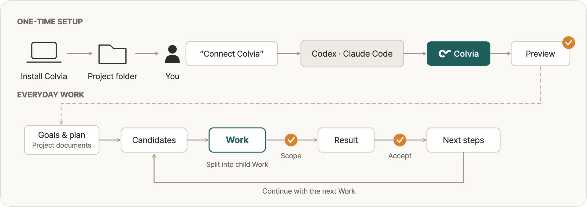
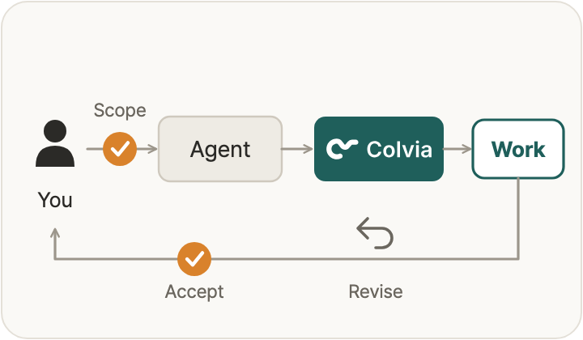

# Colvia user guide

[한국어](../ko/README.md) · English · [About Colvia](../../README.md)

This guide covers Colvia Preview. It explains how to approve a work scope in Codex or Claude Code, review and accept a result, and pick up in a new chat.

## If you are new

1. [Colvia at a glance](overview.md) — who decides what, and what is kept where.
2. [Install Colvia and connect a project](install.md) — install for your operating-system account, then connect a project folder.
3. [Follow along](tutorial.md) — write a customer inquiry report or build a team to-do web app, and try approving, reviewing and accepting for yourself.

<picture><source media="(prefers-color-scheme: dark)" srcset="../assets/gallery/overview-en-dark.png"></picture> 
<em>Install Colvia once in the account you use, then approve the connection for each folder. In a connected folder, start a new task or pick up where you left off.</em>

[Accept and apply two submissions together on macOS](work.md#grouped-acceptance)

## Returning to a project

- If you left a note before the first submission, [compare it with the files as they are now](work.md#progress-note).
- Ask “What needs my attention today?” to [see what needs review and what needs revision](work.md#project-status). You can also find [the version behind a decision](work.md#decision-history) or [the result another task is waiting for](work.md#work-dependencies).

## Using Colvia

| Guide | What it covers |
| --- | --- |
| [Assign and review work](work.md) | Starting a task, approving scope, reviewing and accepting a submission, asking for changes, picking up in a new chat, follow-ups, child Works and isolated folders |
| [Working with Git](git.md) | Registering Git, putting an accepted result into Git, recovering an interrupted Git integration, [adopting Git in a connected folder](git.md#adopt-git) |
| [Records, backups, and moving folders](records.md) | What Colvia keeps, backup and restore, continuing after moving a folder |
| [Updates, notifications, disconnecting, and removal](maintenance.md) | Updating and recovering an interrupted update, notifications, disconnecting a project, removing and reinstalling while keeping records |

<picture><source media="(prefers-color-scheme: dark)" srcset="../assets/gallery/scope-en-dark.png"></picture>

## Learn more

| Guide | What it covers |
| --- | --- |
| [Architecture](architecture.md) | Components and layers, the call path, record storage, and the Git, installation and notification boundaries |
| [Supported environments and reference](reference.md) | Supported environments, files and folders, command summary, glossary, and what to do when something goes wrong |

## Find by situation

| Situation | Where to look |
| --- | --- |
| I want to check the installed version | [Check the installed version](install.md#check-installed-version) |
| The agent can’t access a folder or the records | [If access is blocked](install.md#access) |
| I want to step away before submitting | [Save a progress note](work.md#progress-note) |
| I want to leave A and work on B | [Switch Work, pause and resume](work.md#work-lifecycle) |
| Add files before submission or during a requested revision | [Approve a table edit and a new appendix together](work.md#scope-change) |
| I want to continue yesterday’s task in a new chat | [Pick up in a new chat or with another agent](work.md#resume) |
| A submission was refused | [Delegate and review](work.md#review) |
| I want to commit an accepted result | [Put an accepted result into Git](git.md#git-integration) |
| I moved the project folder | [Continue after moving a project folder](records.md#move) |
| An update stopped midway | [If setup or an update stops](maintenance.md#update-recovery) |
| I want to stop using Colvia in this project | [Disconnect a project](maintenance.md#disconnect) |
| I want to remove Colvia and keep my records | [Remove Colvia and keep your records](maintenance.md#uninstall) |

## If you use an earlier trial build

Trial builds before the public release kept records in a `.hrn/` folder inside the project. Material for projects that still use that setup is collected under [Earlier trial reference](earlier-profile/README.md). If you started with the official installer, follow the current guide.

## Getting help

[Questions and bug reports](../../CONTRIBUTING.md#questions-and-bug-reports) · [Report a security issue privately](../../SECURITY.md#english) · [Contributing](../../CONTRIBUTING.md)
