# Colvia architecture

[User guide](README.md) · [한국어](../ko/architecture.md) · English

What Colvia Preview is made of, and the path one command takes before it becomes a record. You do not need this page for everyday use. It is for readers who want to understand the structure, diagnose a problem, or contribute to Colvia.

Read first · [Overall picture](#overview) · [Call path](#call-path) · [Responsibilities](#layers) · [CLI and View](#cli-view) · [Agent connection](#agent) · [Work lifecycle](#work-lifecycle) · [Record storage](#storage)

Read when needed · [The Git boundary](#git-boundary) · [Installation and updates](#install-update) · [Notifications and delivery](#notifications) · [Trust boundaries](#trust) · [Finding it in the source](#source-map)

## Three things to know first

1. **Colvia does not run the agent for you.** Your usual Codex or Claude Code does the work and calls Colvia commands when it needs to. Colvia’s own direct agent execution is disabled in this Preview.
2. **Records live outside the project folder.** Approvals, submissions and decisions are kept in a per-project SQLite database in the operating system’s user-data directory. The project folder holds only the launcher, connection information and guidance.
3. **Decisions are separated by kind.** Scope approval, result acceptance, Git integration and notification never stand in for one another. The whole structure is arranged to keep that separation.

A progress note before the first submission is a separate SQLite record linked to the active Work. Saving changes the latest-note reference while preserving plan approval, submission and acceptance records.

An additional approval links the previous active Work to the effective plan. The original plan and retained contents stay intact. Earlier notes compare only the files observed for that note.

<a id="overview" name="overview"></a>

## Overall picture

Arrows show calls and data flow. They are not import relationships in the source code.

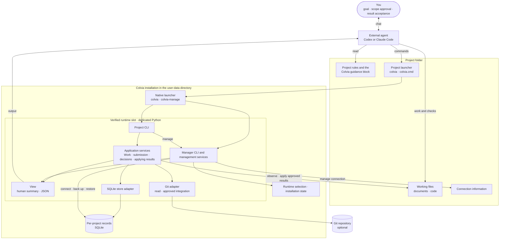

| Component | What it does | What it does not do |
| --- | --- | --- |
| You | Choose the goal and scope, grant necessary access, and decide whether to accept the result. | — |
| External agent | Reads the project rules, proposes a task, does the work, and runs the checks. | It does not stand in for your approval or acceptance. |
| Project launcher | Calls the installation’s native launcher from the project folder. | It holds no records. |
| Native launcher | Checks that the selected runtime slot is unaltered, then starts dedicated Python. `colvia` leads to the project CLI and `colvia-manage` to the manager CLI. | It never uses your own Python or `PATH`. |
| Project CLI and application services | Compare and record plans, approvals, submissions and decisions. When applying an approved result from an isolated folder or integrating into Git, they change the destination files and Git. | They do not write or check the contents of ordinary Work, and they do not call the agent. |
| Manager CLI and management services | Handle installation and updates, connecting, disconnecting and moving projects, restoring backups, Git registration and notification registration. They live in the same runtime slot as the project CLI. | They record no Work approval or acceptance. |
| View | Shows results as a human summary or JSON. | It changes no state. |
| Per-project records | Hold immutable records and retained contents. | They do not mix into the project folder or Git history. |

The notification receiver and work window are covered separately under [Notifications and delivery](#notifications).

<a id="call-path" name="call-path"></a>

## Call path

This is the representative path for `./colvia ordinary list`, which looks up project records.

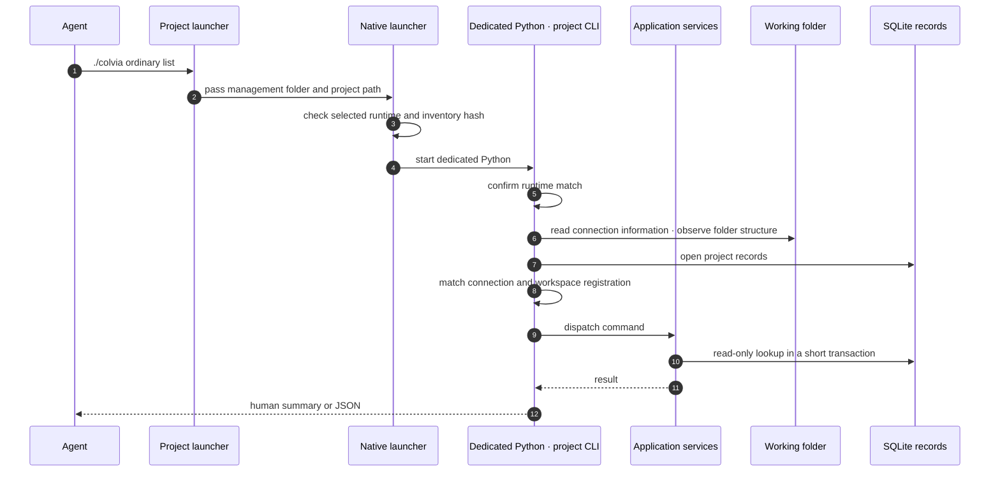

Not every command takes exactly this path.

- `guide` and `execution readiness` finish after checking the installation, without opening project records.
- `manage` and `colvia-manage` hand over to the manager CLI.
- State-changing commands use a write transaction on the same path and go through further checks specific to each command. See [The path of one write](#write-path).

When something goes wrong, the stretch where it stopped tells you what kind of problem you have.

| Stretch | What it means | Where to look |
| --- | --- | --- |
| Launcher and runtime | The launcher does not start: an installation or runtime-selection problem | [If setup or an update stops](maintenance.md#update-recovery) |
| Connection and access | A folder or record store is inaccessible, or the connection needs to be confirmed again | [If access is blocked](install.md#access) · [Moving a folder](records.md#move) |
| Command-specific checks | Colvia refused the request: a change outside the approved scope, a stale receipt, and so on | [Delegate and review](work.md#review) |

<a id="layers" name="layers"></a>

## Responsibilities

The diagram below is a conceptual map of responsibilities in the implementation. The entry assembles services and implementations, and services use storage, observation and external effects. The current code does not follow a strict one-way dependency rule in every module. Connection, backup and update code combines platform implementations directly in places.

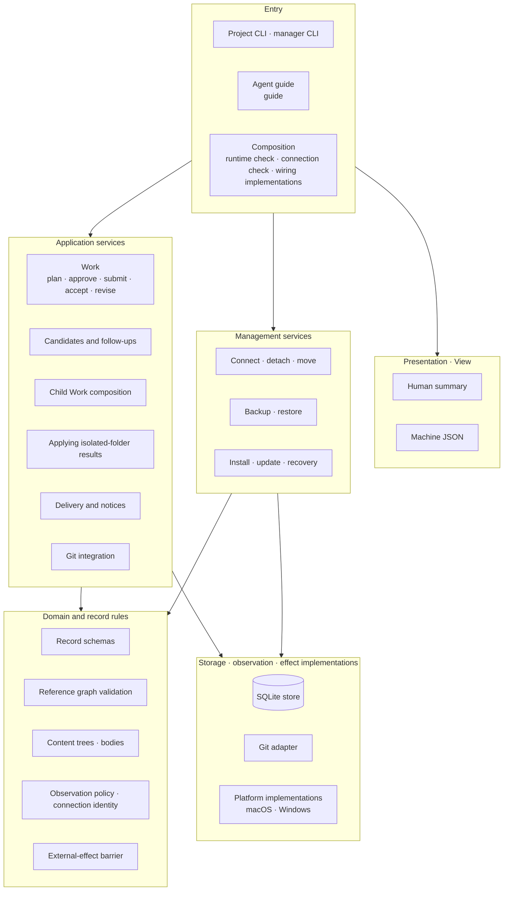

| Area | Responsibility | Boundary it aims to keep |
| --- | --- | --- |
| Entry | Parses commands, checks the runtime and the project connection, and wires implementations into services. | Never substitutes Python from `PATH` or a source checkout. |
| Presentation (View) | Shows results as a human summary or JSON. | Presentation is read-only. Opening a screen changes no state. |
| Application services | Compose the user flows such as plan, approval, submission and acceptance. | Screen output and agent calls are kept out of the record rules. |
| Management services | Compose the flows that deal with the installation and project connections, such as connecting, backing up, installing and updating. | They do not record a Work approval or acceptance on your behalf. |
| Domain and record rules | Define the meaning of a Work, acceptance and references, the record formats, and scope decisions. | The meaning of a decision does not vary by operating system, Git or app name. |
| Storage, observation and effect implementations | Implement SQLite, Git, and macOS and Windows features. Storage, observation and effects are attached to services across replaceable boundaries. | An unsupported environment never falls back to another operating system’s implementation. |

Source locations are listed under [Finding it in the source](#source-map).

<a id="cli-view" name="cli-view"></a>

## CLI and View

There are two entry points. The project CLI works with the Works of one project; the manager CLI works with the installation and project connections. The project launcher’s `manage` leads to the manager CLI of the same installation.

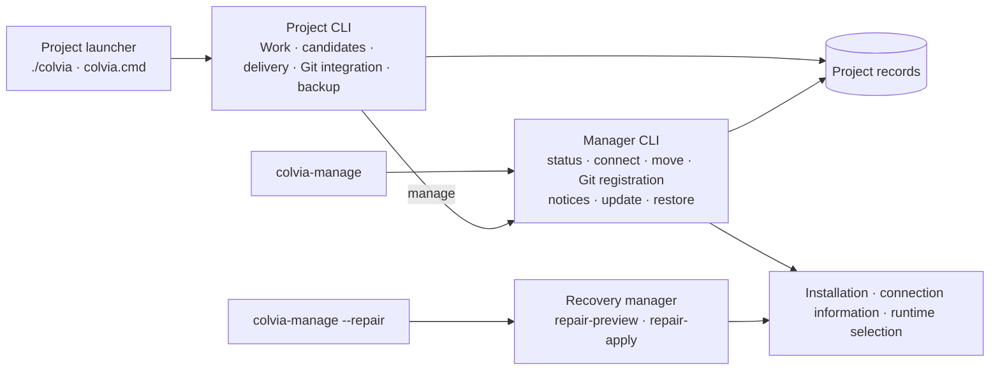

Most state-changing commands are split into two steps, in the order **preview → receipt → apply**. The receipt returned by a preview is bound to what was shown, so applying is refused if the target changed in the meantime. This keeps what you reviewed and what is applied the same.

CLI results are a human summary by default, and `--json` exposes the machine fields.

| Form | Used when | Characteristics |
| --- | --- | --- |
| Human summary | The agent explains something to you in chat | Titles, states and the decision needed. Identifiers needed for a related Work or a diagnosis can appear here too. |
| JSON (`--json`) | The agent needs values for its next command | Includes machine fields such as Work IDs, receipts and revision numbers. |

The work window that opens when you click a notification is a separate screen from CLI output. It distinguishes the original result the notification points to from the current state.

The main commands are in the [command summary](reference.md#commands).

<a id="agent" name="agent"></a>

## Agent connection

Colvia installs no plugin into the agent. When you connect a project, it appends a short guidance block to the agent instruction files, and the agent follows that guidance to call the launcher. This is the general flow when the agent is asked for a change.

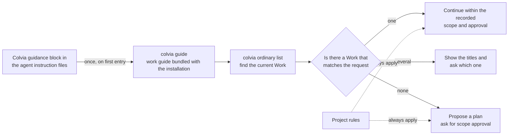

- If a Work is waiting for a decision from you, the agent presents that decision first.
- A lookup, or a small correction you ask for directly, can be handled without a new Work. See [what you can do without a Work](work.md#without-work).
- **The guidance block** is added when you connect and removed when you disconnect. Your existing project rules continue to apply.
- **`guide`** reads the work guide bundled with the installation. The launcher returns it only when the file matches the hash in the release inventory. It does not open project records.
- **The same launcher** serves both Codex and Claude Code, which is why the same records can be found after switching chats or agents.

<a id="work-lifecycle" name="work-lifecycle"></a>

## Work lifecycle

A Work passes through five phases. Each transition adds records and never edits earlier ones.

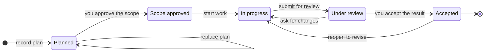

| Transition | Who decides | What is recorded |
| --- | --- | --- |
| Record plan | The agent proposes | Goal, file scope, checks, exclusions, a baseline observation of the working folder, and the existing contents of the files in scope |
| Approve scope | You | Which plan you approved, and your approval statement |
| Start work | The agent | Colvia compares the current folder with the baseline recorded at planning and adds a new record for the in-progress state. |
| Submit for review | The agent | Changed contents, a summary, and passed, failed or unavailable for each planned check |
| Accept result | You | Which submission you accepted, and your acceptance statement |
| Ask for changes | You | The revision request. The original scope, checks and previous submission are kept |

At submission, Colvia observes the working folder again and refuses the submission if the observed files include changes outside the approved scope. At acceptance, it compares the current files with the submission you reviewed once more. An accepted Work can be archived; its contents, decisions and follow-up links remain readable afterward.

<a id="storage" name="storage"></a>

## Record storage

### Folder layout

The installation and the records sit together in one place in the operating system’s user-data directory: `~/Library/Application Support/Colvia` on macOS and `%LOCALAPPDATA%\Colvia` on Windows.

```text
Colvia/
├─ bin/                    native launchers colvia and colvia-manage, the notification receiver on macOS
├─ notification-tools/     the notification receiver on Windows
├─ runtime/                runtime selection and immutable runtime slots
│  └─ slots/<slot>/        dedicated Python, Colvia code, bundled guides, release inventory
├─ authorities/
│  └─ <project ID>/        the records of one project
│     ├─ active.json       pointer to the current store generation
│     └─ stores/<generation>/state.sqlite3
├─ backups/                recovery copies of records made before an update
├─ operations/             records of management operations in progress or finished
└─ trust/                  trust state used to verify updates
```

The project folder holds only the launcher, connection information and the guidance block in the instruction files. Connection information is kept in `.colvia-link.json` at the top of a plain folder, or in `colvia/connection.json` in the common Git directory of a repository. In a Git repository, the working tree therefore shows only the launcher and the changes to the instruction files.

### One project, several workspaces, one active generation

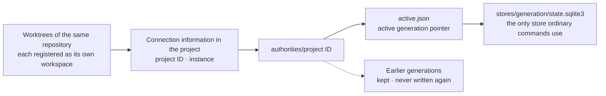

Ordinary commands use only the one generation the active pointer names. An operation that replaces the whole store, such as a restore, never overwrites the existing database file. It creates a new generation and then moves the pointer. Writes can be blocked while a generation switch is in progress. Earlier generations are kept and are never written again. If the instance named by the connection information differs from the active pointer, Colvia treats the connection as stale or foreign and does not open it.

A project has one set of records, and each worktree of the same repository is registered as its own workspace under that project connection. A Work belongs to the workspace it was created in.

### Inside SQLite

The database has a small number of tables. The meaning is not in the tables but in a **reference graph of immutable objects**.

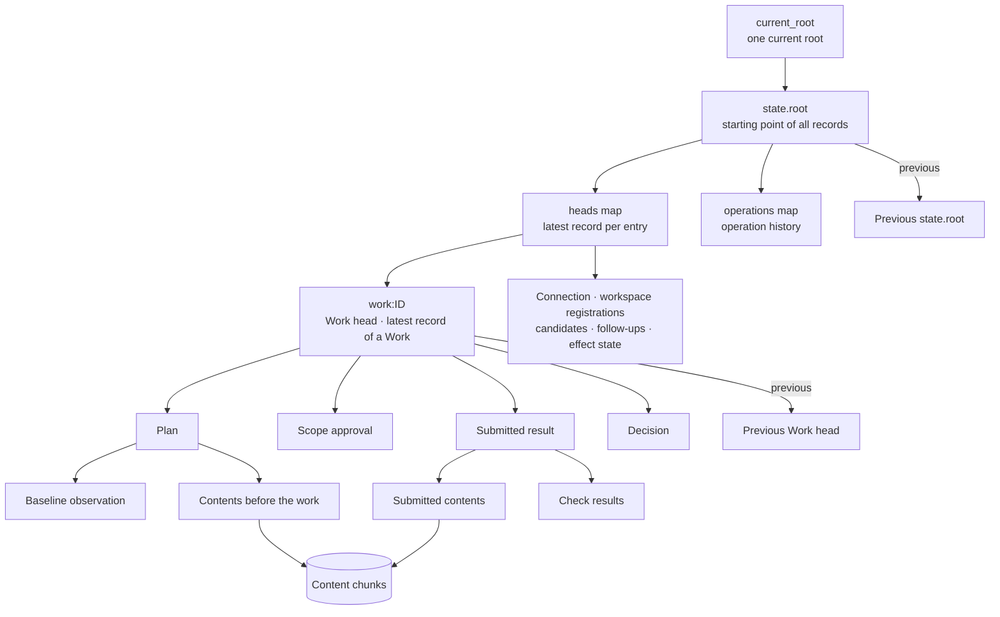

| Table | What it holds |
| --- | --- |
| `objects` | Every record and content chunk. The hash of the content is its identifier, and a published object cannot be modified or deleted. |
| `current_root` | A pointer to the single current state root object |
| `operations` | The root before and after each operation ID, so the same operation is never applied twice |
| `imports`, `claims` | Intermediate state while large contents are brought in as chunks |
| `generation` | The project, instance and generation identity, write fencing and suspension, and whether reconnection is needed |
| `requirements` | The capabilities needed to read and write these records. An update compares them with the new runtime. |
| `restore_origin` | The origin of restored records and whether the restore completed |

- **Content addressing.** An object is identified by kind, version, size and hash, and is checked again every time it is read. Human-readable titles are never keys.
- **Append only.** Asking for changes or reopening an accepted Work adds new records and never edits past ones. Database triggers enforce the immutability as well.
- **Archiving is not deletion.** An archived Work keeps its contents and decisions. Records are never cleaned up automatically.
- **A listing is not the source of truth.** Lists and summaries are lookup results rebuilt from the records each time.

<a id="write-path" name="write-path"></a>

### The path of one write

This example is a Work change that needs a workspace observation and retained contents, such as a submission for review.

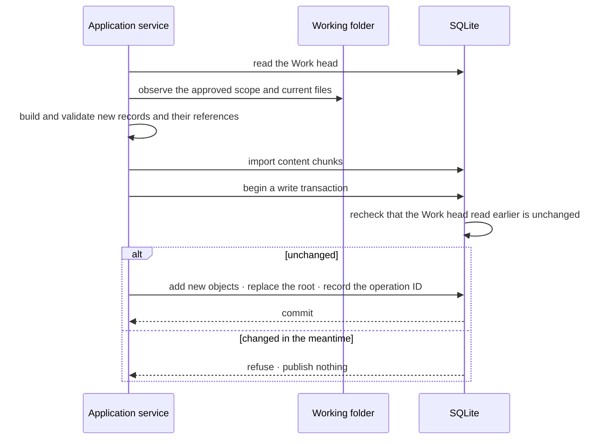

Transactions are kept short, and a writer rechecks that the basis it read is still current before writing. Changes to different Works do not overwrite each other, and a write to the same Work from a stale basis is refused. Storage settings favor durability over speed: SQLite is opened in rollback-journal mode with `synchronous=EXTRA`, plus `fullfsync` on macOS.

Operations that leave an effect outside the records, such as updating Git’s ref and index, replacing destination files with a result from an isolated folder, delivery and disconnection, first record their intent before starting that effect. The code calls this the external-effect barrier, and there is one per project. If one stops midway, that record remains, and no other write can slip in until its outcome is established. Recovery of the stopped operation itself can continue.

<a id="git-boundary" name="git-boundary"></a>

## The Git boundary

Colvia handles Git in three stages. Your current branch and staging area change only after you review a candidate and approve it separately.

| Stage | What happens to Git |
| --- | --- |
| Ordinary observation | Reads the repository structure, working tree and index. Changes nothing in the repository. |
| Candidate preparation | Creates the candidate Git objects and preparation record. The next Preview first runs the [credential check](git.md#git-credential-check). The current ref and index are not changed. |
| Apply after approval | Applies the reviewed candidate to the ref and index. Changes staged for other files are preserved. |

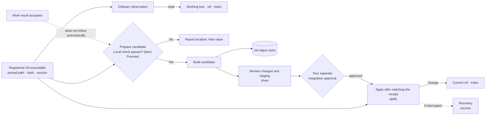

- **The executable is pinned.** Colvia does not look for Git on `PATH`. It uses only the executable you approved and registered, and checks on every use that its hash still matches the registration.
- **Observation leaves the repository untouched.** No fetch, index refresh, hook execution, checkout or Git metadata write.
- **Acceptance is not a commit.** An accepted submission stays in Colvia records, so you can compare it later without a work-in-progress commit.
- **Staging is preserved.** The whole index is retained before integration, and changes staged for other files are kept. When conditions are not met, Colvia stops instead of disabling hooks or resetting the index.
- **Moving between workspaces is a separate operation.** Moving a submission from one workspace to another is approved one submission at a time.

### Credential screening · Next Preview

For supported images and fonts with matching extensions and signatures, the preview and JSON identify each file and its format. The preview omits their contents because they were not scanned for credentials.

Adding or editing a protected path, or detecting a recognizable credential, stops preparation before new Git objects are written. A candidate that passes still needs separate approval to update the branch and staging area. When a protected file is deleted, the preview shows the deletion and withholds its former contents. [What the check covers](git.md#git-credential-check)

The procedures are in [Working with Git](git.md).

<a id="install-update" name="install-update"></a>

## Installation and updates

This is the flow when an update runs to completion.

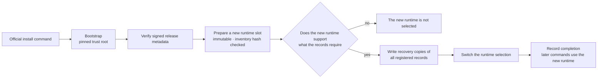

A verification or compatibility refusal leaves the new runtime unselected. An interrupted activation may already have changed the runtime selection, so inspect the update status first.

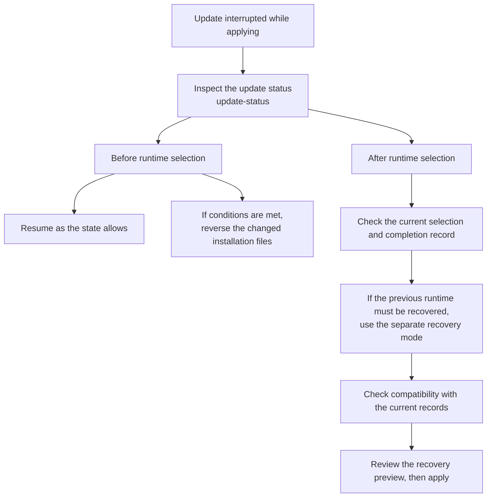

- **A download is not an installation.** A new release is only prepared in a separate slot, and the selection changes only after verification and the compatibility check both pass.
- **Runtime slots are immutable.** Dedicated Python and the Colvia code sit together in a slot, and the native launcher checks the selected slot’s inventory hash on every start.
- **Reversal and recovery are different procedures.** Reversing installation file changes made before the selection switched is one thing; recovering by selecting a compatible previous runtime is another. Recovery is not an ordinary manager command. You review a preview in the separate recovery mode started with `--repair` and then apply it.
- **A runtime lease guards the switch.** A lease is a lock on the runtime selection. Each record transaction in an installation takes a shared lease and checks the runtime selection. Switching the selection during an update takes the lease exclusively. Once the selection has changed, further record access from an earlier process is refused.
- **Records and runtime move independently.** In no case are Work records rewound to an earlier point. Removal and reinstallation likewise leave records, project connections, settings and trust state in place.

The procedures are in [Updates, notifications, disconnecting, and removal](maintenance.md).

<a id="notifications" name="notifications"></a>

## Notifications and delivery

Delivery is a single step that hands off submission of a result that is already prepared. The notification is a separate send requested after it.

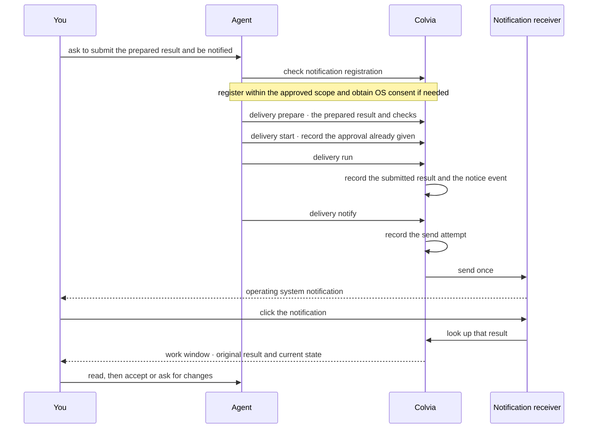

A notification is only a shortcut back to a result. A notification event is a pointer to a record, and the fact that a notification was displayed or clicked is not acceptance. When delivery is uncertain, Colvia does not automatically send the same notification again. If you miss a notification, the result is still in the project records.

<a id="trust" name="trust"></a>

## Trust boundaries and limits

| What Colvia aims to guarantee | What it does not guarantee |
| --- | --- |
| It records which plan you approved and which submission you accepted, bound to the exact contents. | It does not authenticate who made a decision. It trusts the same device account. |
| It compares changes in the observed files with the approved scope and stops the submission when it finds a change outside the scope that is not allowed. | It is not a security sandbox. It does not prevent an agent or another program from editing files. |
| It verifies integrity when reading records, and stops on corruption instead of silently falling back to an earlier state. | It cannot stop an attacker using the same account from rewriting all the records. It provides no encryption. |
| It assumes durability on local APFS and local NTFS. | It does not guarantee the safety of records kept on a network share or in a synchronized folder. |
| It keeps the records and decisions of several Works without one overwriting another. | It does not coordinate several agents editing the same files at once. |

The files an agent can read and write and the tools it can run are set by the app or CLI’s permissions, not by Colvia. Messages and materials you share with an agent follow the AI service’s data handling settings.

### Optional feature · document execution

A feature in which Colvia calls an agent directly to edit a document remains in the code as an optional module, but it is disabled in this Preview and a request to enable it is refused. Ordinary Work runs without this module. You can inspect the current state with `execution readiness`.

<a id="source-map" name="source-map"></a>

## Finding it in the source

Paths are relative to `src/colvia` in the Colvia source repository.

| Area | Main locations |
| --- | --- |
| Entry and composition | `managed_entry.py`, `manager_entry.py`, `cli.py` |
| Presentation | `presentation.py` |
| Application services | `work.py`, `rework.py`, `planning.py`, `composition.py`, `worker.py`, `delivery/`, `git_integration.py` |
| Management services | `management.py`, `project_setup.py`, `lifecycle.py`, `move_setup.py`, `backup_service.py`, `restore_manager.py`, `updates/` |
| Domain and record rules | `records.py`, `schemas.py`, `codec.py`, `graph.py`, `maps.py`, `tree.py`, `bodies.py`, `observation.py`, `binding.py`, `effects.py` |
| Store | `storage/sqlite.py`, `storage/authority.py` |
| Git and workspaces | `adapters/git.py`, `observe.py`, `workspace.py`, `git_registration.py` |
| Platform implementations | `platforms/` |
| Optional feature | `execution/` |
| Native launcher | `distribution/foundation-launcher/` in the repository |

---

[Back to the user guide](README.md) · [Supported environments and reference](reference.md)
