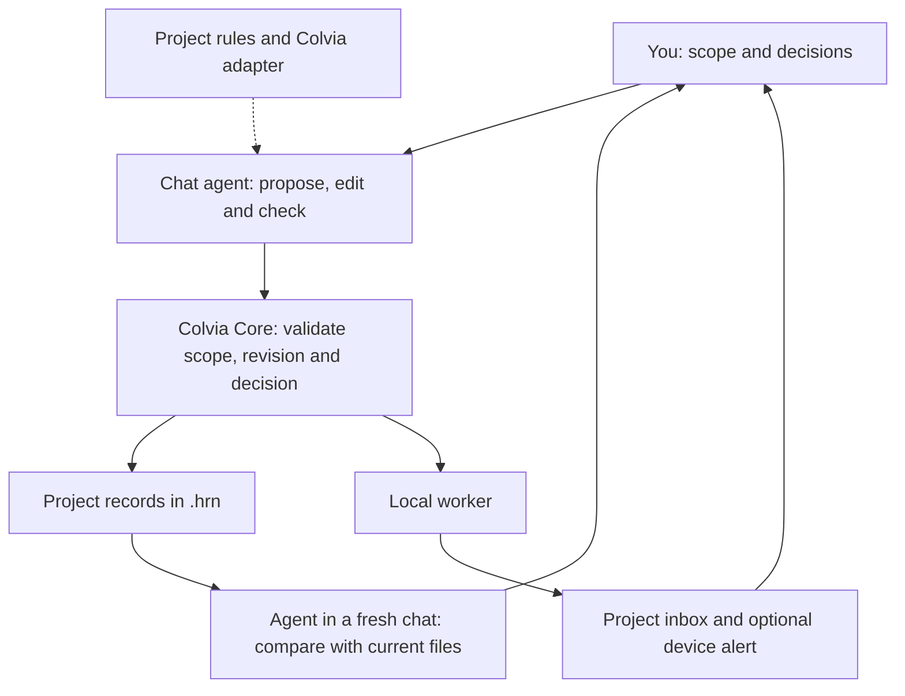
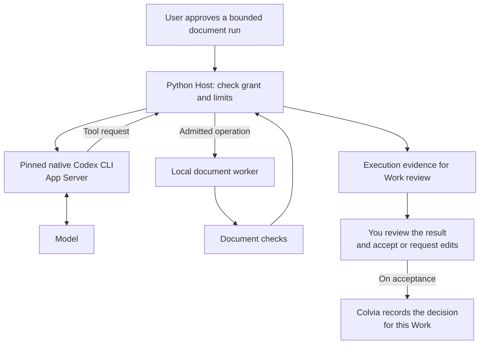

# How Colvia works with an agent

[User guide](README.md)

You can use Colvia with Codex or Claude Code to agree on a task, review the result and pick up the work in a new chat. You follow the same steps in Claude Code to set the scope and decide whether to accept the result.

The optional macOS document runner described later is a separate feature. Its Python Host calls a pinned version of the Codex CLI.

In everyday use, you agree on the scope. The agent reads the project's instructions, prepares a plan and makes the authorized changes. The adapter gives the agent a procedure for turning a request such as “show me yesterday's result” into the right project lookup. Colvia Core checks the relationship between the request, the selected revision and the acceptance decision. It keeps these records under the project's `.hrn/` directory so the next chat can find them.

Project rules tell the agent which source to use and which checks matter here. Colvia's rules govern how a proposal becomes an authorized task and how a particular result gets accepted. In the inquiry report, the manager chooses which improvement to pursue. An approval quoted in an old meeting note cannot authorize the new edit.

## From one request to the next

1. **Agree on the task.** Identify the inputs, files to change and checks. The user accepts the request.
2. **Edit and check.** A Work can go through several rounds within the agreed time, scope and attempt limits. This is the work loop. A material change of scope requires a decision.
3. **Submit and review.** The submission identifies a revision and its evidence. On resume, compare that revision to the files as they stand now.
4. **Accept or request another edit.** Review the submitted revision and decide whether to accept it. Grouping and delegation are advanced paths outside the first Preview everyday scope. A parent Work (umbrella) can depend on specified direct children. Accepting those results and accepting the integrated result are separate steps. A narrowly scoped delegation can cover acceptance of one eligible ordinary isolated-worker result for a named delegate. Initial intent and parent acceptance remain human decisions.
5. **Choose what comes next.** Recording a candidate for follow-up gives you something to return to. Executing it needs its own authority.

## Inbox steps and optional document execution

**The project inbox** takes one supported step and a deadline, such as summarizing a Work or submitting a prepared change. A notice helps you find the result. If the worker stops early, check the process outcome separately from the effect on the documents.

**The optional macOS document execution path** uses a Python Host. It checks the authorized inputs, edit range and limits and talks to a pinned Codex CLI through its App Server. A local worker carries out the reads and edit admitted by the Host. After the edit, the worker checks links, Markdown structure and the required or forbidden text specified for that run. Completing the run leaves acceptance of the Work for a separate decision. See [environments and limits](work-guide.md#limits-en) for the required macOS and Codex setup.

A successful run supplies evidence for review. The user still decides whether to accept the Work result.

[Back to the user guide](README.md)
