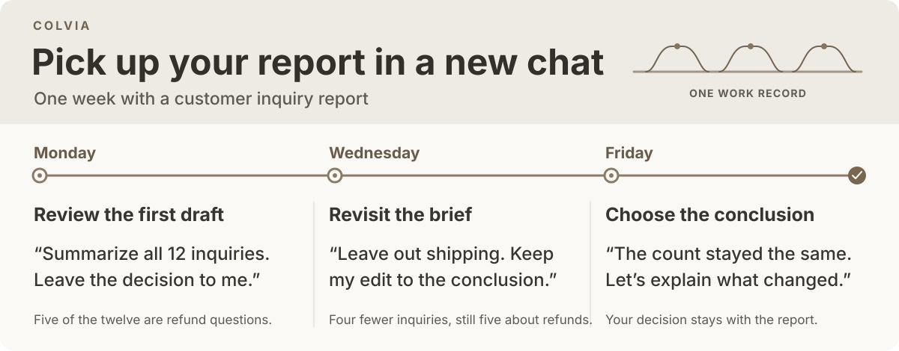

# What does Colvia remember?

[User guide](README.md)

If the conclusion looks different when you open yesterday’s report, start with the draft you accepted. Colvia keeps the decision tied to that draft.

“Check the counts. Leave the choice of improvements to me.” When the report arrives, you can see which figures were checked and which decision is still yours.

In the next chat, compare the draft you reviewed with the file as it stands. If you have edited the conclusion yourself, decide whether to keep that wording before continuing.

You can revise and review a draft several times within one task. Reviewing several tasks together under a parent is an advanced workflow, provided as reference material outside the first Preview everyday scope. See [environments and limits](work-guide.md#limits-en).

To step away, hand off one supported step, such as submitting a prepared change for review. Once you confirm, Colvia runs that step on this device. Questions and results appear in the local project inbox. When you return, check the inbox to see what was recorded, including whether a step stopped early.

[How the agent and Colvia share the work](architecture.md)

## Who makes the decision?

You approve the scope and decide which result to accept. Colvia trusts the local account, so a role recorded in the project does not authenticate a person. Other programs can edit the files. Git tracks file history separately from the acceptance record. You decide when to commit or publish.

[Back to the user guide](README.md)
