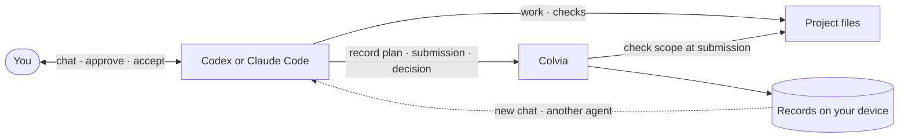
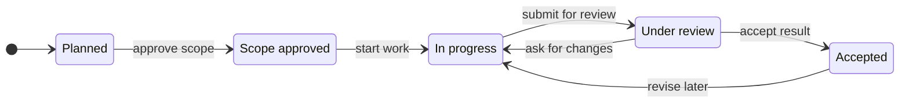

# Colvia at a glance

[User guide](README.md) · [한국어](../ko/overview.md) · English

Colvia is a local workflow tool for working with AI agents. Approve the scope proposed by Codex or Claude Code, then review the result and decide whether to accept it. Colvia keeps approvals and submissions on your device. Open the same project to pick up the work in a new chat or with another agent.

[Who does what](#roles) · [Three decisions](#decisions) · [The flow of one Work](#work) · [What is kept where](#where) · [What Colvia does not do](#not)

## Who does what

| Who | What they do |
| --- | --- |
| You | Choose the goal and scope, grant necessary access, and decide whether to accept the result. |
| Codex and Claude Code | Read the project rules, propose a task, do the work, and run the checks. |
| Colvia | Checks file changes against the approved scope at submission. Keeps plans, approvals, submissions, and decisions on your device so the agent can find and resume the same Work. |

Colvia has no chat window of its own. You ask in your usual chat, and the agent calls Colvia when it needs to.

## Three separate decisions

Granting file or command access in the app or CLI, approving the scope of a Work, and accepting the submission you reviewed are separate decisions.

| Decision | Where you make it | What it means |
| --- | --- | --- |
| Granting access | The app or CLI’s permission prompts | Which files the agent can read or write and which tools it can run |
| Approving scope | In chat with the agent; Colvia records it | You entrust the work with this goal, file scope and checks. |
| Accepting a result | In chat with the agent; Colvia records it | You accept the submission you just read. |

If [an out-of-scope change blocks submission](work.md#review), your files stay in the folder. Review the changes and resolve the issue before submitting again.

A [result notification](maintenance.md#notifications) opens the Work for review. Read the submission and decide whether to accept it. To [commit an accepted result to Git](git.md#git-integration), review the proposed changes and the current staging state, then approve the commit separately.

Starting in v0.2.0, Colvia checks for known credential patterns and protected paths when you prepare a commit through Colvia. [What the credential check covers](git.md#git-credential-check)

## The flow of one Work

Colvia records each task you scope and review as a **Work**.

1. **Approve the scope.** The agent proposes source material, files to create or change, and checks for the result.
2. **Review the submission and checks.** The agent submits the result and tells you which checks passed, failed, or could not be run.
3. **Accept the result or ask for changes.** If the requested changes fit the approved scope, continue in the same Work.
4. **Record what comes next when you need to.** A new chat can find that decision along with the result.

Some things need no Work at all, such as a short question, looking up a file, or a typo fix you ask for directly. See [what you can do without a Work](work.md#without-work). The full guide is [Assign and review work](work.md).

## What is kept where

| Location | What stays there |
| --- | --- |
| The project folder | Your documents and code, the project launcher, connection information, and Colvia guidance in the agent instructions |
| The operating system’s user-data directory | Each project’s records of plans, approvals, submissions and decisions, and the Colvia installation |
| The Git repository | Commits you approved separately. Colvia records do not go there. |

As a result:

- Close a chat or switch agents, and you can still find the records by opening the same project.
- Disconnect a project or remove Colvia, and your files and Work records remain.
- A Git commit or clone does not back up Colvia records. Use [backup and restore](records.md#backup).
- The existing contents of files in a plan, and submitted contents, stay in records and backups. List only the files the work needs. See [what Colvia keeps](records.md#retained-contents).

## What Colvia does not do

- **It does not control file access.** Use the app or CLI’s permissions to control what the agent can read, write, or run. Apps and agents can edit files they have permission to change. At submission, Colvia checks changes in the files it tracks against the approved scope and stops the submission if it finds a change outside that scope.
- **It does not run agents itself.** Colvia’s direct agent execution is disabled in the first Preview.
- **It does not coordinate concurrent editing by several agents.** Keeping several Works is different from letting several agents edit the same files concurrently.
- **It does not put results into Git automatically.** You review the changes to commit and the staging state, then approve separately.
- **It does not handle your conversations.** Messages and materials you share with an agent follow the AI service’s data handling settings.

Components and record storage are explained in [Architecture](architecture.md).

---

Next · [Install Colvia and connect a project](install.md) · [Follow along](tutorial.md)
