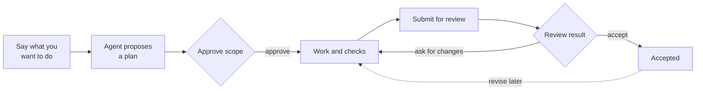

# Assign and review work

[User guide](README.md) · [한국어](../ko/work.md) · English

How to assign work in a connected project, review a submission and accept it or ask for changes, and pick the work up in a new chat. Colvia keeps the goal, file scope, checks, submission, and decisions together in a **Work**, a single recorded task.

[Start](#start) · [What needs my attention today?](#project-status) · [Delegate and review](#review) · [Pick up in a new chat](#resume) · [Revise an earlier result](#revise) · [Find a recorded next step](#follow-up) · [Child Works and isolated folders](#child-works)

The two diamonds are your decisions. Approving the scope entrusts the work; accepting is a decision about the submission you just read.

## Start with the work you want to do

Once the folder is connected, tell the agent what you want to do here in the current chat. A sentence or two is enough. The agent may ask:

> The folder is connected. Tell me briefly what you’d like to work on here.

> I’d like to set up a small project to track action items from our team meetings.

In a folder without project material, the agent can explain what it sees and help turn an idea into a goal and a first task. You might say, “I’d like to summarize the meeting in one page.” If you have already shared a goal or task, the agent can use that request and any existing brief, README, or project rules to propose a plan.

For a document, ask for an outline and a way to check it. For a new app, ask for a first version, a recommended stack and a way to run and test it. For example, a personal to-do list that runs in one browser can start with a small web page and browser storage. For a team list, review the proposed way to share the data and control access as part of the first version.

If you already know what to do, ask for it directly. The agent can answer a short question or inspect files within the access already allowed.

You can discuss project goals and rules later, or include them when you review the proposed scope. Check the file names and changes before approving that scope. Before recording the plan, review [what Colvia keeps](records.md#retained-contents). In a workspace with many files, recording a plan or submitting a result may take longer. If the command is still running, wait for it to return a result.

### Record decisions and reasons where your team can find them

Try “Record why we chose batch delivery over sending each item separately, using our team’s usual format.” If your team uses a brief to compare options and a decision record to explain what it chose and why, the agent follows that convention. If the record and its index both need edits, the agent proposes both files in one plan. If the team is still deciding, the agent records the alternatives and open question in a draft. You can accept the wording of that draft while the policy still awaits team review.

Once the record is in the shared repository, colleagues can sync their checkout and follow the usual index to find the decision’s status and rationale. You can reopen the version you accepted in Colvia on your device.

Colleagues need wiki access to read a decision kept only in the team wiki. If the repository has no link, syncing alone won’t help them find it. Where team sharing rules allow, the agent can propose adding a link to the existing index. If the agent lacks write access, it can prepare wording for someone who can post it. In a folder without a shared format, an existing note suitable for the intended readers can be enough.

The agent reuses a check result when it covers the same change under the same conditions. It briefly explains a project rule when the rule changes what you can expect. For instance, if committing a document automatically publishes it and you only authorized a draft, the agent prepares the draft and stops before committing to explain the publication step.

### What you can do without a Work

To refine a result, ask “Could you also fix the last example in the guide I just accepted?” If the goal and approved scope still fit, your agent continues in the same Work. You can request a change while reviewing a version or after accepting it. Earlier versions and decisions stay on record, and you can review and accept the next version.

For an independent correction, just ask “Update the list-work example in the README to use the current command.” The agent checks the current version’s command help to find the right command for that example. If the answer is clear and immediately verifiable, your project rules and granted access allow the edit, and no separate review, retained result or handoff is needed, the agent corrects the example and reports the change and check without opening a Work. The same applies to a typo that leaves the meaning intact.

Use a Work when you need to choose between disconnecting a folder and deleting its data, or when an error in deletion or permissions guidance could cause harm. Also use a Work if your project requires review or you want a record of the submission and your decision. If another file needs to change, the agent explains why and proposes the extra scope before editing it. You decide separately whether to apply changes to Git.

## Delegate and review

> Summarize the types of customer inquiries and the complaints that come up most often in a report for our meeting. I’ll decide which improvements to prioritize.

1. **Approve the scope.** The agent proposes files to work on and how to check the result. If you agree with the scope, tell it to proceed. Colvia records which plan you approved.
2. **The agent drafts, checks, and revises.** For example, if the counts by inquiry type don’t add up to the total in the source, the agent can correct the report within the scope you approved and check the total again. If it needs another file or different check criteria, it proposes the change and waits for your approval.
3. **Review the submission and checks.** When the work is ready, the agent records the check results and submits it for review. Colvia checks scope at submission and blocks results that include changes outside it. If Colvia blocks a submission, the changes already made stay in the work folder. Check those changes and resolve the issue before submitting again.
4. **Accept the result or ask for changes.** Read the submission and decide whether to accept it or ask for changes. Colvia records which submission you accepted.

The app or CLI’s permission prompts control which files the agent can read or write and which tools it can run. Review the Work scope and its submission separately.

Before recording ordinary Work acceptance, Colvia compares the current files in that Work’s folder with the submission you reviewed. If the files have changed, review the changes and submit again.

### Archive an accepted Work

You can archive a Work once it is accepted. Archiving does not delete records or free storage. Its submitted contents, decisions and follow-up links remain available afterward.

## Switch to another Work or take a break

Say “Leave A as it is and open B.” Opening B’s plan or submission leaves A in its current state. You can work on C and then return to A. To mark where you want to return, say “Pause A. Next time I’ll check the sources for the table.” Confirm the Work and review the edits that will stay in the folder.

Ask to resume A. Active work returns to its approved scope. A submission awaiting review returns to the same review. Check changed paths and any files Colvia could not compare. Colvia compares up to the first 128 approved paths in sorted order and reports how many fall outside that observation. Other Work can change files in the same folder. Resuming keeps the files as they are. If a submitted file has changed, review the changes before accepting a result.

To end A, ask to discard it and confirm the reason. Files, approvals, notes and submissions remain available. If the goal has changed, ask to replace A with B. Select an existing B or record a plan for a new B first. The decision records both the end of A and its successor. B keeps its own scope and approval.

The current list hides archived and discarded Work. Open the full list or look up a Work by ID to see it again. Restoring an archived Work returns it to the completed list. Once you record a lifecycle decision, older launchers cannot open the project or restore a new backup.

## Step away before submitting

On an active ordinary Work, say “Save our progress for tomorrow.” The agent records what it did, what it checked, what remains and what to do next. If you just say “Let's wrap up,” it asks whether to save. Saving leaves the Work active.

In a new chat, say “Pick up where we left off.” The agent reads the note and approved scope, then compares the files with their state when the note was saved. If the note says to check a source and the report has since changed, inspect the report first. Unavailable comparisons are shown separately. Checks mentioned in a note do not count as a submission's check report. After a submission is sent back, resume from its revision request. A Work that returns to the same approved plan can use its earlier note. After a file addition, the note still compares the paths it observed. Newly approved files have no comparison until you save another note.

Once the first note is saved, this project's records and subsequent backups require a version that supports notes. If you might return to v0.2.0, keep a separate [backup](records.md#backup) before saving that first note.

## What needs my attention today?

Ask “What needs my attention today?” in a connected folder. For one Work you get its title and next action on one line. When several are shown, the ones awaiting your review appear first among those checked. You can see what needs your review, where a reviewer requested changes, where a progress note left off, and why a Work is paused. You can start without entering priorities or dependencies.

Try “Show me revision 2 of the proposal.” If the overview you just saw showed a submission awaiting review, this opens that version. If it showed a change request, you can see the version the reviewer read and what they asked the agent to change. Ask “Has a new revision arrived?” to check again. If titles match, use the file name to tell them apart.

A partial overview suggests what to look at among the records checked. Ask “Show the next page” to see just that page. Ask “What needs my review across the whole project?” to include the remaining pages. To see ideas for future Work, ask “Show the candidates by priority too.” Candidate ranks appear separately. Giving a candidate a high rank does not authorize starting it.

## Pick up in a new chat or with another agent

In a new conversation, open the same project and ask, “Show me only what I need to review in the report I assigned earlier.” When the agent can access the project folder and Colvia records, it can find the approved scope, the last submission, differences from the current files, and any recorded next step.

If you use both Codex and Claude Code, you can switch between them in the same project. The new agent can find the records when it can read both the connected folder and the Colvia record folder. If the app created a Git worktree, first confirm which project it belongs to.

You can pick up a coding task the same way.

> Show me what changed since the file-upload update I accepted and what I need to review again. Did we test resuming an interrupted upload?

The agent can compare current files with the accepted submission and show which checks passed, failed, or could not be run. If a check was never recorded, the agent can tell you that.

## Revise an earlier result

To revise an earlier result after working on something else, tell the agent what to change. The agent checks the recorded request, approved scope, and changes since the last submission. If the approval is still valid and the requested changes fit the scope, continue in the same Work. Colvia can attribute a file to the other Work that added and submitted it when its current contents match that Work’s retained submission. The agent reports the affected files for unattributed changes and outside-scope edits or deletions. Your draft is preserved; you decide whether to accept the result after review.

You can review and accept such a revision in the workspace where you made it. Applying it to a different workspace is outside the current scope.

### When files outside the approved scope are needed

Before editing, tell the agent “Show me what it would take to update the table and add an appendix to this proposal.” Before the first submission, or once you have asked for changes to a submission in the same ordinary Work, the agent shows the files to edit or create, the reason and any extra checks. Approve that proposal to add both files. The original approval, edits and progress note stay with the Work. Review and accept the proposal and appendix in one submission.

An existing file must still match the original observation. Colvia saves its original contents on approval, including in subsequent backups. A new file must have an exact unused path in an existing folder, both at preview and when the approval is recorded. If it was already created, approval cannot be backdated. Use the primary work folder for this operation. If the path is occupied, protected, ignored or ambiguous, review the indicated path before continuing. Use a follow-up Work for a different goal.

For example, if you sent back revision 1 to ask for sources, ask to see the scope change before editing the source table. Check the revision number, your request and the proposed files. Accepting the scope change lets the agent submit revision 2 with the table. You can still open revision 1 with its original scope and wording. If another Work submits changes to an added path, or Colvia cannot compare the relevant records, submission stops. Keep both drafts and review the affected path. If the changes cannot be separated, pause or explicitly discard this Work and continue in a new Work. A scope approval does not lock the file. If this Work submits first and another separately approved Work submits the same file later, both submissions remain available for review. Colvia can compare recorded submissions but cannot identify who made an unrecorded edit.

After you approve an addition during revision for the first time, opening these records or restoring a new backup requires a version that supports additions during revision. Additions before the first submission also require a version that supports those additions. If you need to return to an earlier version, keep a [backup](records.md#backup) before approval.

## Find a recorded next step

Ask “What did we decide to do after the meeting report?” The agent can look up the Work using `ordinary list`, then use `ordinary view WORK_ID` for the Work or `followup WORK_ID` for its recorded choice. Use the same project launcher for each command. `candidate list` shows saved candidates and any Work already linked to them. These commands only read.

The record distinguishes a choice you have never made, a decision to leave no follow-up, and a decision deferred until later. A selected candidate or Work appears with its name and status. If a plan or candidate has changed, the display tells you the choice was about the earlier record. Check that follow-up Work's own approval before starting it. Reuse a recorded approval that still covers the scope.

### Try it · Pick up a meeting report in a new chat

If you’ve submitted a meeting report in the same connected project, open a new chat and ask:

> Find the meeting report Work and show me its latest submission status and any recorded follow-up decision. Just look it up.

If the record says “No follow-up,” you recorded a decision to leave it without a follow-up. If there’s no recorded choice or you deferred the decision, the next step is still open. If you see a candidate or a Work, check whether the work you would continue already has an approved scope.

## Find out why you asked for a change

Ask “Why did we remove the market-size figure from the proposal?” In the same Work you can find the version you reviewed, what the revision request said, and whether you accepted a later version. Ask to see that earlier version if you need to check the wording in the file.

If the request said “Remove the figure because the source is unreliable,” the reason is in that record. If it said only “Remove the figure,” the request is recorded and the reason may be missing. A suggestion in a progress note is shown as a note. If you explain your reason today, the agent can distinguish that later explanation in the conversation. You can keep approving work or asking for changes without supplying a reason.

The [decision history command](reference.md#decision-history-command) shows the newest entries first. If one entry cannot be opened, you can still see earlier decisions that can be read. If the chain of records breaks, the history shows where the lookup stopped.

## See which result another Work needs

A candidate’s priority says what you would like to tackle first. Recording “Let’s write instructions next” after accepting a result preserves a follow-up decision. A dependency identifies the result another Work is waiting for.

Tell your agent, “Wait for me to accept the installation guide before inviting colleagues.” If both tasks already have a Work, the project overview will show why the invitations are waiting. Open the guide’s Work to see who needs its result. You can ask “Why are the invitations waiting?” or “Show all the results we need.” A priority, a suggested next task or two tasks mentioned together leaves this list unchanged.

You can name several prerequisites. For each one, look for the accepted revision, a pending review or revision request, or a paused Work. Archiving an accepted result keeps it available. Reopening the result puts the prerequisite back on the waiting list. If the Work was discarded or replaced, choose whether to remove or replace that prerequisite. If Colvia cannot check a record, it shows that the result is unknown. A short overview can show just the first few relationships.

To change a relationship, say “The invitation no longer needs the guide” or “Have the invitation wait for the checklist instead of the guide.” You can ask who recorded the change and what was requested. The link explains the wait. It neither blocks starting a Work nor grants permission to start it. Each Work keeps its own approvals, submissions and acceptance. A parent Work’s existing child submission requirements still apply. If a child changes after the parent result was accepted, you can see the accepted revision and the need to recheck the child. When selecting new children, a duplicate or circular prerequisite must be resolved first.

Preparing a trial with a colleague? Ask which revision of the instructions was accepted and what the invitation is waiting for. For a release, ask whether the notes need review and which results publication depends on. The summary draws on the work and relationships you recorded. Check for tasks you have not recorded before calling the entire trial or release ready.

The first time you save a dependency in a project, older versions without this feature can no longer open the project or its later backups. Removing all relationships keeps that format. If you need the earlier state, keep a [backup](records.md#backup) before you agree to the first change.

## Set or check a candidate’s priority

Say “Set the colleague trial candidate to high.” Choose high, normal or low, or ask to clear the priority. An unset priority is distinct from low. Asking to see a candidate only reads its record.

Ask “Why did we change the trial’s priority?” to see when it changed, the old and new levels, the request and any reason you gave. Changes requested in chat are recorded as a user request reported by the agent. Changing a rank leaves the linked Work’s approvals and state intact.

Once you save the first priority in this project, older versions without priority support cannot open the project or subsequent backups. Clearing every priority does not restore compatibility. The agent explains this and waits for your agreement before saving the first change. If you still need to work in the older version, stop before saving. To keep the option of returning to the pre-change state, make a [backup](records.md#backup) first.

## Child Works and results from isolated folders

### Give two agents separate tasks

In a Git project, if the two tasks change different files, tell the first agent who should do each one.

> **You**　“Fix the login bug here. I’d like Claude Code to update the installation guide at the same time.”

The first agent takes the login bug in the current folder. Following the project’s rules, it prepares or reuses a separate folder for the installation guide. Once it verifies that the folder is registered with the same repository and can be used with the same Colvia project, it gives you both of these in one message.

- **Folder to open** — the actual path to the installation guide’s working folder
- **First request to paste** — “Update the installation guide in this folder to match the current install steps. Use Colvia and first propose which files to change and how you’ll check them.”

Open that folder yourself in Claude Code and paste the request into a new chat. Approve the proposed scope in each chat and review each submission. If the first agent can’t prepare the second folder, it explains why. You can finish one task before starting the other.

### Accept and apply 2–8 submissions together

When you have two or three independent tasks, ask the agent to keep their plans and final review together. For example: “Split the CSV server and download button between two agents. Let me review the results and their integration checks, then accept and apply them together.” Grouped acceptance of 2–8 submissions is available on macOS and native Windows 11 x64. On Windows 11 ARM64, use [individual Work](#start).

Use a separate registered working folder per Work and a separate destination in the same Git repository. At the start, the observed file paths and contents, file modes where supported, and Git observation settings must match across the folders. The tasks must change different regular files. Nested groups and overlapping changes need a different plan.

1. Before first using the 2–8-member format, keep a new, verified [record backup](records.md#backup) and preserve working files separately. Even a project that already used two-member groups needs a backup made immediately before activation. Earlier versions, including two-member-only versions, cannot open the activated project or later backups. Existing two-member records can continue in their original format until activation. After activation, the older runtime cannot resume them. A record backup alone does not restore your working files. Then review all file scopes and exclusions, the destination, and the commands that will check the combined result, and approve the plans together.
2. On macOS, the coordinator in Claude Code CLI or Codex CLI starts restricted workers in the approved Work folders and collects their results. Prepare account sign-in, required tool permissions and first-use folder trust first. The coordinator runs up to two workers at a time and starts further work after collecting an earlier result. Workers edit only their assigned files, and the coordinator confirms successful completion before recording submissions and checks. On Windows x64, [open each worker’s folder and start the session yourself](#child-works). Use the individual workflow if your host cannot enforce the approved scopes or confirm completion.
3. Review every exact submitted version and its changes alongside the required integration check results. Colvia runs checks on a separate copy of the combined files and protects the original folder. On Windows x64, use a file-based check, such as comparing the generated CSV with the expected contents. Windows x64 grouped checks do not support browser execution. On macOS, approved checks can read files your account can read and use local loopback connections. Ordinary writes outside the test copy are blocked. Use trusted check commands, since these checks are scoped to ordinary file effects and do not contain untrusted code or operating-system services. Ignored, non-regular and opaque entries are not copied. Agree on the runtime and environment before approval, and keep secrets out of check output because it is retained in records and backups.
4. Decide once whether to accept all results and apply them to the original folder. Colvia verifies the applied files before recording every acceptance together. Failed or unavailable required checks block this step. Commit and push remain separate decisions.

The project overview shows one group; open it to inspect every member. If a result needs changes, request a revision of that member and have the agent rebuild and recheck the combined candidate. Changed submissions or check evidence require a fresh review. Before any file is applied, or after an all-pre cancellation, you can explicitly dissolve the group and return to individual decisions. Dissolution releases the group from records even if a workspace connection changed; it does not repair the project connection. Changing the agreed file scopes requires a new plan; the group does not silently expand them. After grouped acceptance, further changes use a new ordinary Work or a new group name. Completed group members cannot be reopened.

If application stops, some files may already have changed while no submission is accepted. Keep the prepared files and ask the agent to inspect the group and resume the same request. After completion, repeating that request returns the recorded result. If preparation stopped before any application was reserved, the agent checks that state and prepares a fresh attempt while preserving the old preparation. Changed destination or staging files block recovery until the specific discrepancy is resolved; Colvia does not overwrite them with a new guess. Cancellation is available only while every file is still in its original state. Once application has started, preserve the evidence and recover forward. All acceptances stay with the human reviewer; this group flow cannot be delegated.

The review lists every member’s title, retained source folder, revision and changed files. Log previews identify any truncation. For large or binary contents, use a suitable viewer only after the file matches the retained submission’s bytes and mode; if you cannot inspect that exact result, resolve the gap before acceptance.

The number of Works accepted together is separate from the number of concurrent workers. Eight is the current joint-acceptance limit, not an optimal task size or concurrency recommendation. If you need nine or more members, or exceed the record metadata limit, the agent proposes a meaningful plan with at most eight members. Approve the changed scope before it runs. Accepting several groups separately gives up whole-set atomic acceptance, so agree on that decision boundary first.

Keep the coordinating session open until its workers have been collected. If the coordinator process exits during execution and a successful result cannot be established, submission stays blocked. A new session can recover confirmed completed results; it must not automatically relaunch an unknown run. If submission finished but its response was lost, it checks and reuses that same submission and revision. For unknown or blocked work, the agent first shows the last confirmed state and current file changes. You decide whether to prepare a fresh attempt under the same approved scope after confirming no writer remains, or dissolve before application and approve a new plan.

### Review and apply individual submissions

If you split a larger goal into direct child Works in the same folder, review and accept each submission. For an isolated folder (a registered Git worktree of the same repository), check the exact submission and destination.

- If the submission is still under review, use the preview to approve both applying and accepting it. Colvia records acceptance after applying the files and checking the destination.
- If you already accepted the submission, approve the application alone.

Check the destination before applying. Colvia blocks the application if any other Work in that folder is approved, in progress, or under review. Apply one submission at a time, then review the combined result and checks before accepting the parent Work separately.

If applying an approved submission is interrupted, check whether Colvia recorded its preparation. When that record is available, resume the application with the approved submission. The destination connection and common Git directory must remain valid. If you can’t verify the preparation record or the destination connection, pause and ask for help diagnosing the issue.

To delegate applying and accepting a specific isolated Work, check the source, destination, file scope, named delegate, and a valid grant. The grant applies to the specified isolated Work. You decide whether to accept other Work and the final parent result.

If a missing worktree blocks a command, [check its Git registration](git.md#git-worktree-registration) before continuing. For ordinary Work acceptance, Colvia still checks the current files in that Work’s own folder.

## What to know in the current Preview

- Use separate working folders for independent edits. If both agents need to change the same file, or an interrupted operation has an unknown outcome, pause and check the current state before continuing.
- Colvia’s direct agent execution for document tasks is disabled in the current Preview. Working in the ordinary Codex or Claude Code CLI or desktop app is separate from this feature. You can inspect the current configuration with the [document execution availability check](reference.md#execution-readiness).
- Messages and materials you share with an agent follow the AI service’s data handling settings.

---

Next · [Working with Git](git.md) · [Records, backups, and moving folders](records.md)
