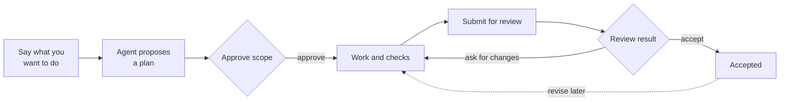

# Assign and review work

[User guide](README.md) · [한국어](../ko/work.md) · English

How to assign work in a connected project, review a submission and accept it or ask for changes, and pick the work up in a new chat. Colvia keeps the goal, file scope, checks, submission, and decisions together in a **Work**, a single recorded task.

[Start](#start) · [Delegate and review](#review) · [Pick up in a new chat](#resume) · [Revise an earlier result](#revise) · [Find a recorded next step](#follow-up) · [Child Works and isolated folders](#child-works)

The two diamonds are your decisions. Approving the scope entrusts the work; accepting is a decision about the submission you just read.

## Start with the work you want to do

Once the folder is connected, tell the agent what you want to do here in the current chat. A sentence or two is enough. The agent may ask:

> The folder is connected. Tell me briefly what you’d like to work on here.

> I’d like to set up a small project to track action items from our team meetings.

In a folder without project material, the agent can explain what it sees and help turn an idea into a goal and a first task. You might say, “I’d like to summarize the meeting in one page.” If you have already shared a goal or task, the agent can use that request and any existing brief, README, or project rules to propose a plan.

For a document, ask for an outline and a way to check it. For a new app, ask for a first version, a recommended stack and a way to run and test it. For example, a personal to-do list that runs in one browser can start with a small web page and browser storage. For a team list, review the proposed way to share the data and control access as part of the first version.

If you already know what to do, ask for it directly. The agent can answer a short question or inspect files within the access already allowed.

You can discuss project goals and rules later, or include them when you review the proposed scope. Check the file names and changes before approving that scope. Before recording the plan, review [what Colvia keeps](records.md#retained-contents).

### What you can do without a Work

You can skip creating a Work for a typo, spacing, or punctuation correction you explicitly request. The edit must follow your project rules and granted access, preserve meaning and behavior, and need no separate result review, retention, or handoff. If the edit belongs to an existing Work, check that Work’s approved scope and continue with its records.

## Delegate and review

> Summarize the types of customer inquiries and the complaints that come up most often in a report for our meeting. I’ll decide which improvements to prioritize.

1. **Approve the scope.** The agent proposes files to work on and how to check the result. If you agree with the scope, tell it to proceed. Colvia records which plan you approved.
2. **Review the submission and checks.** When the work is ready, the agent records the check results and submits it for review. Colvia checks scope at submission and blocks results that include changes outside it. If Colvia blocks a submission, the changes already made stay in the work folder. Check those changes and resolve the issue before submitting again.
3. **Accept the result or ask for changes.** Read the submission and decide whether to accept it or ask for changes. Colvia records which submission you accepted.

The app or CLI’s permission prompts control which files the agent can read or write and which tools it can run. Review the Work scope and its submission separately.

Before recording ordinary Work acceptance, Colvia compares the current files in that Work’s folder with the submission you reviewed. If the files have changed, review the changes and submit again.

### Archive an accepted Work

You can archive a Work once it is accepted. Archiving does not delete records or free storage. Its submitted contents, decisions and follow-up links remain available afterward.

## Step away before submitting

On an active ordinary Work, say “Save our progress for tomorrow.” The agent records what it did, what it checked, what remains and what to do next. If you just say “Let's wrap up,” it asks whether to save. Saving leaves the Work active.

In a new chat, say “Pick up where we left off.” The agent reads the note and approved scope, then compares the files with their state when the note was saved. If the note says to check a source and the report has since changed, inspect the report first. Unavailable comparisons are shown separately. Checks mentioned in a note do not count as a submission's check report. After a submission is sent back, resume from its revision request. A Work that returns to the same approved plan can use its earlier note. After a file addition, the note still compares the paths it observed. Newly approved files have no comparison until you save another note.

Once the first note is saved, this project's records and subsequent backups require a version that supports notes. If you might return to v0.2.0, keep a separate [backup](records.md#backup) before saving that first note.

## Pick up in a new chat or with another agent

In a new conversation, open the same project and ask, “Show me only what I need to review in the report I assigned earlier.” When the agent can access the project folder and Colvia records, it can find the approved scope, the last submission, differences from the current files, and any recorded next step.

If you use both Codex and Claude Code, you can switch between them in the same project. The new agent can find the records when it can read both the connected folder and the Colvia record folder. If the app created a Git worktree, first confirm which project it belongs to.

You can pick up a coding task the same way.

> Show me what changed since the file-upload update I accepted and what I need to review again. Did we test resuming an interrupted upload?

The agent can compare current files with the accepted submission and show which checks passed, failed, or could not be run. If a check was never recorded, the agent can tell you that.

## Revise an earlier result

To revise an earlier result after working on something else, tell the agent what to change. The agent checks the recorded request, approved scope, and changes since the last submission. If the approval is still valid and the requested changes fit the scope, continue in the same Work. Colvia can attribute a file to the other Work that added and submitted it when its current contents match that Work’s retained submission. The agent reports the affected files for unattributed changes and outside-scope edits or deletions. Your draft is preserved; you decide whether to accept the result after review.

You can review and accept such a revision in the workspace where you made it. Applying it to a different workspace is outside the current scope.

### When files outside the approved scope are needed

Before editing, tell the agent “Show me what it would take to update the table and add an appendix to this proposal.” On an active ordinary Work before its first submission, the agent shows the files to edit or create, the reason and any extra checks. Approve that proposal to add both files. The original approval, edits and progress note stay with the Work. Review and accept the proposal and appendix in one submission.

An existing file must still match the original observation. Colvia saves its original contents on approval, including in subsequent backups. A new file must have an exact unused path in an existing folder, both at preview and when the approval is recorded. If it was already created, approval cannot be backdated. Use the primary work folder for this operation. If the path is occupied, protected, ignored or ambiguous, review the indicated path before continuing. A different goal or a change after the first submission uses the existing follow-up or revision workflow.

Once you approve the first addition in a project, its records and future backups require a version that supports scope additions. If you need to return to an earlier version, keep a [backup](records.md#backup) before approval.

## Find a recorded next step

Ask “What did we decide to do after the meeting report?” The agent can look up the Work using `ordinary list`, then use `ordinary view WORK_ID` for the Work or `followup WORK_ID` for its recorded choice. Use the same project launcher for each command. `candidate list` shows saved candidates and any Work already linked to them. These commands only read.

The record distinguishes a choice you have never made, a decision to leave no follow-up, and a decision deferred until later. A selected candidate or Work appears with its name and status. If a plan or candidate has changed, the display tells you the choice was about the earlier record. Check that follow-up Work's own approval before starting it. Reuse a recorded approval that still covers the scope.

### Try it · Pick up a meeting report in a new chat

If you’ve submitted a meeting report in the same connected project, open a new chat and ask:

> Find the meeting report Work and show me its latest submission status and any recorded follow-up decision. Just look it up.

If the record says “No follow-up,” you recorded a decision to leave it without a follow-up. If there’s no recorded choice or you deferred the decision, the next step is still open. If you see a candidate or a Work, check whether the work you would continue already has an approved scope.

## Child Works and results from isolated folders

If you split a larger goal into direct child Works in the same folder, review and accept each submission. For an isolated folder (a registered Git worktree of the same repository), check the exact submission and destination.

- If the submission is still under review, use the preview to approve both applying and accepting it. Colvia records acceptance after applying the files and checking the destination.
- If you already accepted the submission, approve the application alone.

Check the destination before applying. Colvia blocks the application if any other Work in that folder is approved, in progress, or under review. Apply one submission at a time, then review the combined result and checks before accepting the parent Work separately.

If applying an approved submission is interrupted, check whether Colvia recorded its preparation. When that record is available, resume the application with the approved submission. The destination connection and common Git directory must remain valid. If you can’t verify the preparation record or the destination connection, pause and ask for help diagnosing the issue.

To delegate applying and accepting a specific isolated Work, check the source, destination, file scope, named delegate, and a valid grant. The grant applies to the specified isolated Work. You decide whether to accept other Work and the final parent result.

If a missing worktree blocks a command, [check its Git registration](git.md#git-worktree-registration) before continuing. For ordinary Work acceptance, Colvia still checks the current files in that Work’s own folder.

## What to know in the first Preview

- Keeping several Works is different from letting several agents edit the same files concurrently. Do not assume actual concurrent execution is supported in the first release. Overlapping changes or an unresolved interruption require checking the current state before proceeding.
- Colvia’s direct agent execution for document tasks is disabled in the first Preview. Working in the ordinary Codex or Claude Code CLI or desktop app is separate from this feature. You can inspect the current configuration with the [document execution availability check](reference.md#execution-readiness).
- Messages and materials you share with an agent follow the AI service’s data handling settings.

---

Next · [Working with Git](git.md) · [Records, backups, and moving folders](records.md)
