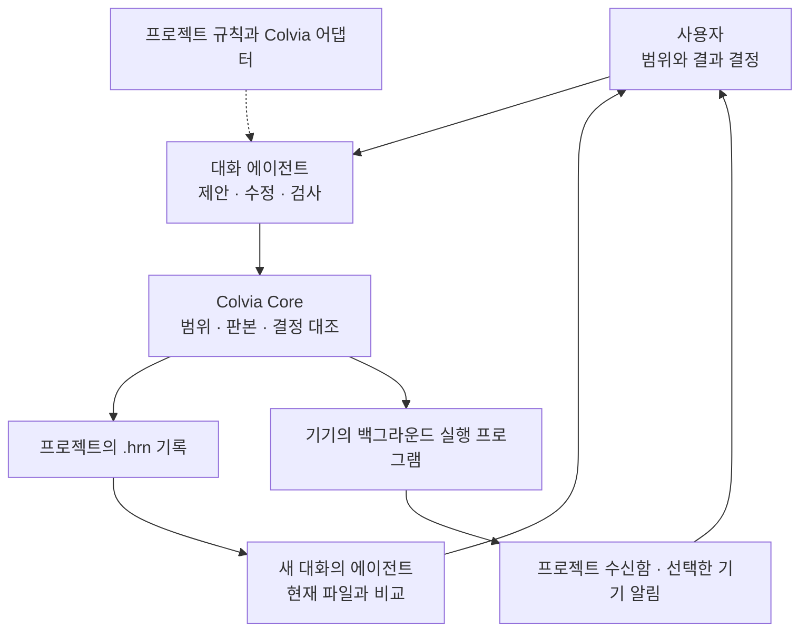
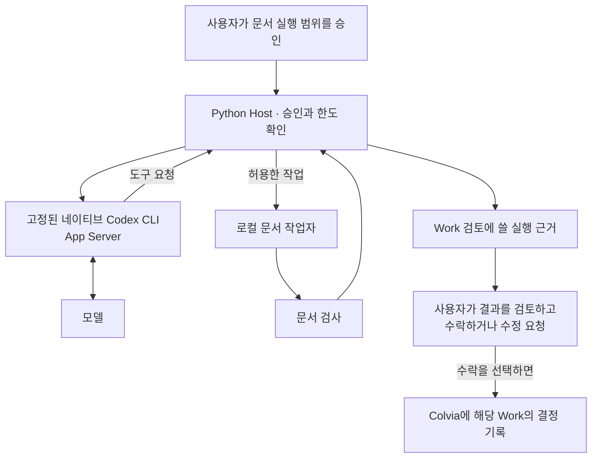

# 에이전트와 Colvia가 함께 일하는 방식

[사용 설명서](README.md)

Colvia에서는 Codex와 Claude Code로 작업을 맡기고, 결과를 검토하고, 새 대화에서 이어갈 수 있습니다. 작업 범위를 정하고 결과를 받아들일지 결정하는 과정은 Claude Code에서도 같습니다.

뒤에서 설명하는 선택형 macOS 문서 실행은 별도 기능입니다. 이 경로에서는 Python Host가 정해진 버전의 Codex CLI를 호출합니다.

| 누가 | 보고서 예제에서 맡는 일 |
| --- | --- |
| 사용자 | 보고서의 범위를 정하고 결과를 읽어 수락합니다. |
| 대화 중인 에이전트 | 프로젝트 지침과 현재 작업을 읽고 계획을 설명합니다. 승인된 범위에서 수정하고 변경점과 검사 결과를 제출합니다. |
| 어댑터 | 에이전트가 “어제 맡긴 일 보여줘”를 해당 프로젝트의 조회 절차로 옮길 때 따르는 사용 지침입니다. 판단하거나 실행하는 별도 모델은 없습니다. |
| Colvia Core | 작업 요청, 선택한 판본, 제출과 수락의 관계를 대조하고 프로젝트의 `.hrn/`에 기록합니다. 새 대화에서도 같은 판본을 찾아갈 근거가 됩니다. |

프로젝트 규칙은 *이 프로젝트에서* 어떤 자료를 쓸지, 어떤 검사를 할지 정합니다. Colvia 규칙은 작업 요청과 승인, 수정본과 결정을 어떻게 연결할지 정합니다. 예를 들어 ‘개선안은 팀장이 고른다’는 프로젝트 지침을 에이전트가 읽었다면 개선안은 후보로만 정리합니다. 반대로 예전 회의록에 ‘승인’이라는 단어가 있어도 이번 작업의 승인으로 쓸 수 없습니다.

## 작업 하나가 끝나기까지

1. **범위를 정합니다.** 에이전트가 입력, 수정 대상, 확인 방법을 제안하고 사용자가 작업 요청을 승인합니다.
2. **수정하고 확인합니다.** 한 Work 안에서 허용한 시간과 횟수만큼 고치고 다시 확인할 수 있습니다. 이 반복이 작업 루프입니다. 입력이나 권한이 달라지면 필요한 결정을 먼저 받습니다.
3. **제출하고 검토합니다.** 결과에는 수정본과 근거가 남습니다. 같은 작업을 재개할 때는 최신 파일과 해당 판본을 대조합니다. 파일이 달라졌다면 그 차이를 먼저 설명합니다.
4. **수락하거나 다시 고칩니다.** 수정본을 읽고 직접 수락하거나 고칠 부분을 알려 주세요. 상위 작업과 위임은 고급 기능으로 첫 Preview의 지원 제안에서 제외했습니다. 상위 작업에서는 바로 아래 작업 각각의 수락과 통합 결과의 수락을 구분합니다. 위임을 쓰면 지정한 대리인이 정해진 조건에서 일반 격리 작업자의 결과 한 건을 수락할 수 있습니다. 최초 작업 범위 승인과 상위 결과 수락은 사용자가 직접 결정합니다.
5. **다음을 고릅니다.** 다음 작업을 추천하거나 후보로 남길 수 있습니다. 후보를 고르는 일과 실행을 승인하는 일은 별개의 결정입니다.

## 실행을 맡기는 두 가지 경우

**프로젝트 수신함.** 작업 현황 정리나 준비된 결과 제출처럼 지원되는 한 단계를 기한과 함께 맡깁니다. 결과는 수신함에 남고 알림은 그 결과를 다시 찾는 지름길입니다. 기기의 프로세스가 멈췄다면 실행이 끝났는지와 파일에 반영된 내용을 따로 확인합니다.

**선택형 macOS 문서 실행.** Python Host가 승인된 입력과 편집 범위, 시간·호출 한도를 확인하고 고정된 Codex CLI의 App Server와 통신합니다. 모델이 제안한 읽기·편집은 Host가 허용한 로컬 작업자를 거칩니다. 문서 일부를 바꾼 뒤 링크와 Markdown 형식, 미리 지정한 필수·금지 문구를 검사합니다. 사용자는 그 결과를 따로 검토하고 수락합니다. 이 경로를 확인한 환경은 고정한 비공개 macOS 패키지와 Codex입니다. [문서 실행의 확인 범위](work-guide.md)에서 자세한 조건을 볼 수 있습니다.

실행이 끝나면 문서에 반영된 내용과 검사 근거를 확인합니다. 그 결과를 받아들일지는 사용자가 결정합니다.

[사용 설명서로 돌아가기](README.md)

<!-- en_content_sha256: 845f41f9d64f89fc4a5dc2176b1b930297537b28d73f4a4de7f4342a2094cd04 -->
