# Colvia 아키텍처

[사용 설명서](README.md) · 한국어 · [English](../en/architecture.md)

Colvia Preview가 어떤 구성요소로 이루어져 있고, 명령 하나가 어디를 거쳐 기록으로 남는지 설명합니다. 일상적인 사용에는 이 문서가 필요하지 않습니다. 구조가 궁금하거나, 문제를 진단하거나, Colvia에 기여하려는 분을 위한 문서입니다.

먼저 읽을 곳 · [전체 구성](#overview) · [호출 경로](#call-path) · [책임별 구성](#layers) · [CLI와 View](#cli-view) · [에이전트 연결](#agent) · [Work 수명 주기](#work-lifecycle) · [기록 저장 구조](#storage)

필요할 때 읽을 곳 · [Git과의 경계](#git-boundary) · [설치와 업데이트](#install-update) · [알림과 전달](#notifications) · [신뢰 경계](#trust) · [소스에서 찾아보기](#source-map)

## 먼저 알아 둘 세 가지

1. **Colvia는 에이전트를 대신 실행하지 않습니다.** 작업은 평소 쓰는 Codex나 Claude Code가 수행하고, 에이전트가 필요할 때 Colvia 명령을 호출합니다. Colvia가 에이전트를 직접 호출하는 기능은 이 Preview에서는 비활성입니다.
2. **기록은 프로젝트 폴더 밖에 있습니다.** 승인, 제출본, 결정은 운영체제의 사용자 데이터 폴더에 있는 프로젝트별 SQLite 데이터베이스에 남습니다. 프로젝트 폴더에는 실행기와 연결 정보, 안내만 둡니다.
3. **결정은 종류별로 분리돼 있습니다.** 범위 승인, 결과 수락, Git 반영, 알림은 서로를 대신하지 않습니다. 구조 전체가 이 분리를 지키도록 짜여 있습니다.

진행 중인 일반 Work의 첫 제출 전 메모는 승인된 Work를 가리키는 별도 SQLite 기록입니다. 메모를 저장해도 계획 승인·제출본·수락 기록은 바뀌지 않습니다.

추가 승인은 직전 활성 Work와 유효 계획을 연결합니다. 기존 계획과 원문을 보존하며, 이전 메모는 당시 관찰한 파일만 대조합니다. 수정 요청 뒤의 추가 승인은 돌려보낸 제출본, 그 판의 계획, 수정 요청을 함께 가리킵니다. 각 제출본에서 당시 적용한 계획과 승인을 확인할 수 있습니다.

<a id="overview" name="overview"></a>

## 전체 구성

화살표는 호출과 데이터의 흐름입니다. 소스 코드의 import 관계가 아닙니다.

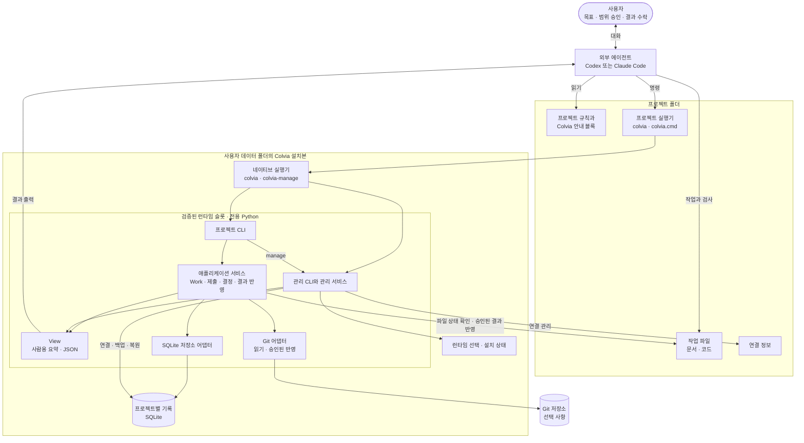

| 구성요소 | 맡는 일 | 하지 않는 일 |
| --- | --- | --- |
| 사용자 | 목표와 범위를 정하고, 필요한 접근을 허용하고, 결과를 수락할지 결정합니다. | — |
| 외부 에이전트 | 프로젝트 규칙을 읽고, 작업을 제안하고, 실제 작업과 검사를 수행합니다. | 사용자의 승인과 수락을 대신하지 않습니다. |
| 프로젝트 실행기 | 프로젝트 폴더에서 설치본의 네이티브 실행기를 호출합니다. | 기록을 직접 담지 않습니다. |
| 네이티브 실행기 | 선택된 런타임 슬롯(전용 Python과 Colvia 코드를 함께 담은 설치 단위)이 변조되지 않았는지 확인한 뒤 전용 Python을 실행합니다. `colvia`는 프로젝트 CLI로, `colvia-manage`는 관리 CLI로 이어집니다. | 사용자의 Python이나 `PATH`를 쓰지 않습니다. |
| 프로젝트 CLI와 애플리케이션 서비스 | 계획·승인·제출본·결정을 대조하고 기록합니다. 승인된 격리 폴더 결과 반영과 Git 반영에서는 대상 파일과 Git을 변경합니다. | 일반 Work의 내용을 작성하거나 검사하지 않습니다. 에이전트를 호출하지 않습니다. |
| 관리 CLI와 관리 서비스 | 설치와 업데이트, 프로젝트 연결·해제·이동, 백업 복원, Git 등록, 알림 등록을 맡습니다. 프로젝트 CLI와 같은 런타임 슬롯 안에 있습니다. | Work의 승인이나 수락을 기록하지 않습니다. |
| View | 결과를 사람용 요약이나 JSON으로 보여 줍니다. | 상태를 바꾸지 않습니다. |
| 프로젝트별 기록 | 한번 남기면 바뀌지 않는 기록과, 보관해 둔 파일 본문을 담습니다. | 프로젝트 폴더나 Git 이력에 섞이지 않습니다. |

알림 수신기와 작업 창은 [알림과 전달](#notifications)에서 따로 설명합니다.

<a id="call-path" name="call-path"></a>

## 호출 경로

다음은 프로젝트 기록을 조회하는 `./colvia ordinary list`의 대표 경로입니다.

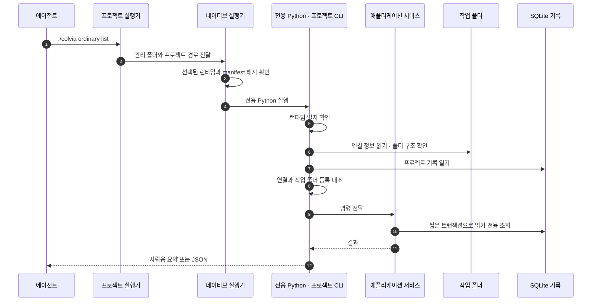

명령에 따라 거치는 경로가 다릅니다.

- `guide`와 `execution readiness`는 프로젝트 기록을 열지 않고 설치본만 확인한 뒤 끝납니다.
- `manage`와 `colvia-manage`는 관리 CLI로 넘어갑니다.
- 상태를 바꾸는 명령은 같은 경로에서 쓰기 트랜잭션을 사용하고, 명령마다 추가 검증을 거칩니다. [쓰기 한 번의 경로](#write-path)을 보세요.

문제가 생기면 어느 구간에서 멈췄는지에 따라 원인이 갈립니다.

| 구간 | 뜻 | 볼 곳 |
| --- | --- | --- |
| 실행기와 런타임 | 실행기가 열리지 않음. 설치본이나 런타임 선택 문제 | [설치나 업데이트가 중단됐을 때](maintenance.md#update-recovery) |
| 연결과 접근 | 폴더나 기록에 접근할 수 없거나 연결을 다시 확인해야 함 | [접근이 막혔을 때](install.md#access) · [폴더 이동](records.md#move) |
| 명령별 검증 | Colvia가 요청을 거부함. 승인 범위 밖 변경, 오래된 확인값 등 | [맡기고 검토하기](work.md#review) |

<a id="layers" name="layers"></a>

## 책임별 구성

다음 그림은 구현의 책임을 이해하기 위한 개념도입니다. 진입점이 서비스에 필요한 구현을 연결하고, 서비스는 저장소, 파일 상태 확인, 기록 밖 변경 기능을 사용합니다. 현재 코드는 모든 모듈이 엄격한 단방향 의존 규칙을 따르는 구조는 아닙니다. 연결·백업·업데이트에는 플랫폼 구현을 직접 조합하는 부분이 있습니다.

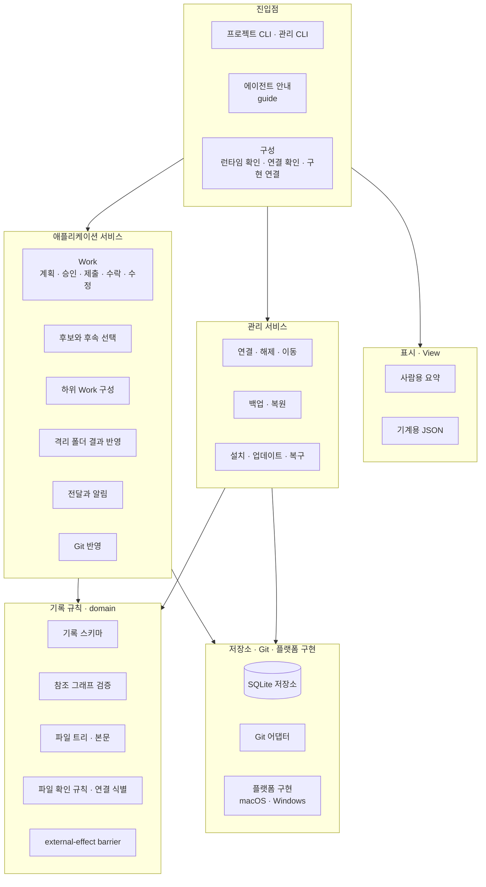

| 영역 | 책임 | 지키려는 경계 |
| --- | --- | --- |
| 진입점 | 명령을 해석하고, 런타임과 프로젝트 연결을 확인하고, 서비스에 필요한 구현을 연결합니다. | `PATH`의 Python이나 소스 체크아웃으로 대체하지 않습니다. |
| 표시(View) | 결과를 사람용 요약이나 JSON으로 보여 줍니다. | 표시는 읽기 전용입니다. 화면을 여는 것만으로 상태가 바뀌지 않습니다. |
| 애플리케이션 서비스 | 계획·승인·제출·수락 같은 사용 흐름을 조합합니다. | 화면 출력이나 에이전트 호출을 기록 규칙에 섞지 않습니다. |
| 관리 서비스 | 연결, 백업, 설치와 업데이트처럼 설치본과 프로젝트 연결을 다루는 흐름을 조합합니다. | Work의 승인이나 수락을 대신 기록하지 않습니다. |
| 기록 규칙(domain) | Work·수락·참조의 의미, 기록 형식, 범위 판정을 정합니다. | 운영체제·Git·앱 이름에 따라 결정의 의미가 달라지지 않습니다. |
| 저장소·Git·플랫폼 구현 | SQLite, Git, macOS·Windows 기능을 구현합니다. 서비스와는 교체할 수 있는 인터페이스로 연결합니다. | 지원하지 않는 환경에서 다른 운영체제 구현으로 대체하지 않습니다. |

소스에서의 위치는 [소스에서 찾아보기](#source-map)에 있습니다.

<a id="cli-view" name="cli-view"></a>

## CLI와 View

진입점은 두 개입니다. 프로젝트 CLI는 프로젝트 하나의 Work를 다루고, 관리 CLI는 설치본과 프로젝트 연결을 다룹니다. 프로젝트 실행기의 `manage`는 같은 설치본의 관리 CLI로 이어집니다.

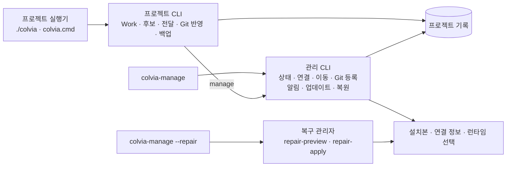

상태를 바꾸는 명령은 대부분 두 단계로 나뉩니다. **미리보기 → 확인값 → 적용** 순서입니다. 미리보기가 돌려준 확인값(receipt)은 그때 본 내용에 묶여 있어서, 그사이 대상이 바뀌면 적용이 거부됩니다. 사용자가 검토한 것과 실제로 적용되는 것이 같도록 하는 장치입니다.

CLI 결과는 기본적으로 사람용 요약이며, `--json`으로 기계용 필드를 확인할 수 있습니다.

| 형태 | 쓰는 곳 | 특징 |
| --- | --- | --- |
| 사람용 요약 | 대화에서 에이전트가 사용자에게 설명할 때 | 제목과 상태, 필요한 결정 위주입니다. 관련 Work나 진단에 필요한 식별자는 여기에도 나타날 수 있습니다. |
| JSON (`--json`) | 에이전트가 다음 명령에 쓸 값을 얻을 때 | Work ID, 확인값(receipt), revision 번호 같은 기계용 필드를 포함합니다. |

알림을 눌렀을 때 열리는 작업 창은 CLI 출력과 별개의 화면입니다. 알림이 가리키는 원래 결과와 현재 상태를 구분해 보여 줍니다.

주요 명령은 [명령 요약](reference.md#commands)에 있습니다.

<a id="agent" name="agent"></a>

## 에이전트 연결

Colvia는 에이전트에 플러그인을 설치하지 않습니다. 프로젝트를 연결할 때 에이전트 지침 파일에 짧은 안내 블록을 덧붙이고, 에이전트는 그 안내를 따라 실행기를 호출합니다. 다음은 변경을 요청받았을 때의 일반 흐름입니다.

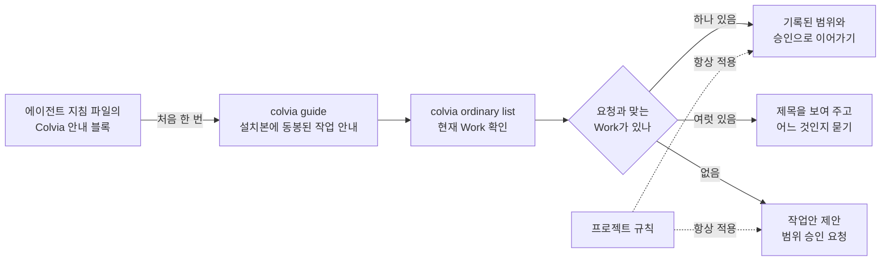

- 사용자의 결정을 기다리는 Work가 있으면 그 결정을 먼저 보여 줍니다.
- 조회나 직접 요청한 작은 교정은 새 Work 없이 처리할 수 있습니다. [Work 없이 처리할 수 있는 일](work.md#without-work)
- **안내 블록은** 연결할 때 추가되고 연결을 해제할 때 제거됩니다. 프로젝트의 기존 규칙은 그대로 적용됩니다.
- **`guide`는** 설치본에 동봉된 작업 안내를 읽어 줍니다. 실행기는 이 파일이 배포 manifest(배포본에 든 파일과 해시의 목록)에 적힌 해시와 일치할 때에만 내용을 돌려줍니다. 프로젝트 기록은 열지 않습니다.
- **같은 실행기를** Codex와 Claude Code가 함께 씁니다. 그래서 대화나 에이전트를 바꿔도 같은 기록을 찾을 수 있습니다.

<a id="work-lifecycle" name="work-lifecycle"></a>

## Work 수명 주기

일반 Work는 계획부터 수락까지 진행하며, 일시정지하거나 사유를 남겨 폐기할 수 있습니다. 단계가 바뀔 때마다 기록을 추가할 뿐 이전 기록을 고치지 않습니다.

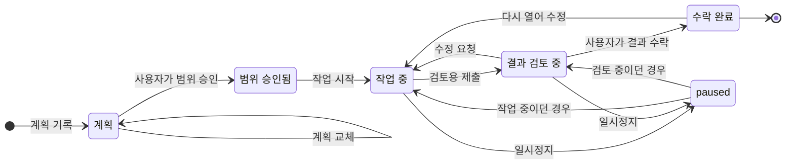

| 단계 변화 | 누가 결정하나 | 이때 남는 기록 |
| --- | --- | --- |
| 계획 기록 | 에이전트가 제안 | 목표, 파일 범위, 검사, 제외 항목, 작업 폴더의 기준 snapshot(계획 시점의 파일 상태), 범위에 든 기존 파일의 본문 |
| 범위 승인 | 사용자 | 어느 계획을 승인했는지와 승인 문구 |
| 작업 시작 | 에이전트 | 계획 때 기록한 기준과 현재 폴더를 대조하고, 작업 중 상태의 새 기록을 남깁니다. |
| 검토용 제출 | 에이전트 | 바뀐 본문, 요약, 계획한 검사별 통과·실패·확인 불가 |
| 결과 수락 | 사용자 | 어느 제출본을 수락했는지와 수락 문구 |
| 수정 요청 | 사용자 | 수정 요청 내용. 원래 범위와 검사, 이전 제출본은 유지 |

제출할 때 Colvia는 작업 폴더의 파일 상태를 다시 확인해, 확인 대상 파일에 승인 범위 밖의 변경이 있으면 제출을 거부합니다. 수락할 때는 현재 파일이 검토한 제출본과 같은지 다시 대조합니다. 수락 완료된 Work는 보관 처리할 수 있으며, 보관해도 본문·결정·후속 연결은 그대로 조회됩니다.

미완료 Work를 폐기하거나 다른 Work로 대체하면 기존 기록은 조회할 수 있습니다. 새 Work의 범위는 별도로 승인합니다. [전환과 대체](work.md#work-lifecycle)

<a id="storage" name="storage"></a>

## 기록 저장 구조

### 폴더 배치

설치본과 기록은 운영체제의 사용자 데이터 폴더 한곳에 모입니다. macOS에서는 `~/Library/Application Support/Colvia`, Windows에서는 `%LOCALAPPDATA%\Colvia`입니다.

```text
Colvia/
├─ bin/                    네이티브 실행기 colvia와 colvia-manage, macOS의 알림 수신기
├─ notification-tools/     Windows의 알림 수신기
├─ runtime/                런타임 선택 정보와 불변 런타임 슬롯
│  └─ slots/<슬롯>/        전용 Python, Colvia 코드, 동봉 안내, manifest
├─ authorities/
│  └─ <프로젝트 ID>/       프로젝트 하나의 기록
│     ├─ active.json       현재 저장소 generation을 가리키는 포인터
│     └─ stores/<generation>/state.sqlite3
├─ backups/                업데이트 전에 남기는 기록 복구본
├─ operations/             진행 중이거나 끝난 관리 작업의 기록
└─ trust/                  업데이트 검증에 쓰는 신뢰 정보
```

프로젝트 폴더에는 실행기와 연결 정보, 지침 파일의 안내 블록만 있습니다. 연결 정보는 일반 폴더에서는 폴더 최상위의 `.colvia-link.json`에, Git 저장소에서는 공통 Git 디렉터리의 `colvia/connection.json`에 둡니다. 그래서 Git 저장소의 working tree에는 실행기와 지침 파일의 변경만 나타납니다.

### 프로젝트 하나, 작업 폴더 여럿, 활성 generation 하나

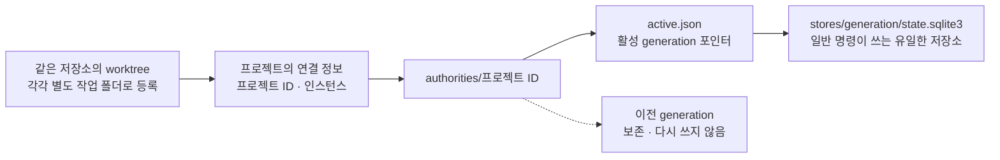

generation은 프로젝트 기록 저장소 한 벌을 가리키는 이름입니다. 일반 명령은 활성 포인터가 가리키는 generation 하나만 사용합니다. 복원처럼 저장소를 통째로 바꾸는 작업은 기존 데이터베이스 파일을 덮어쓰지 않고 새 generation을 만든 뒤 포인터를 옮깁니다. 전환하는 동안에는 쓰기가 막힐 수 있습니다. 이전 generation은 보존하며 다시 쓰지 않습니다. 연결 정보가 가리키는 인스턴스와 활성 포인터가 다르면 오래됐거나 다른 프로젝트의 연결로 보고 열지 않습니다.

<a id="why-local-records"></a>

### 기록을 Git 이력과 프로젝트 폴더 밖에 두는 이유

범위 승인과 결과 수락은 커밋하기 전에도 일어납니다. Colvia는 이 결정을 사용자 데이터 폴더에 저장하므로 브랜치를 바꿔도 같은 기록을 읽을 수 있습니다. 일반 폴더로 시작해 [나중에 Git을 연결해도](git.md#adopt-git) 기존 기록을 이어갑니다. SQLite를 쓰면 서버를 설치할 필요가 없고, 결정과 그 결정이 가리키는 제출본의 연결을 한 트랜잭션으로 저장할 수 있습니다.

프로젝트 기록은 하나이고, 같은 저장소의 worktree는 그 프로젝트 연결을 기준으로 각각 별도의 작업 폴더로 등록됩니다. Work는 자신이 만들어진 작업 폴더에 속합니다.

### SQLite 안의 구조

데이터베이스는 테이블 몇 개로 이루어진 단순한 구조이고, 의미는 테이블이 아니라 **불변 객체의 참조 그래프에** 있습니다.

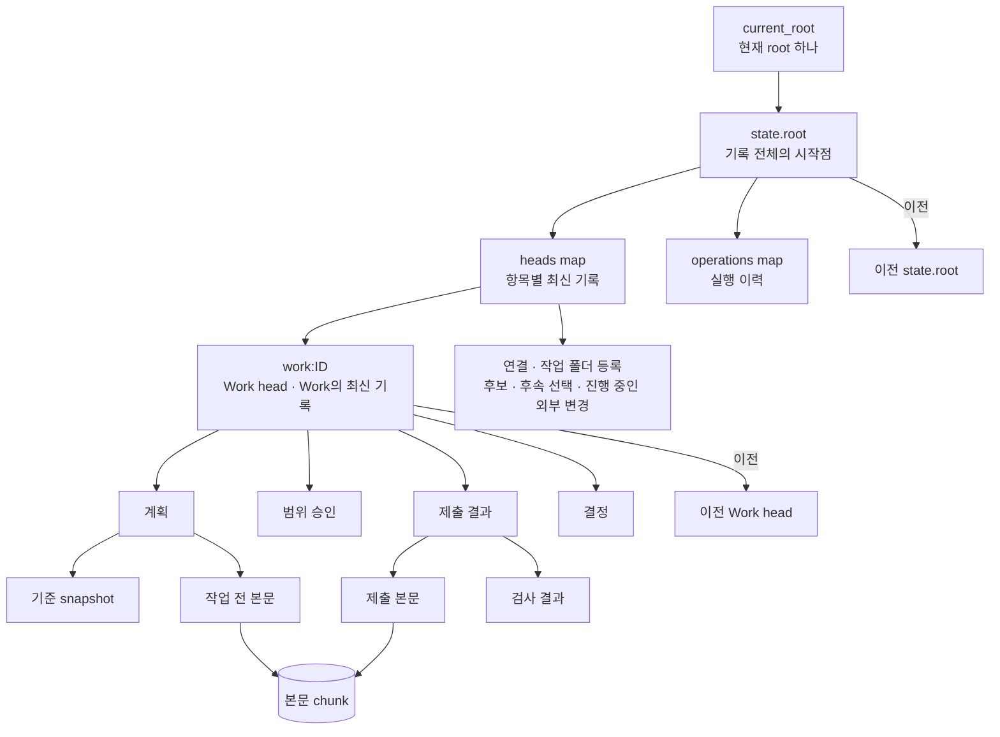

| 테이블 | 담는 것 |
| --- | --- |
| `objects` | 모든 기록과 본문 chunk. 내용의 해시가 곧 식별자이며, 한번 확정되면 수정·삭제할 수 없습니다. |
| `current_root` | 현재 `state.root` 객체 하나를 가리키는 포인터 |
| `operations` | 실행 ID별로 적용 전후의 root. 같은 실행을 두 번 적용하지 않기 위한 기록 |
| `imports`, `claims` | 큰 본문을 chunk로 나눠 저장하는 동안의 중간 상태 |
| `generation` | 프로젝트·인스턴스·generation 식별 정보, 쓰기를 막아 둔 상태인지, 폴더에 다시 연결해야 하는지 |
| `requirements` | 이 기록을 읽고 쓰는 데 필요한 기능 목록. 업데이트 때 새 런타임과 대조합니다. |
| `restore_origin` | 복원한 기록의 원본과 복원 완료 상태 |

- **content-addressed 저장입니다.** 객체는 내용의 해시로 식별합니다. 종류·버전·크기도 함께 기록하고, 읽을 때마다 다시 확인합니다. 제목처럼 사람이 붙인 이름은 식별자로 쓰지 않습니다.
- **append-only입니다.** 수정을 요청하거나 수락한 Work를 다시 열어도 새 기록을 추가할 뿐 과거 기록을 고치지 않습니다. 불변성은 데이터베이스 트리거로도 강제합니다.
- **보관은 삭제가 아닙니다.** 보관한 Work도 본문과 결정이 그대로 남습니다. 기록을 자동으로 정리하지 않습니다.
- **조회 화면은 원본이 아닙니다.** 목록과 요약은 기록에서 매번 다시 구성한 조회 결과입니다.

<a id="write-path" name="write-path"></a>

### 쓰기 한 번의 경로

다음은 검토용 제출처럼 작업 폴더 확인과 본문 보관이 필요한 Work 변경의 예입니다.

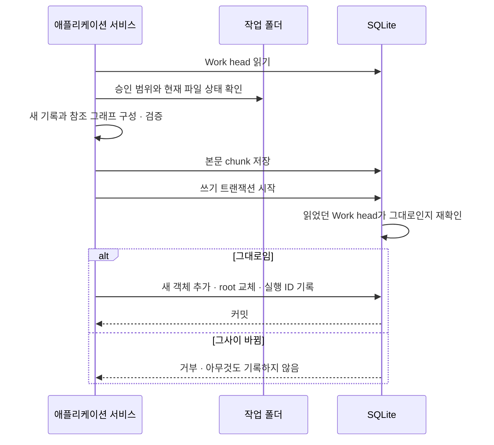

트랜잭션은 짧게 유지하고, 쓰기 전에 읽었던 기준이 그대로인지 다시 확인합니다. 서로 다른 Work의 변경은 서로를 덮어쓰지 않고, 같은 Work를 그사이 다른 명령이 바꿨다면 뒤늦은 쓰기는 거부됩니다. 저장 설정은 속도보다 내구성을 우선합니다. SQLite를 rollback journal 모드와 `synchronous=EXTRA`로 열고, macOS에서는 `fullfsync`를 켭니다.

Git의 ref·index 반영, 격리 폴더 결과의 대상 파일 교체, 전달, 연결 해제처럼 기록 밖에 변경을 남기는 작업은 그 변경을 시작하기 전에 의도를 먼저 기록합니다. 코드에서는 이 장치를 external-effect barrier라고 부르며, 프로젝트마다 하나입니다. 중간에 멈추면 그 기록이 남아 있어, 결과를 확인하기 전에는 다른 쓰기가 끼어들지 못합니다. 멈춘 그 작업의 복구는 이어갈 수 있습니다.

<a id="git-boundary" name="git-boundary"></a>

## Git과의 경계

사용자가 직접 `git init`을 한 경우에는 원래 일반 폴더의 연결·폴더 식별값과 단일 Git 루트를 대조합니다. 기존 Work를 마칠 때는 확인한 Git 관리 디렉터리만 제외하고 원래 일반 폴더의 기준으로 변경을 검사합니다. 남은 Work를 정리한 뒤 Git 전환을 따로 승인합니다.

일반 폴더로 연결한 프로젝트의 Work를 모두 마치거나 폐기하면 Git으로 전환할 수 있습니다. 관리자는 연결 표식을 바꾸기 전에 기존 프로젝트에 전환 승인을 기록합니다. 프로젝트와 작업공간 ID, 이전 승인·제출본·수락 내역을 유지하며, 전환 기록을 읽을 수 없는 구버전의 쓰기를 차단합니다. [쓰던 폴더에서 Git 시작하기](git.md#adopt-git)

Colvia가 Git을 다루는 방식은 세 단계로 나뉩니다. 현재 브랜치와 스테이징 영역에 반영하는 일은 사용자가 후보를 검토하고 따로 승인한 뒤에만 일어납니다.

| 단계 | Git에 일어나는 일 |
| --- | --- |
| 읽기 전용 확인 | 저장소 구조와 working tree·index를 읽습니다. 저장소를 바꾸지 않습니다. |
| 후보 준비 | 후보 Git 객체와 준비 기록을 만듭니다. 다음 Preview에서는 먼저 [자격증명 검사](git.md#git-credential-check)를 거칩니다. 현재 ref와 index는 바꾸지 않습니다. |
| 승인 후 적용 | 검토한 후보를 ref와 index에 반영합니다. 다른 파일에 스테이징한 변경은 보존합니다. |

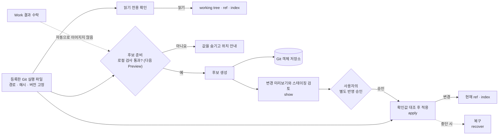

- **실행 파일을 고정합니다.** Colvia는 `PATH`에서 Git을 찾지 않습니다. 사용자가 승인해 등록한 실행 파일만 쓰고, 쓸 때마다 해시가 등록 당시와 같은지 확인합니다.
- **읽기 전용 확인은 저장소를 건드리지 않습니다.** 가져오기, index 갱신, hook 실행, checkout, Git 메타데이터 쓰기를 하지 않습니다.
- **수락은 커밋이 아닙니다.** 수락한 제출본은 Colvia 기록에 남으므로 임시 커밋 없이도 나중에 비교할 수 있습니다.
- **스테이징을 보존합니다.** 반영 전에 index 전체를 보관하고, 다른 파일에 스테이징한 변경을 유지합니다. 조건이 맞지 않으면 hook을 끄거나 index를 초기화하지 않고 멈춥니다.
- **작업 폴더 사이의 이동은 별도 작업입니다.** 한 작업 폴더의 제출본을 다른 작업 폴더에 옮기는 일은 한 건씩 승인합니다.

### 자격증명 검사 · 다음 Preview

확장자와 서명이 일치하는 지원 이미지·글꼴은 미리보기와 JSON에 경로·형식을 남깁니다. 이 파일은 내용 검사를 생략하므로 미리보기에 본문을 넣지 않습니다.

보호 경로의 파일을 추가·수정하거나 알려진 형태의 자격증명이 들어 있으면 새 Git 객체를 쓰기 전에 멈춥니다. 검사에 통과한 후보는 별도 승인 뒤에 브랜치와 스테이징 영역에 반영됩니다. 보호 파일을 삭제하는 경우에는 원래 값 대신 삭제 사실을 미리보기에 표시합니다. [검사 범위](git.md#git-credential-check)

절차는 [Git과 함께 쓰기](git.md)에 있습니다.

<a id="install-update" name="install-update"></a>

## 설치와 업데이트

업데이트가 끝까지 진행되는 경우의 흐름입니다.

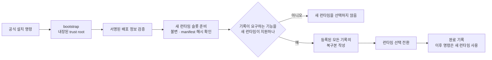

검증이나 호환성 확인에서 거부되면 새 런타임을 선택하지 않습니다. 적용 도중 중단된 경우에는 런타임 선택이 이미 바뀌었을 수 있으므로 먼저 업데이트 상태를 확인합니다.

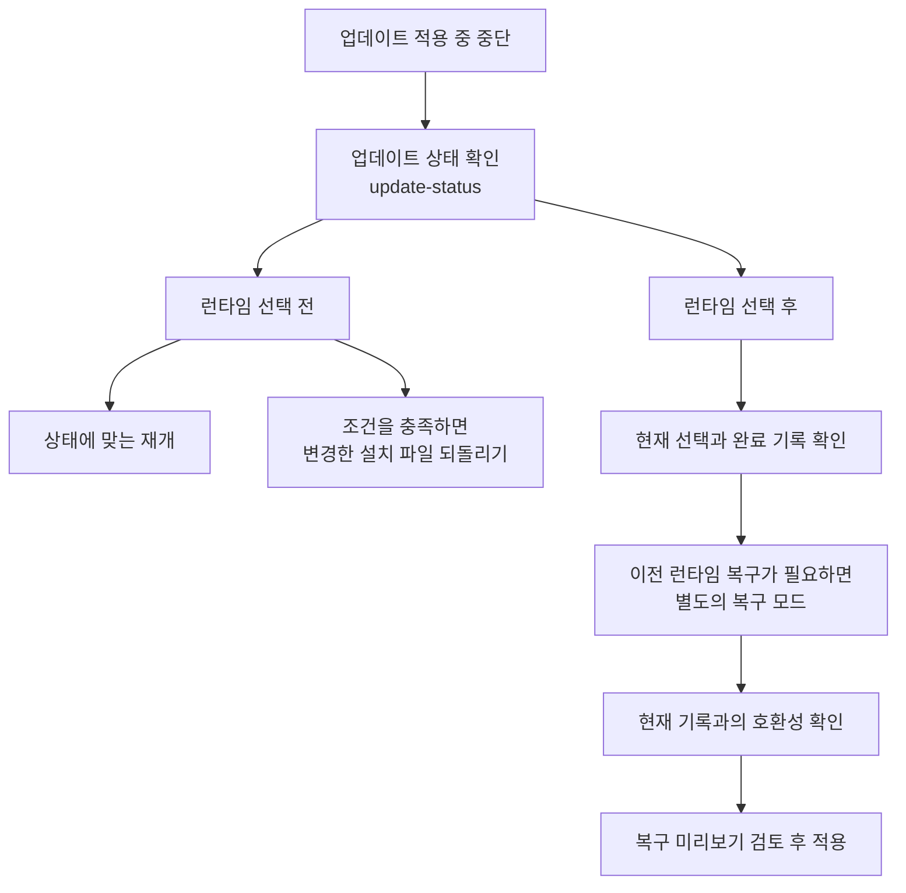

- **다운로드는 설치가 아닙니다.** 새 배포본은 별도 슬롯에 준비될 뿐이고, 검증과 호환성 확인을 모두 통과한 뒤에야 선택이 바뀝니다.
- **런타임 슬롯은 만든 뒤 바뀌지 않습니다.** 전용 Python과 Colvia 코드는 슬롯 안에 함께 있고, 네이티브 실행기는 실행할 때마다 선택된 슬롯의 manifest 해시를 확인합니다.
- **되돌리기와 복구는 다른 절차입니다.** 선택을 바꾸기 전의 설치 파일 변경을 되돌리는 일과, 호환되는 이전 런타임을 선택하는 복구는 서로 다릅니다. 복구는 일반 관리 명령이 아니라 `--repair`로 실행하는 별도의 복구 모드에서 미리보기를 검토한 뒤 적용합니다.
- **런타임 lease로 전환 시점을 지킵니다.** lease는 런타임 선택에 거는 잠금입니다. 기록을 읽고 쓰는 트랜잭션은 shared lease를 잡고 런타임 선택이 그대로인지 확인합니다. 업데이트가 선택을 바꿀 때는 exclusive lease를 잡습니다. 선택이 바뀐 뒤에는 이전 런타임으로 실행 중이던 프로세스가 기록에 접근할 수 없습니다.
- **기록과 런타임은 따로 움직입니다.** 어느 경우에도 Work 기록을 과거 시점으로 되돌리지 않습니다. 제거와 재설치도 기록, 프로젝트 연결, 설정, 신뢰 정보를 남깁니다.

절차는 [업데이트, 알림, 연결 해제와 제거](maintenance.md)에 있습니다.

<a id="notifications" name="notifications"></a>

## 알림과 전달

전달은 이미 준비된 결과의 제출을 맡기는 한 단계입니다. 알림은 그 뒤에 따로 요청하는 전송입니다.

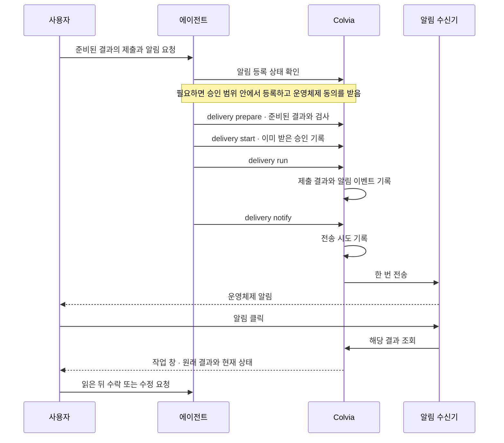

알림은 결과를 다시 찾는 지름길일 뿐입니다. 알림 이벤트는 기록을 가리키는 포인터이고, 알림이 표시됐거나 클릭됐다는 사실은 수락이 아닙니다. 전달 여부가 불확실하면 Colvia는 같은 알림을 자동으로 다시 보내지 않습니다. 알림을 놓쳐도 결과는 프로젝트 기록에 남아 있습니다.

<a id="trust" name="trust"></a>

## 신뢰 경계와 한계

| Colvia가 보장하려는 것 | 보장하지 않는 것 |
| --- | --- |
| 어느 계획을 승인했고 어느 제출본을 수락했는지를 정확한 내용에 묶어 기록합니다. | 결정한 사람의 신원을 인증하지 않습니다. 같은 기기 계정을 신뢰합니다. |
| Colvia가 확인하는 파일의 변경을 승인 범위와 대조하고, 허용되지 않은 범위 밖 변경이 확인되면 제출을 멈춥니다. | 보안 샌드박스가 아닙니다. 에이전트나 다른 프로그램이 파일을 수정하는 것 자체를 막지 않습니다. |
| 기록을 읽을 때 무결성을 확인하고, 손상되면 이전 상태로 조용히 되돌리지 않고 멈춥니다. | 같은 계정으로 기록 전체를 다시 쓰는 공격을 막지 못합니다. 암호화를 제공하지 않습니다. |
| 로컬 APFS와 로컬 NTFS에서의 내구성을 전제로 합니다. | 네트워크 공유나 동기화 폴더에 둔 기록의 안전을 보장하지 않습니다. |
| 여러 Work의 기록과 결정을 서로 덮어쓰지 않고 보관합니다. | 여러 에이전트가 같은 파일을 동시에 편집하는 실행을 조율하지 않습니다. |

에이전트가 읽고 쓰는 파일과 실행할 도구는 Colvia가 아니라 앱이나 CLI의 권한 설정에서 정합니다. 에이전트에게 공유한 자료와 대화에는 사용 중인 AI 서비스의 데이터 처리 설정이 적용됩니다.

### 선택 기능 · 문서 실행

Colvia가 에이전트를 직접 호출해 문서를 고치게 하는 기능은 코드에 선택 모듈로 남아 있지만 이 Preview에서는 비활성이며, 켜려는 요청은 거부됩니다. 일반 Work는 이 모듈 없이 동작합니다. 현재 상태는 `execution readiness`로 확인할 수 있습니다.

<a id="source-map" name="source-map"></a>

## 소스에서 찾아보기

Colvia 소스 저장소의 `src/colvia` 기준입니다.

| 영역 | 주요 위치 |
| --- | --- |
| 진입점과 구성 | `managed_entry.py`, `manager_entry.py`, `cli.py` |
| 표시 | `presentation.py` |
| 애플리케이션 서비스 | `work.py`, `rework.py`, `planning.py`, `composition.py`, `worker.py`, `delivery/`, `git_integration.py` |
| 관리 서비스 | `management.py`, `project_setup.py`, `lifecycle.py`, `move_setup.py`, `backup_service.py`, `restore_manager.py`, `updates/` |
| 기록 규칙(domain) | `records.py`, `schemas.py`, `codec.py`, `graph.py`, `maps.py`, `tree.py`, `bodies.py`, `observation.py`, `binding.py`, `effects.py` |
| 저장소 | `storage/sqlite.py`, `storage/authority.py` |
| Git과 작업 폴더 | `adapters/git.py`, `observe.py`, `workspace.py`, `git_registration.py`, `first_git.py` |
| 플랫폼 구현 | `platforms/` |
| 선택 기능 | `execution/` |
| 네이티브 실행기 | 저장소의 `distribution/foundation-launcher/` |

---

[사용 설명서로 돌아가기](README.md) · [지원 환경과 참고 자료](reference.md)
