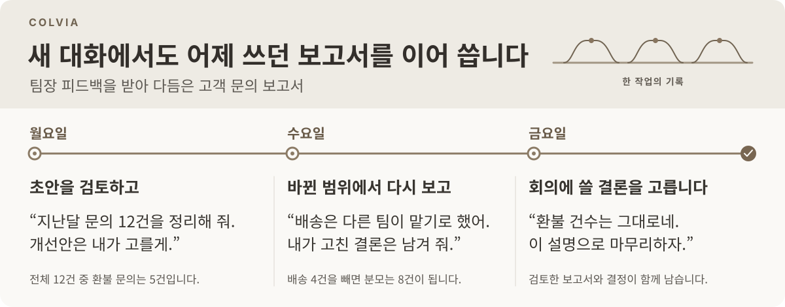

# Colvia는 무엇을 기억하나요?

[사용 설명서](README.md)

어제 읽은 보고서를 오늘 다시 열었는데 결론이 달라졌다면, 먼저 어느 초안을 받아들였는지 찾아보세요. Colvia는 그 결정과 당시 초안을 연결해 둡니다.

“문의 건수는 확인해 줘. 개선안을 고르는 건 내가 할게.” 보고서 초안이 나오면 어떤 수치를 대조했고 무엇을 아직 결정하지 않았는지 함께 볼 수 있습니다.

다음 날에는 검토했던 초안과 현재 파일을 비교합니다. 직접 손본 결론이 있다면 그 문장을 남길지 정한 뒤 이어가세요.

한 작업 안에서 초안을 고치고 다시 검토할 수 있습니다. 여러 작업의 결과를 하나로 묶어 검토하는 방법은 첫 Preview의 일상적인 사용 범위 밖의 고급 참고 기능입니다. [사용 환경과 제한](work-guide.md#limits-ko)을 함께 보세요.

잠시 자리를 비울 때는 지원되는 단계 하나를 맡길 수 있습니다. 예를 들어 이미 준비한 수정본을 검토용으로 제출해 달라고 하세요. 확인하면 Colvia가 이 기기에서 그 단계를 실행합니다. 질문이나 결과는 프로젝트 수신함에서 찾을 수 있습니다. 기기를 다시 켰다면 수신함에서 마지막으로 기록된 단계부터 확인하세요.

[작업 기록과 실행 프로그램의 관계](architecture.md)

## 프로젝트에서 누가 결정하나요?

범위를 승인하고 결과를 받아들일지는 사람이 정합니다. Colvia는 같은 기기 계정을 신뢰하므로 기록의 역할 이름만으로 사용자의 신원을 인증할 수는 없습니다. 다른 프로그램도 파일을 편집할 수 있습니다. 파일의 Git 이력과 작업의 수락 기록은 따로 관리하며 커밋이나 게시는 직접 결정합니다.

[사용 설명서로 돌아가기](README.md)

<!-- en_content_sha256: addfa8c1a2de7bb6cc87205361743fedb8777ac73abf51fe266b63292583c1fa -->
