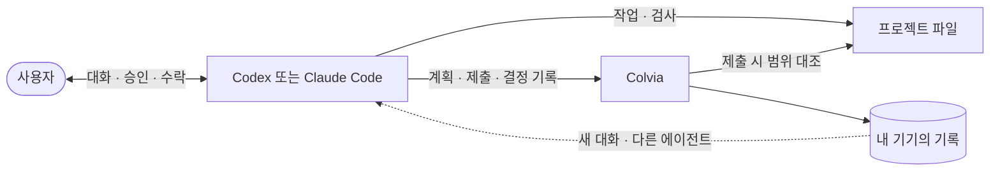
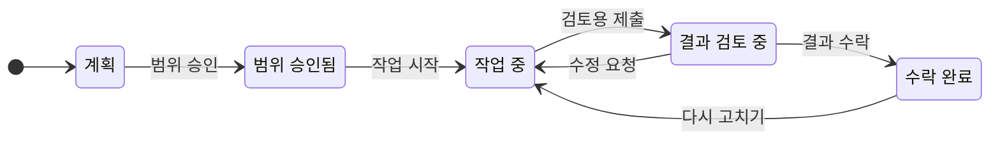

# Colvia 한눈에 보기

[사용 설명서](README.md) · 한국어 · [English](../en/overview.md)

Colvia는 사람과 AI가 함께 일하는 로컬 워크플로 도구입니다. Codex나 Claude Code가 제안한 작업 범위를 승인하고, 결과를 검토해 받아들일지 결정합니다. Colvia는 승인 내역과 제출본을 내 기기에 보관합니다. 같은 프로젝트를 열면 새 대화나 다른 에이전트에서도 작업을 이어갈 수 있습니다.

[누가 무엇을 맡나요](#roles) · [세 가지 결정](#decisions) · [Work 하나의 흐름](#work) · [무엇이 어디에 남나요](#where) · [Colvia가 하지 않는 일](#not)

## 누가 무엇을 맡나요

| 주체 | 맡는 일 |
| --- | --- |
| 사용자 | 목표와 범위를 정하고, 필요한 접근을 허용하고, 결과를 수락할지 결정합니다. |
| Codex·Claude Code | 프로젝트 규칙을 읽고, 작업을 제안하고, 실제 작업과 검사를 수행합니다. |
| Colvia | 제출할 때 파일 변경을 승인 범위와 대조합니다. 계획·승인·제출본·결정을 내 기기에 보관해 에이전트가 같은 Work를 찾아 이어갈 수 있게 합니다. |

Colvia는 대화 창을 따로 제공하지 않습니다. 평소 쓰는 채팅에서 요청하면 에이전트가 필요할 때 Colvia를 호출합니다.

## 따로 내리는 세 가지 결정

앱이나 CLI에서 파일 또는 명령 접근을 허용하는 결정, Work의 범위를 승인하는 결정, 검토한 제출본을 수락하는 결정은 각각 따로 합니다.

| 결정 | 어디서 하나 | 뜻 |
| --- | --- | --- |
| 접근 허용 | 앱이나 CLI의 권한 요청 | 에이전트가 어떤 파일을 읽고 쓰거나 어떤 도구를 쓸 수 있는지 정합니다. |
| 범위 승인 | 에이전트와의 대화. Colvia가 기록 | 이 목표와 파일 범위, 검사 기준으로 일을 맡깁니다. |
| 결과 수락 | 에이전트와의 대화. Colvia가 기록 | 방금 읽은 이 제출본을 받아들입니다. |

[범위 밖 변경으로 제출이 거부되면](work.md#review) 작업한 파일은 폴더에 남습니다. 변경을 확인하고 정리한 뒤 다시 제출하세요.

[결과 알림](maintenance.md#notifications)을 누르면 해당 Work가 열립니다. 제출본을 읽고 수락할지는 그때 결정하세요. 수락한 결과를 [Git에 반영](git.md#git-integration)하려면 커밋에 들어갈 변경과 스테이징 상태를 확인하고 따로 승인합니다.

v0.2.0부터는 Colvia로 커밋을 준비할 때 알려진 형태의 키·토큰과 보호 경로를 검사합니다. [자격증명 검사 범위와 예외](git.md#git-credential-check)

## Work 하나의 흐름

Colvia는 범위를 정해 맡기고 검토하는 작업 한 건을 **Work(작업 단위)** 하나로 기록합니다.

1. **범위를 승인합니다.** 에이전트가 살펴볼 자료, 만들 파일과 확인 기준을 제안합니다.
2. **제출본과 검사 결과를 봅니다.** 에이전트가 결과를 제출하고 검사에서 통과한 것, 실패한 것, 확인하지 못한 것을 알려줍니다.
3. **수락하거나 수정을 요청합니다.** 수정할 내용이 기존 범위 안에 있으면 같은 Work에서 이어갑니다.
4. **필요할 때 다음 일을 기록합니다.** 새 대화에서 결과와 함께 그 결정을 찾을 수 있습니다.

짧은 질문과 자료 조회, 직접 요청한 오탈자 교정처럼 [Work 없이 처리할 수 있는 일](work.md#without-work)도 있습니다. 자세한 사용법은 [일을 맡기고 검토하기](work.md)에 있습니다.

## 무엇이 어디에 남나요

| 위치 | 남는 것 |
| --- | --- |
| 프로젝트 폴더 | 내 문서와 코드, 프로젝트 실행기, 연결 정보, 에이전트 지침의 Colvia 안내 |
| 운영체제의 사용자 데이터 폴더 | 계획·승인·제출본·결정을 담은 프로젝트별 기록, Colvia 설치본 |
| Git 저장소 | 사용자가 따로 승인해 반영한 커밋. Colvia 기록은 여기에 들어가지 않습니다. |

그래서 다음을 기억해 두면 좋습니다.

- 대화를 닫거나 에이전트를 바꿔도 같은 프로젝트를 열면 기록을 찾을 수 있습니다.
- 프로젝트 연결을 해제하거나 Colvia를 제거해도 파일과 Work 기록은 남습니다.
- Git commit이나 clone만으로는 Colvia 기록이 백업되지 않습니다. [기록 백업과 복원](records.md#backup)을 사용하세요.
- 계획에 적은 기존 파일의 본문과 제출본은 기록과 백업에 남습니다. 필요한 파일만 범위에 넣으세요. [Colvia가 보관하는 내용](records.md#retained-contents)

## Colvia가 하지 않는 일

- **파일 접근을 통제하지 않습니다.** 에이전트가 읽고 쓰는 파일과 실행할 도구는 앱이나 CLI의 권한 설정에서 정합니다. 다른 앱이나 에이전트도 권한이 있는 파일은 수정할 수 있습니다. Colvia는 제출할 때 자신이 추적하는 파일의 변경을 승인 범위와 대조하고, 범위를 벗어난 변경이 확인되면 제출을 멈춥니다.
- **에이전트를 직접 실행하지 않습니다.** Colvia가 에이전트를 직접 호출하는 기능은 첫 Preview에서 비활성 상태입니다.
- **여러 에이전트의 동시 편집을 조율하지 않습니다.** 여러 Work의 상태를 보관하는 것과 여러 에이전트가 동시에 같은 파일을 수정하는 것은 다릅니다.
- **Git에 자동으로 반영하지 않습니다.** 커밋할 변경과 스테이징 상태를 검토하고 별도로 승인합니다.
- **대화 내용을 처리하지 않습니다.** 에이전트에게 공유한 자료와 대화에는 사용 중인 AI 서비스의 데이터 처리 설정이 적용됩니다.

구성요소와 저장 구조는 [아키텍처](architecture.md)에서 자세히 설명합니다.

---

다음 · [설치와 프로젝트 연결](install.md) · [따라 하기](tutorial.md)
