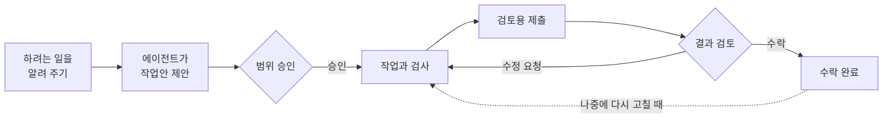

# 일을 맡기고 검토하기

[사용 설명서](README.md) · 한국어 · [English](../en/work.md)

연결한 프로젝트에서 일을 맡기고, 제출본을 검토해 수락하거나 수정을 요청하고, 새 대화에서 이어가는 방법입니다. Colvia는 목표, 파일 범위, 검사, 제출본과 결정을 **Work(작업 단위)** 하나에 남깁니다.

[시작하기](#start) · [오늘 볼 일](#project-status) · [맡기고 검토하기](#review) · [새 대화에서 이어가기](#resume) · [이전 결과 고치기](#revise) · [후속 작업 찾기](#follow-up) · [하위 Work와 격리 폴더](#child-works)

마름모 두 곳이 사용자의 결정입니다. 범위 승인은 일을 맡기는 결정이고, 수락은 방금 읽은 제출본에 대한 결정입니다.

## 하고 싶은 일부터 시작하기

폴더 연결을 마치면 지금 대화에서 하려던 일을 한두 문장으로 알려주세요. 에이전트는 이렇게 안내할 수 있습니다.

> 폴더 연결이 완료되었습니다. 이어서 이 폴더로 어떤 작업을 하려는지 짧게 알려주세요.

> 팀 회의에서 나온 할 일을 모아 관리하는 작은 프로젝트를 시작하고 싶어요.

프로젝트 자료가 없는 폴더에서는 에이전트가 현재 상태를 설명하고 아이디어를 목표와 첫 작업으로 구체화하도록 도울 수 있습니다. 예를 들어 “회의 결과를 한 페이지로 정리하고 싶어요”라고 말해도 됩니다. 이미 목적이나 작업을 말한 경우에는 그 내용과 기존 브리프, README, 프로젝트 규칙을 바탕으로 작업안을 제안받을 수 있습니다.

문서라면 목차와 검토 기준을, 새 앱이라면 첫 버전의 범위와 권장 기술, 실행·검증 방법을 제안받을 수 있습니다. 한 브라우저에서 혼자 쓰는 할 일 목록은 간단한 웹페이지와 브라우저 저장소로 시작할 수 있습니다. 팀용 목록이라면 첫 버전의 범위를 검토할 때 데이터 공유 방식과 접근 권한 제안도 함께 살펴보세요.

이미 할 일이 분명하다면 바로 요청하세요. 짧은 질문이나 파일 조회는 이미 허용한 범위에서 바로 처리할 수 있습니다.

프로젝트 목표와 규칙은 작업 범위를 검토할 때 함께 다루거나 나중에 정리할 수 있습니다. 작업 범위를 승인하기 전에 파일 이름과 변경 내용을 확인하고, 계획을 기록하기 전에 [Colvia가 보관하는 내용](records.md#retained-contents)을 살펴보세요.

### Work 없이 처리할 수 있는 일

직접 요청한 오탈자·띄어쓰기·문장부호 교정은 새 Work 없이 처리할 수 있습니다. 프로젝트 규칙과 허용한 접근 범위 안에서 뜻과 동작이 유지되고, 별도 결과 검토나 보존, 인계가 필요 없을 때에만 해당합니다. 기존 Work에 속한 수정이라면 해당 Work의 승인 범위와 기록을 확인해 이어갑니다.

## 맡기고 검토하기

> 문의 유형과 자주 나오는 불편 사항을 정리해 회의용 보고서를 만들어 주세요. 개선 우선순위는 제가 정할게요.

1. **범위를 승인합니다.** 에이전트가 만들 파일과 확인 기준을 제안합니다. 범위가 맞으면 진행하라고 답하세요. Colvia는 어느 계획을 승인했는지 기록합니다.
2. **제출본과 검사 결과를 봅니다.** 작업을 마치면 에이전트가 검사 결과를 남기고 검토용으로 제출합니다. Colvia는 검토용 제출 시 승인 범위를 확인해 범위 밖 변경이 있으면 제출을 막습니다. 제출이 거부되면 이미 바뀐 파일은 작업 폴더에 남습니다. 변경을 확인한 뒤 정리해 다시 제출하세요.
3. **수락하거나 수정을 요청합니다.** 제출본을 읽고 이 결과를 수락할지, 더 고칠지 결정하세요. Colvia는 어느 제출본을 수락했는지 기록합니다.

앱이나 CLI의 권한 요청은 에이전트가 어떤 파일을 읽고 쓰거나 어떤 도구를 쓸 수 있는지 정합니다. 작업 범위와 제출본은 각각 따로 확인하세요.

결과를 직접 수락할 때 Colvia는 해당 폴더의 현재 파일을 검토한 제출본과 다시 대조합니다. 그사이에 파일이 바뀌었다면 변경을 확인하고 다시 제출해야 합니다.

### 수락한 Work 보관하기

수락을 마친 Work는 보관 처리할 수 있습니다. 보관은 기록 삭제나 저장 공간 정리가 아닙니다. 보관한 뒤에도 제출 본문·결정·후속 연결을 확인할 수 있습니다.

## 다른 작업을 하거나 잠시 멈추기

“A는 두고 B부터 보자”라고 하세요. B의 계획이나 제출본을 열어도 A는 그대로입니다. C를 하다가 A로 돌아올 수도 있습니다. 나중에 돌아올 표시를 남기려면 “A를 잠시 멈춰 줘. 다음에는 표 출처부터 확인할게”라고 하세요. 에이전트가 어느 작업을 멈추는지와 폴더에 남을 변경을 보여 주면 확인하세요.

“A를 다시 이어가자”라고 하면 진행 중이던 작업은 같은 승인 범위에서, 검토 중이던 작업은 같은 제출본에서 이어갑니다. 중단 뒤 바뀐 파일과 확인할 수 없는 경로를 먼저 확인하세요. 중단 시 승인된 경로를 정렬해 앞에서 최대 128개까지 대조하며, 나머지는 미확인으로 표시합니다. 같은 폴더의 파일은 다른 Work에서도 바뀔 수 있습니다. Colvia는 파일을 이전 상태로 되돌리지 않습니다. 마지막 제출본과 파일이 달라졌다면 수정 내용을 검토해야 수락할 수 있습니다.

“A는 더 진행하지 않을게”라고 하면 사유를 확인한 뒤 폐기합니다. 작업 파일, 승인 내역, 중간 메모와 제출본은 남습니다. 목표가 달라졌다면 “A를 B로 대체해 줘”라고 하세요. 기존 B를 고르거나 새 B의 계획을 먼저 기록할 수 있습니다. A의 종료와 B로 이어진 이유가 함께 남습니다. B에서는 B의 승인 범위를 따릅니다.

보관한 완료 Work와 폐기한 Work는 현재 목록에서 숨깁니다. 전체 목록이나 Work 상세에서 다시 볼 수 있습니다. 완료 Work를 보관 해제하면 완료 상태로 돌아옵니다. 처음으로 중단·재개·폐기·대체 결정을 기록하면 이전 실행기로 이 프로젝트를 열거나 새 백업을 복원할 수 없습니다.

## 제출 전에 잠깐 멈출 때

진행 중인 일반 Work에서 “내일 이어가게 여기까지 기록해 줘”라고 하세요. 한 일과 확인한 것, 남은 일, 다음 행동을 Work에 남깁니다. “오늘은 이만하자”라고만 했다면 저장할지 먼저 묻습니다. 메모만으로 결과를 제출하거나 수락하지 않습니다.

새 대화에서 “하던 일 이어가자”라고 하면 마지막 메모와 승인 범위를 열고 그때와 지금의 파일을 비교합니다. 예를 들어 출처 확인을 남겼는데 보고서가 바뀌었다면 바뀐 보고서부터 확인합니다. 확인하지 못한 경로는 따로 표시합니다. 메모에 적힌 검사 결과는 제출용 검사 보고를 대신하지 않습니다. 이미 제출한 결과를 돌려보낸 작업은 기존 수정 요청에서 이어갑니다. 같은 승인 범위로 돌아온 Work에서는 이전 메모에서 이어갈 수 있습니다. 파일을 추가로 승인해도 메모에 있던 파일은 계속 대조합니다. 추가한 파일은 다음 메모부터 비교할 수 있습니다.

첫 메모를 저장하면 이 프로젝트의 기록과 이후 백업을 열 때 중간 메모를 지원하는 버전이 필요합니다. v0.2.0으로 돌아갈 가능성이 있다면 첫 메모 전에 [백업](records.md#backup)을 따로 보관하세요.

## 오늘 뭐부터 보면 돼?

연결한 폴더에서 “오늘 뭐부터 보면 돼?”라고 물어보세요. 한 건이면 제목과 다음 행동을 한 줄로 보여 줍니다. 여러 건이면 “내 검토 1건”처럼 내 차례부터 보입니다. 내가 봐야 할 제출본, 돌려보낸 수정 요청, 메모에서 이어갈 일, 일시정지한 이유를 구분해 볼 수 있습니다. 순위나 의존 관계를 미리 입력할 필요가 없습니다.

이어서 “그 제안서 수정본 보여줘”라고 하면 방금 본 판본을 열 수 있습니다. 어느 작업인지 모호하면 제목이나 파일로 구분합니다. 일부 기록만 읽었을 때는 다른 검토 요청이 있을 수 있다는 안내가 나옵니다. 더 보고 싶으면 “나머지도 보여줘”라고 하세요.

## 새 대화나 다른 에이전트에서 이어가기

새 대화에서는 같은 프로젝트를 열고 “아까 맡긴 보고서에서 내가 확인할 부분만 보여줘”라고 물어보세요. 에이전트가 작업 폴더와 Colvia 기록에 접근할 수 있으면 승인 범위, 마지막 제출본, 현재 파일과 달라진 부분, 기록해 둔 후속 결정을 확인할 수 있습니다.

Codex와 Claude Code를 모두 이용 중이라면 같은 프로젝트에서 두 에이전트를 번갈아 쓸 수 있습니다. 바꿔 쓰는 에이전트가 연결한 폴더와 Colvia 기록 폴더를 읽을 수 있으면 이전 기록을 찾을 수 있습니다. 앱이 만든 Git 작업 폴더라면 원래 프로젝트와 연결된 폴더인지 먼저 확인하세요.

코드를 고친 결과도 같은 방식으로 이어서 볼 수 있습니다.

> 제가 수락한 파일 업로드 변경 이후에 달라진 파일과 다시 볼 부분을 보여 주세요. 업로드가 끊겼다가 재개되는 경우는 검사했나요?

에이전트가 현재 파일과 수락한 제출본을 대조하고, 기록된 검사에서 통과·실패·확인 불가를 구분하고, 해당 검사 기록이 없으면 그 점을 알려 줄 수 있습니다.

## 이전 결과 고치기

다른 작업을 진행한 뒤 이전 결과를 고치려면, 고칠 부분을 말씀해 주세요. 에이전트는 기록된 수정 요청과 승인 범위, 마지막 제출 뒤 바뀐 내용을 확인해 이어갑니다. 기존 승인이 유효하고 요청한 수정이 그 범위 안에 있으면 같은 Work에서 이어갑니다. 다른 Work가 새로 추가해 제출한 파일은 현재 내용이 그 Work의 제출 기록과 일치할 때만 해당 Work의 변경으로 구분합니다. 출처를 확인할 수 없는 변경이나 범위 밖에서 수정·삭제된 파일이 있으면 에이전트가 해당 파일을 알려 줍니다. 수정본은 보존되고, 결과를 받아들일지는 검토 후 결정합니다.

이렇게 다른 Work가 추가한 파일을 구분해 제출한 수정본은 작성한 작업 폴더에서 검토하고 수락할 수 있습니다. 그 수정본을 다른 작업 폴더에 적용하는 것은 현재 지원 범위 밖입니다.

### 승인 범위 밖의 파일이 필요해졌을 때

파일을 건드리기 전에 “이 제안서에 표 수정과 부록 생성을 추가하려면 무엇을 승인해야 해?”라고 물어보세요. 첫 제출 전인 일반 Work라면 에이전트가 수정할 파일, 새로 만들 파일, 이유와 추가 검사를 보여 줍니다. 이 제안을 승인하면 기존 승인과 작성 중인 내용, 중간 메모가 같은 Work에 남습니다. 제안서와 부록은 한 번에 제출하고 함께 수락할 수 있습니다.

수정할 파일은 처음 관찰한 내용과 일치해야 합니다. 추가 승인 때 그 원문을 저장하며 이후 백업에도 들어갑니다. 새 파일은 이미 있는 폴더 안에서 정확한 이름을 정하고, 미리보기와 승인 적용 때 모두 그 경로가 비어 있어야 합니다. 이미 만든 파일은 소급 승인할 수 없습니다. 격리 작업 폴더는 이 기능의 대상에서 제외됩니다. 파일이 있거나 보호·무시 대상이거나 경로가 불확실하면 안내된 위치를 확인하세요. 목표가 달라지거나 이미 첫 제출을 마쳤다면 기존 후속 Work 또는 수정 요청 절차로 이어갑니다.

프로젝트에서 첫 추가 승인을 적용하면 기록과 이후 백업을 여는 데 이 기능을 지원하는 버전이 필요합니다. 이전 버전으로 돌아갈 가능성이 있다면 승인 전에 [백업](records.md#backup)을 따로 보관하세요.

## 기록한 후속 작업 찾기

“회의 보고서 뒤에 무엇을 하기로 했지?”라고 물어보세요. 에이전트는 `ordinary list`로 해당 Work를 찾고, `ordinary view WORK_ID`로 작업을 보거나 `followup WORK_ID`로 기록한 후속 결정을 확인합니다. 모두 같은 프로젝트 실행기를 사용합니다. `candidate list`에서는 저장한 후보와 이미 연결한 Work를 볼 수 있습니다. 이 명령들은 기록을 조회합니다.

후속 선택을 기록한 적이 없는 경우, 후속 작업을 두지 않기로 한 경우, 결정을 미룬 경우를 각각 표시합니다. 후속 후보나 Work를 선택했다면 이름과 상태가 나옵니다. 선택한 뒤 계획이나 후보가 바뀌었다면 당시 기록과 연결된 선택이라고 표시합니다. 이어갈 때는 해당 Work의 범위 승인 기록을 확인하세요. 현재 범위에 유효한 승인이 있으면 재사용합니다.

### 실습 · 새 대화에서 회의 보고서 이어 보기

같은 연결 프로젝트에서 회의 보고서를 제출한 적이 있다면 새 대화를 열고 이렇게 요청하세요.

> 회의 보고서 Work를 찾아 마지막 제출 상태와 기록된 후속 결정을 알려 주세요. 조회만 해 주세요.

‘후속 작업 없음’으로 기록돼 있다면 후속을 두지 않기로 한 것입니다. 후속 선택 기록이 없거나 결정이 미뤄졌다면 다음 일은 아직 정해지지 않은 상태입니다. 후보나 Work가 표시되면 이어갈 작업에 이미 승인된 범위가 있는지 확인하세요.

## 하위 Work와 격리 폴더의 결과

같은 폴더에서 큰 목표를 바로 아래 하위 Work로 나눴다면 각 제출본을 검토하고 수락합니다. 격리 폴더(같은 저장소에 등록한 별도 Git 작업 폴더)의 결과를 반영할 때는 어느 제출본을 어느 대상 폴더에 반영할지 확인하세요.

- 아직 검토 중인 제출본이면 미리보기에서 반영과 수락을 함께 승인합니다. Colvia는 반영이 완료되고 대상 파일을 확인한 뒤 해당 제출본의 수락을 기록합니다.
- 이미 수락한 제출본이면 반영만 승인합니다.

반영 전에 대상 폴더를 확인하세요. 그 폴더에 승인됐거나 진행 중이거나 검토 중인 다른 Work가 있으면 Colvia가 반영을 멈춥니다. 한 건씩 반영하고, 여러 결과를 모은 상위 Work의 전체 결과와 검사 내용을 따로 검토해 수락합니다.

승인한 제출본을 대상 폴더에 반영하는 도중 멈췄다면 준비 기록이 남아 있는지 확인하세요. 그 기록이 있으면 승인한 제출본으로 반영을 이어갑니다. 대상 폴더의 연결과 공통 Git 디렉터리가 유효해야 합니다. 준비 기록이나 대상 연결을 확인할 수 없다면 반영을 멈추고 진단을 요청하세요.

지정한 격리 Work의 반영과 수락을 위임할 때는 원본과 대상, 파일 범위, 지정한 대리인, 유효한 위임을 확인합니다. 이 위임은 지정한 격리 Work에 적용됩니다. 다른 Work와 상위 Work의 최종 결과를 수락할지는 사용자가 결정합니다.

사라진 worktree 때문에 명령이 멈췄다면 [Git의 등록 상태](git.md#git-worktree-registration)부터 확인하세요. 일반 Work 결과를 수락할 때는 해당 작업 폴더의 현재 파일을 대조합니다.

## 첫 Preview에서 알아 둘 점

- 여러 Work의 상태를 보관하는 것과 여러 에이전트가 동시에 같은 파일을 수정하는 것은 다릅니다. 첫 공개에서 실제 동시 실행을 지원한다고 가정하지 마세요. 겹치는 변경이나 확인할 수 없는 중단 상태에서는 멈추고 현재 상태를 확인합니다.
- Colvia가 에이전트를 직접 호출하는 문서 실행은 첫 Preview에서 비활성입니다. Codex나 Claude Code의 일반 CLI와 데스크톱에서 작업하고 검토하는 흐름은 별개입니다. 현재 설정은 [문서 실행 준비 상태 확인](reference.md#execution-readiness)으로 볼 수 있습니다.
- 에이전트에게 공유한 자료와 대화에는 사용 중인 AI 서비스의 데이터 처리 설정이 적용됩니다.

---

다음 · [Git과 함께 쓰기](git.md) · [기록과 백업, 폴더 이동](records.md)
