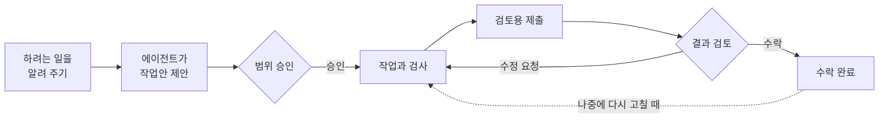

# 일을 맡기고 검토하기

[사용 설명서](README.md) · 한국어 · [English](../en/work.md)

연결한 프로젝트에서 일을 맡기고, 제출본을 검토해 수락하거나 수정을 요청하고, 새 대화에서 이어가는 방법입니다. Colvia는 목표, 파일 범위, 검사, 제출본과 결정을 **Work(작업 단위)** 하나에 남깁니다.

[시작하기](#start) · [오늘 내가 볼 건 뭐지?](#project-status) · [맡기고 검토하기](#review) · [새 대화에서 이어가기](#resume) · [이전 결과 고치기](#revise) · [후속 작업 찾기](#follow-up) · [하위 Work와 격리 폴더](#child-works)

마름모 두 곳이 사용자의 결정입니다. 범위 승인은 일을 맡기는 결정이고, 수락은 방금 읽은 제출본에 대한 결정입니다.

## 하고 싶은 일부터 시작하기

폴더 연결을 마치면 지금 대화에서 하려던 일을 한두 문장으로 알려주세요. 에이전트는 이렇게 안내할 수 있습니다.

> 폴더 연결이 완료되었습니다. 이어서 이 폴더로 어떤 작업을 하려는지 짧게 알려주세요.

> 팀 회의에서 나온 할 일을 모아 관리하는 작은 프로젝트를 시작하고 싶어요.

프로젝트 자료가 없는 폴더에서는 에이전트가 현재 상태를 설명하고 아이디어를 목표와 첫 작업으로 구체화하도록 도울 수 있습니다. 예를 들어 “회의 결과를 한 페이지로 정리하고 싶어요”라고 말해도 됩니다. 이미 목적이나 작업을 말한 경우에는 그 내용과 기존 브리프, README, 프로젝트 규칙을 바탕으로 작업안을 제안받을 수 있습니다.

문서라면 목차와 검토 기준을, 새 앱이라면 첫 버전의 범위와 권장 기술, 실행·검증 방법을 제안받을 수 있습니다. 한 브라우저에서 혼자 쓰는 할 일 목록은 간단한 웹페이지와 브라우저 저장소로 시작할 수 있습니다. 팀용 목록이라면 첫 버전의 범위를 검토할 때 데이터 공유 방식과 접근 권한 제안도 함께 살펴보세요.

이미 할 일이 분명하다면 바로 요청하세요. 짧은 질문이나 파일 조회는 이미 허용한 범위에서 바로 처리할 수 있습니다.

프로젝트 목표와 규칙은 작업 범위를 검토할 때 함께 다루거나 나중에 정리할 수 있습니다. 작업 범위를 승인하기 전에 파일 이름과 변경 내용을 확인하고, 계획을 기록하기 전에 [Colvia가 보관하는 내용](records.md#retained-contents)을 살펴보세요.

### 팀원이 찾을 수 있는 곳에 결정과 이유 남기기

“두 가지 발송 방식 중 왜 일괄 발송을 골랐는지 우리 팀 방식으로 남겨 줘”라고 요청해 보세요. 팀에서 브리프로 대안을 비교하고 결정 기록에 채택 여부와 이유를 남긴다면 에이전트도 그 방식을 따릅니다. 결정 기록과 색인을 함께 고쳐야 하면 두 파일을 한 계획에 담습니다. 팀이 아직 결정하지 않았다면 초안에 대안과 남은 질문을 적습니다. 초안의 문장을 수락한 뒤에도 정책 채택은 팀의 검토 절차를 따릅니다.

결정 기록이 저장소에 반영되면 동료는 저장소를 동기화한 뒤 평소 쓰던 색인에서 결정 상태와 이유를 찾을 수 있습니다. 내가 수락한 판은 내 기기의 Colvia에서 다시 볼 수 있습니다.

팀 위키에만 기록한 결정은 위키를 읽을 권한이 있어야 확인할 수 있습니다. 저장소에 링크가 없으면 동기화만으로는 그 결정을 찾을 수 없습니다. 이때 팀의 공유 규칙이 허용하면 에이전트가 기존 색인에 링크를 추가할지 제안합니다. 에이전트에게 쓰기 권한이 없으면 위키에 올릴 문안을 받을 수 있습니다. 공유 양식이 없는 폴더에서는 독자에게 적합한 기존 메모 한 곳으로 시작해도 됩니다.

에이전트는 같은 변경을 같은 조건으로 검사한 결과가 있으면 재사용합니다. 프로젝트 규칙에 따라 예상과 다르게 진행해야 할 때는 그 이유를 짧게 알려 줍니다. 예를 들어 커밋과 동시에 문서가 자동 게시되는데 초안 작성만 승인했다면, 에이전트는 초안을 준비하고 커밋 전에 멈춰 게시까지 이어진다는 점을 알려 줍니다.

### Work 없이 처리할 수 있는 일

이미 맡긴 안내를 더 다듬고 싶다면 “방금 수락한 안내의 마지막 예시도 고쳐 줘”라고 하세요. 같은 목표와 승인 범위 안이라면 에이전트가 같은 Work에서 고칩니다. 검토 중이거나 수락한 판에 수정을 요청하면 이전 판과 결정은 그대로 남고, 새 판을 보고 다시 수락할 수 있습니다.

독립된 수정이라면 “README의 작업 목록 보기 예시를 현재 명령에 맞춰 줘”라고만 해도 됩니다. 프로젝트 규칙과 허용한 접근 범위 안에서, 현재 버전의 명령 도움말을 보면 그 자리에 쓸 명령이 하나로 정해지고 바로 확인할 수 있는 경우입니다. 별도 검토나 결과 보관·인계가 필요 없으면 에이전트가 새 Work 없이 예시를 고치고 바뀐 문장과 확인 결과를 알려 줍니다. 뜻을 바꾸지 않는 오탈자 교정도 마찬가지입니다.

연결만 해제할지 데이터까지 삭제할지 정해야 하거나, 삭제·권한 안내처럼 잘못 고쳤을 때 영향이 크다면 Work로 진행하세요. 프로젝트가 리뷰를 요구하거나 제출본·수락 이력을 남기고 싶을 때도 Work를 씁니다. 도중에 다른 파일까지 고쳐야 한다면 에이전트가 먼저 이유와 추가 범위를 제안합니다. Git 반영은 따로 결정합니다.

## 맡기고 검토하기

> 문의 유형과 자주 나오는 불편 사항을 정리해 회의용 보고서를 만들어 주세요. 개선 우선순위는 제가 정할게요.

1. **범위를 승인합니다.** 에이전트가 만들 파일과 확인 기준을 제안합니다. 범위가 맞으면 진행하라고 답하세요. Colvia는 어느 계획을 승인했는지 기록합니다.
2. **에이전트가 만들고 검사하고 고칩니다.** 예를 들어 유형별 문의 건수의 합이 원본과 다르면 에이전트는 승인한 범위 안에서 보고서를 고치고 합계를 다시 확인할 수 있습니다. 다른 파일이나 새로운 검사 기준이 필요하면 변경을 제안하고 승인을 기다립니다.
3. **제출본과 검사 결과를 봅니다.** 작업을 마치면 에이전트가 검사 결과를 남기고 검토용으로 제출합니다. Colvia는 검토용 제출 시 승인 범위를 확인해 범위 밖 변경이 있으면 제출을 막습니다. 제출이 거부되면 이미 바뀐 파일은 작업 폴더에 남습니다. 변경을 확인한 뒤 정리해 다시 제출하세요.
4. **수락하거나 수정을 요청합니다.** 제출본을 읽고 이 결과를 수락할지, 더 고칠지 결정하세요. Colvia는 어느 제출본을 수락했는지 기록합니다.

앱이나 CLI의 권한 요청은 에이전트가 어떤 파일을 읽고 쓰거나 어떤 도구를 쓸 수 있는지 정합니다. 작업 범위와 제출본은 각각 따로 확인하세요.

결과를 직접 수락할 때 Colvia는 해당 폴더의 현재 파일을 검토한 제출본과 다시 대조합니다. 그사이에 파일이 바뀌었다면 변경을 확인하고 다시 제출해야 합니다.

### 수락한 Work 보관하기

수락을 마친 Work는 보관 처리할 수 있습니다. 보관은 기록 삭제나 저장 공간 정리가 아닙니다. 보관한 뒤에도 제출 본문·결정·후속 연결을 확인할 수 있습니다.

## 다른 작업을 하거나 잠시 멈추기

“A는 두고 B부터 보자”라고 하세요. B의 계획이나 제출본을 열어도 A는 그대로입니다. C를 하다가 A로 돌아올 수도 있습니다. 나중에 돌아올 표시를 남기려면 “A를 잠시 멈춰 줘. 다음에는 표 출처부터 확인할게”라고 하세요. 에이전트가 어느 작업을 멈추는지와 폴더에 남을 변경을 보여 주면 확인하세요.

“A를 다시 이어가자”라고 하면 진행 중이던 작업은 같은 승인 범위에서, 검토 중이던 작업은 같은 제출본에서 이어갑니다. 중단 뒤 바뀐 파일과 확인할 수 없는 경로를 먼저 확인하세요. 중단 시 승인된 경로를 정렬해 앞에서 최대 128개까지 대조하며, 나머지는 미확인으로 표시합니다. 같은 폴더의 파일은 다른 Work에서도 바뀔 수 있습니다. Colvia는 파일을 이전 상태로 되돌리지 않습니다. 마지막 제출본과 파일이 달라졌다면 수정 내용을 검토해야 수락할 수 있습니다.

“A는 더 진행하지 않을게”라고 하면 사유를 확인한 뒤 폐기합니다. 작업 파일, 승인 내역, 중간 메모와 제출본은 남습니다. 목표가 달라졌다면 “A를 B로 대체해 줘”라고 하세요. 기존 B를 고르거나 새 B의 계획을 먼저 기록할 수 있습니다. A의 종료와 B로 이어진 이유가 함께 남습니다. B에서는 B의 승인 범위를 따릅니다.

보관한 완료 Work와 폐기한 Work는 현재 목록에서 숨깁니다. 전체 목록이나 Work 상세에서 다시 볼 수 있습니다. 완료 Work를 보관 해제하면 완료 상태로 돌아옵니다. 처음으로 중단·재개·폐기·대체 결정을 기록하면 이전 실행기로 이 프로젝트를 열거나 새 백업을 복원할 수 없습니다.

## 제출 전에 잠깐 멈출 때

진행 중인 일반 Work에서 “내일 이어가게 여기까지 기록해 줘”라고 하세요. 한 일과 확인한 것, 남은 일, 다음 행동을 Work에 남깁니다. “오늘은 이만하자”라고만 했다면 저장할지 먼저 묻습니다. 메모만으로 결과를 제출하거나 수락하지 않습니다.

새 대화에서 “하던 일 이어가자”라고 하면 마지막 메모와 승인 범위를 열고 그때와 지금의 파일을 비교합니다. 예를 들어 출처 확인을 남겼는데 보고서가 바뀌었다면 바뀐 보고서부터 확인합니다. 확인하지 못한 경로는 따로 표시합니다. 메모에 적힌 검사 결과는 제출용 검사 보고를 대신하지 않습니다. 이미 제출한 결과를 돌려보낸 작업은 기존 수정 요청에서 이어갑니다. 같은 승인 범위로 돌아온 Work에서는 이전 메모에서 이어갈 수 있습니다. 파일을 추가로 승인해도 메모에 있던 파일은 계속 대조합니다. 추가한 파일은 다음 메모부터 비교할 수 있습니다.

첫 메모를 저장하면 이 프로젝트의 기록과 이후 백업을 열 때 중간 메모를 지원하는 버전이 필요합니다. v0.2.0으로 돌아갈 가능성이 있다면 첫 메모 전에 [백업](records.md#backup)을 따로 보관하세요.

## 오늘 내가 볼 건 뭐지?

연결한 폴더에서 “오늘 내가 볼 건 뭐지?”라고 물어보세요. 한 건이면 제목과 다음 행동을 한 줄로 보여 줍니다. 여러 건이면 읽어 온 작업 중 내가 검토할 일을 “내 검토 1건”처럼 먼저 보여 줍니다. 검토할 제출본, 검토자가 에이전트에게 남긴 수정 요청, 메모에서 이어갈 일, 일시정지한 이유를 구분해 볼 수 있습니다. 순위나 의존 관계를 미리 입력할 필요가 없습니다.

“제안서 2판 보여 줘”라고 해 보세요. 방금 본 목록에서 ‘내 검토’였다면 목록에 표시됐던 판을 엽니다. ‘수정 요청’이었다면 검토자가 읽은 판과 에이전트에게 요청한 수정 내용을 볼 수 있습니다. 그사이에 새 제출본이 왔는지 궁금하면 “새로 제출한 판이 있는지 확인해 줘”라고 하세요. 같은 제목이 여럿이면 파일 이름으로 구분할 수 있습니다.

일부 기록만 읽었다면 확인한 범위에서 먼저 볼 일을 알려 줍니다. 다음 페이지만 보려면 “다음 것도 보여 줘”라고 하세요. 다른 검토 요청까지 모두 보려면 “프로젝트 전체에서 내가 볼 일을 알려 줘”라고 하세요. 다음 일의 후보는 “후보도 순위대로 보여 줘”라고 요청해 따로 볼 수 있습니다. 후보를 높음으로 정해도 그 작업을 시작할 권한이 생기지는 않습니다.

## 새 대화나 다른 에이전트에서 이어가기

새 대화에서는 같은 프로젝트를 열고 “아까 맡긴 보고서에서 내가 확인할 부분만 보여 줘”라고 물어보세요. 에이전트가 작업 폴더와 Colvia 기록에 접근할 수 있으면 승인 범위, 마지막 제출본, 현재 파일과 달라진 부분, 기록해 둔 후속 결정을 확인할 수 있습니다.

Codex와 Claude Code를 모두 이용 중이라면 같은 프로젝트에서 두 에이전트를 번갈아 쓸 수 있습니다. 바꿔 쓰는 에이전트가 연결한 폴더와 Colvia 기록 폴더를 읽을 수 있으면 이전 기록을 찾을 수 있습니다. 앱이 만든 Git 작업 폴더라면 원래 프로젝트와 연결된 폴더인지 먼저 확인하세요.

코드를 고친 결과도 같은 방식으로 이어서 볼 수 있습니다.

> 제가 수락한 파일 업로드 변경 이후에 달라진 파일과 다시 볼 부분을 보여 주세요. 업로드가 끊겼다가 재개되는 경우는 검사했나요?

에이전트가 현재 파일과 수락한 제출본을 대조하고, 기록된 검사에서 통과·실패·확인 불가를 구분하고, 해당 검사 기록이 없으면 그 점을 알려 줄 수 있습니다.

## 이전 결과 고치기

다른 작업을 진행한 뒤 이전 결과를 고치려면, 고칠 부분을 말씀해 주세요. 에이전트는 기록된 수정 요청과 승인 범위, 마지막 제출 뒤 바뀐 내용을 확인해 이어갑니다. 기존 승인이 유효하고 요청한 수정이 그 범위 안에 있으면 같은 Work에서 이어갑니다. 다른 Work가 새로 추가해 제출한 파일은 현재 내용이 그 Work의 제출 기록과 일치할 때만 해당 Work의 변경으로 구분합니다. 출처를 확인할 수 없는 변경이나 범위 밖에서 수정·삭제된 파일이 있으면 에이전트가 해당 파일을 알려 줍니다. 수정본은 보존되고, 결과를 받아들일지는 검토 후 결정합니다.

이렇게 다른 Work가 추가한 파일을 구분해 제출한 수정본은 작성한 작업 폴더에서 검토하고 수락할 수 있습니다. 그 수정본을 다른 작업 폴더에 적용하는 것은 현재 지원 범위 밖입니다.

### 승인 범위 밖의 파일이 필요해졌을 때

파일을 건드리기 전에 “이 제안서에 표 수정과 부록 생성을 추가하려면 무엇을 승인해야 해?”라고 물어보세요. 일반 Work의 첫 제출 전이거나 제출본에 수정을 요청한 상태라면 에이전트가 수정할 파일, 새로 만들 파일, 이유와 추가 검사를 보여 줍니다. 이 제안을 승인하면 기존 승인과 작성 중인 내용, 중간 메모가 같은 Work에 남습니다. 제안서와 부록은 한 번에 제출하고 함께 수락할 수 있습니다.

수정할 파일은 처음 관찰한 내용과 일치해야 합니다. 추가 승인 때 그 원문을 저장하며 이후 백업에도 들어갑니다. 새 파일은 이미 있는 폴더 안에서 정확한 이름을 정하고, 미리보기와 승인 적용 때 모두 그 경로가 비어 있어야 합니다. 이미 만든 파일은 소급 승인할 수 없습니다. 격리 작업 폴더는 이 기능의 대상에서 제외됩니다. 파일이 있거나 보호·무시 대상이거나 경로가 불확실하면 안내된 위치를 확인하세요. 목표가 달라졌다면 후속 Work로 진행하세요.

예를 들어 1판을 보고 출처를 보강해 달라고 했다면, 근거 표를 고치기 전에 범위 추가를 요청하세요. 미리보기에서 어느 판에 어떤 수정을 요청했는지와 추가할 파일을 확인합니다. 승인하면 표까지 고쳐 2판으로 제출할 수 있습니다. 나중에 1판을 열면 당시의 범위와 본문을 확인할 수 있습니다. 다른 Work가 추가 승인한 경로의 변경을 제출했거나 관련 기록을 대조할 수 없으면 제출을 멈춥니다. 두 작업의 내용을 보존하고 해당 경로를 확인하세요. 분리가 어렵다면 원래 Work를 일시정지하거나 명시적으로 폐기하고 새 Work에서 이어가세요. 추가 승인으로 파일이 잠기지는 않습니다. 이 Work가 먼저 제출하고 별도 승인을 받은 다른 Work가 나중에 같은 파일을 제출하면 두 제출본을 각각 검토할 수 있습니다. Colvia는 기록된 제출본을 대조하며, 기록 밖에서 누가 파일을 편집했는지까지 식별하지는 않습니다.

첫 제출 전에 파일을 추가 승인하면 범위 추가를 지원하는 버전이 필요합니다. 수정 요청 뒤에도 파일을 추가 승인하면, 이때부터 기록과 새 백업을 열 때 수정 중 범위 추가까지 지원하는 버전이 필요합니다. 이전 버전으로 돌아갈 가능성이 있다면 승인 전에 [백업](records.md#backup)을 따로 보관하세요.

## 기록한 후속 작업 찾기

“회의 보고서 뒤에 무엇을 하기로 했지?”라고 물어보세요. 에이전트는 `ordinary list`로 해당 Work를 찾고, `ordinary view WORK_ID`로 작업을 보거나 `followup WORK_ID`로 기록한 후속 결정을 확인합니다. 모두 같은 프로젝트 실행기를 사용합니다. `candidate list`에서는 저장한 후보와 이미 연결한 Work를 볼 수 있습니다. 이 명령들은 기록을 조회합니다.

후속 선택을 기록한 적이 없는 경우, 후속 작업을 두지 않기로 한 경우, 결정을 미룬 경우를 각각 표시합니다. 후속 후보나 Work를 선택했다면 이름과 상태가 나옵니다. 선택한 뒤 계획이나 후보가 바뀌었다면 당시 기록과 연결된 선택이라고 표시합니다. 이어갈 때는 해당 Work의 범위 승인 기록을 확인하세요. 현재 범위에 유효한 승인이 있으면 재사용합니다.

### 실습 · 새 대화에서 회의 보고서 이어 보기

같은 연결 프로젝트에서 회의 보고서를 제출한 적이 있다면 새 대화를 열고 이렇게 요청하세요.

> 회의 보고서 Work를 찾아 마지막 제출 상태와 기록된 후속 결정을 알려 주세요. 조회만 해 주세요.

‘후속 작업 없음’으로 기록돼 있다면 후속을 두지 않기로 한 것입니다. 후속 선택 기록이 없거나 결정이 미뤄졌다면 다음 일은 아직 정해지지 않은 상태입니다. 후보나 Work가 표시되면 이어갈 작업에 이미 승인된 범위가 있는지 확인하세요.

## 그때 왜 고쳐 달라고 했는지 확인하기

“제안서에서 시장 규모 수치를 왜 뺐지?”라고 물어보세요. 그 Work에서 어느 판을 보고 어떤 수정을 요청했는지, 나중에 어느 판을 수락했는지 확인할 수 있습니다. 당시 파일의 표현도 보려면 “그때 본 제안서도 보여 줘”라고 하세요.

수정 요청에 “출처가 불분명하니 수치를 빼 주세요”라고 남아 있으면 그 이유까지 찾을 수 있습니다. “수치를 빼 주세요”만 남아 있다면 삭제 요청은 확인되지만 이유는 알 수 없습니다. 진행 메모에 적힌 추측은 메모로 구분합니다. 오늘 이유를 덧붙이면 에이전트는 대화에서 이를 사후 설명으로 구분할 수 있습니다. 승인하거나 수정을 요청할 때마다 이유를 적을 필요는 없습니다.

[결정 이력 명령](reference.md#decision-history-command)은 최근 기록부터 보여 줍니다. 중간에 한 항목을 열 수 없어도 읽을 수 있는 이전 결정은 계속 보여 줍니다. 기록 간 연결까지 확인할 수 없으면 조회가 어디에서 멈췄는지 알려 줍니다.

## 다른 작업이 기다리는 결과 확인하기

순위를 정하면 무엇을 먼저 하고 싶은지 남습니다. 수락한 뒤 “이제 안내문을 쓰자”라고 남기면 후속 선택으로 다시 찾을 수 있습니다. 작업 간 의존은 어떤 결과를 기다리는지 나타냅니다.

“동료 초대는 설치 안내를 수락할 때까지 기다리도록 두 작업을 연결해 줘”라고 말해 보세요. 둘 다 이미 Work로 만들었다면 프로젝트 현황에서 초대가 무엇을 기다리는지 볼 수 있습니다. 반대로 설치 안내 쪽에서는 그 결과가 필요한 작업을 볼 수 있습니다. “동료 초대는 왜 기다리고 있어?” 또는 “기다리는 결과 전부 보여 줘”라고 물어보세요. 후보의 순위를 정하거나 다음 할 일을 언급하는 것만으로 관계가 생기지는 않습니다.

필요한 결과가 여러 개라면 각각 어떤 판을 수락했는지, 검토나 수정을 기다리는지, 작업을 잠시 멈췄는지 볼 수 있습니다. 수락한 작업을 보관해도 그 결과는 유효합니다. 수락한 결과에 다시 수정을 요청하면 대기로 돌아갑니다. 앞선 Work가 폐기되거나 다른 Work로 대체되면 어떤 결과를 기다릴지 다시 정하세요. 기록을 확인할 수 없는 경우도 따로 표시합니다. 현황에 일부만 나오면 해당 Work를 열어 나머지 관계를 확인하세요.

“동료 초대에 설치 안내는 이제 필요 없어”라고 하면 관계를 해제할 수 있습니다. “초대는 설치 안내 대신 점검표의 수락을 기다리게 해 줘”라고 하면 한 번에 바꿉니다. 누가 어떤 요청을 기록했는지도 볼 수 있습니다. 이 관계는 기다리는 이유를 알려 줍니다. Colvia가 작업 시작을 막거나 대신 승인하지는 않습니다. 각 Work의 승인·제출·수락은 별도로 진행합니다. 하위 결과가 필요한 상위 Work의 기존 제출 조건도 계속 적용됩니다. 상위 결과를 수락한 뒤 하위 결과가 바뀌면, 수락했던 판과 하위 결과를 다시 확인해야 한다는 안내가 함께 나옵니다. 새 하위 Work를 연결할 때 중복되거나 서로 기다리게 되는 조건이 있으면 먼저 정리하세요.

동료 체험을 준비한다면 “설치 안내는 어느 판을 수락했고, 초대 메일은 무엇을 기다리지?”라고 물어보세요. 릴리스를 준비할 때도 “릴리스 노트가 검토를 기다리나? 게시에 필요한 결과는 모두 수락했나?”라고 확인할 수 있습니다. 현황은 기록해 둔 작업과 관계에서 답을 찾습니다. 아직 Work로 남기지 않은 일까지 포함해 목표 전체가 끝났는지는 직접 판단하세요.

이 프로젝트에 의존 관계를 처음 저장하면 이 기능이 없는 구버전에서는 프로젝트 기록과 이후 백업을 열 수 없습니다. 관계를 모두 해제해도 마찬가지입니다. 변경 전 상태가 필요하다면 먼저 [백업](records.md#backup)을 보관한 뒤 진행하세요.

## 후보의 순위를 정하거나 확인하기

“동료 체험 후보를 높음으로 해 줘”라고 말하세요. 높음·보통·낮음 중 하나를 정하거나 “순위를 지워 줘”라고 할 수 있습니다. 순위를 정한 적이 없는 후보와 낮음으로 정한 후보는 구분됩니다. “그 후보 보여 줘”라고 하면 조회만 합니다.

“동료 체험 순위를 왜 바꿨지?”라고 물으면 바꾸기 전후의 순위와 시점, 요청 내용, 직접 알려 준 사유를 확인할 수 있습니다. 채팅으로 맡긴 변경은 ‘에이전트가 전달한 사용자 요청’으로 남습니다. 순위만 바꾸면 연결된 Work의 승인과 진행 상태는 그대로입니다.

이 프로젝트에 순위를 처음 저장하면 이 기능을 지원하지 않는 구버전에서는 프로젝트 기록과 이후 백업을 열 수 없습니다. 순위를 모두 지워도 마찬가지입니다. 에이전트는 이 영향을 안내하고 진행 의사를 확인한 뒤 첫 변경을 저장합니다. 구버전을 계속 써야 한다면 저장 전에 멈추세요. 나중에 변경 전 상태로 돌아가야 한다면 먼저 [백업](records.md#backup)을 보관하세요.

## 하위 Work와 격리 폴더의 결과

### 두 에이전트에 서로 다른 일 맡기기

Git 프로젝트에서 두 일이 서로 다른 파일을 바꾼다면, 첫 대화에서 두 에이전트의 역할을 정하세요.

> **나**　“로그인 오류는 네가 고치고, 설치 안내는 Claude Code에 맡겨서 동시에 진행하고 싶어.”

첫 에이전트는 현재 폴더에서 로그인 오류를 맡고, 프로젝트 규칙에 따라 설치 안내용 작업 폴더를 준비하거나 기존 폴더를 사용합니다. 그 폴더가 같은 저장소에 등록돼 있고 그곳에서 같은 Colvia 프로젝트로 작업할 수 있는지 확인한 뒤, 한 메시지에 두 가지를 알려 줍니다.

- **열 폴더** — 설치 안내용 폴더의 실제 경로
- **붙여 넣을 첫 요청** — “이 폴더에서 설치 안내를 현재 설치 방법에 맞춰 줘. Colvia로 진행하고, 먼저 고칠 파일과 확인 방법을 제안해 줘.”

Claude Code에서 안내받은 폴더를 직접 열고 새 대화에 요청을 붙여 넣으세요. 두 대화에서 각각 제안받은 범위를 승인하고 제출본을 검토합니다. 두 번째 폴더를 준비할 수 없다면 첫 에이전트가 이유를 설명합니다. 이때는 한 작업을 마친 뒤 다음 일을 맡길 수 있습니다.

### 2~8개 제출본을 함께 수락·반영하기

macOS에서 독립적인 2~8개 일을 진행할 때 계획과 최종 검토를 묶어 달라고 요청하세요. 예를 들어 “CSV 서버와 다운로드 버튼을 두 에이전트에 나눠 맡기고, 두 제출본과 통합 검사 결과를 보고 한 번에 수락·반영하고 싶어”라고 말할 수 있습니다. 같은 Git 저장소에 등록한 Work별 작업 폴더와 결과를 받을 원래 폴더가 따로 필요하며, 모든 폴더는 같은 파일 상태에서 시작합니다. 각 일이 바꾸는 일반 파일은 서로 겹치지 않아야 합니다. 중첩된 묶음이나 같은 파일을 함께 고치는 일은 계획을 달리 잡아야 합니다.

1. 모든 계획의 파일 범위와 제외 사항, 반영 대상, 합친 결과를 검사할 명령을 보고 함께 승인합니다. 2~8건 형식을 처음 사용하기 전에는 에이전트가 구버전 영향을 설명합니다. 두 건만 지원하는 버전을 포함한 구버전은 이 프로젝트 기록과 이후 백업을 열 수 없습니다. 이전에 두 건 묶음을 사용했어도 활성화 직전의 새 백업이 필요합니다. 기존 두 건 기록은 새 형식 활성화 전까지 원래 형식으로 이어갈 수 있지만, 활성화 뒤에는 구버전으로 그 기록을 재개할 수도 없습니다. 변경 직전의 검증된 기록 백업을 보관하고 작업 파일도 따로 보존하세요. 기록 백업만으로 작업 파일이 복원되지는 않습니다.
2. Claude Code CLI의 조정 에이전트가 승인된 Work별 폴더에서 권한을 제한한 작업자를 실행하고 결과를 모읍니다. 사용자는 작업자 터미널을 하나씩 열거나 파일·완료 메시지를 중계하지 않아도 됩니다. 계정 로그인, 필요한 도구 권한과 새 폴더의 신뢰 확인은 먼저 준비합니다. 작업자는 맡은 파일만 편집하고, 조정 에이전트가 정상 종료와 결과를 확인한 뒤 제출·검사를 기록합니다. 첫 연결 경로는 동시에 최대 두 작업자를 실행하며, 나머지는 앞선 결과를 회수한 뒤 이어갑니다. 실행과 대기는 Claude Code의 기능을 사용합니다. 이 권한 구분이나 완료 확인을 제공하지 못하는 도구에서는 기존 개별 진행 방법을 사용하세요.
3. 정확한 모든 제출본의 변경 내용과 필수 통합 검사 결과를 함께 검토합니다. Colvia는 합친 파일의 별도 사본에서 검사하므로 원래 폴더는 그대로입니다. 승인한 검사 명령은 계정에서 읽을 수 있는 파일을 읽고 로컬 연결을 사용할 수 있습니다. 일반적인 명령의 검사 사본 밖 파일 쓰기는 차단하지만, 신뢰할 수 없는 코드나 운영체제 서비스를 격리하는 도구는 아닙니다. 무시된 파일, 일반 파일이 아닌 항목과 내용을 관찰하지 않는 항목은 복사하지 않으므로 필요한 실행 환경을 승인 전에 정하세요. 검사 출력도 기록과 백업에 남으므로 비밀값을 넣지 마세요.
4. 모든 결과를 수락하고 원래 폴더에 반영할지 한 번에 결정합니다. Colvia는 반영한 파일을 확인한 뒤 모든 수락을 함께 기록합니다. 필수 검사가 실패하거나 실행되지 못하면 이 단계가 보류됩니다. 커밋과 push는 별도로 결정합니다.

프로젝트 현황에는 묶음 하나가 표시되고, 이를 열어 모든 Work를 확인할 수 있습니다. 고칠 결과가 있으면 해당 Work에 수정을 요청하고 합친 후보를 다시 만들어 검사하세요. 제출본이나 검사 결과가 바뀌면 새로 검토해야 합니다. 파일 반영 전이나 모든 파일이 원래 상태임을 확인해 취소한 뒤에는 명시적으로 묶음을 해제하고 개별 결정으로 돌아갈 수 있습니다. 작업 폴더 연결이 바뀌어도 기록에서 묶음을 해제할 수 있지만, 프로젝트 연결 자체를 복구하는 기능은 아닙니다. 파일 범위를 바꾸려면 계획을 다시 잡아야 하며, 묶음에서 범위가 자동으로 늘어나지 않습니다. 묶음 수락이 끝난 뒤 추가 변경은 새 Work나 새 이름의 묶음으로 진행합니다. 완료된 묶음의 Work를 다시 여는 기능은 제공하지 않습니다.

반영이 멈추면 파일 일부는 바뀌었어도 모든 제출본이 아직 수락되지 않은 상태일 수 있습니다. 준비 파일을 보존하고 에이전트에게 묶음 상태를 확인한 뒤 같은 요청으로 재개하게 하세요. 완료 후 같은 요청을 반복하면 기록된 결과를 돌려줍니다. 반영이 예약되기 전에 준비만 멈췄다면 에이전트가 그 상태를 확인하고, 이전 준비를 보존한 채 새로 준비합니다. 대상 파일이나 반영용 스테이징 파일이 달라지면 차이를 해결할 때까지 복구가 멈추며, Colvia가 새로 추정한 내용으로 덮어쓰지 않습니다. 모든 파일이 원래 상태일 때만 취소할 수 있습니다. 반영이 시작됐다면 근거를 보존하고 남은 반영을 이어갑니다. 묶음의 모든 결과 수락은 사용자가 직접 결정하며 위임할 수 없습니다.

검토 화면에는 모든 Work의 제목, 기록된 작업 폴더, 제출 판과 변경 파일이 표시됩니다. 검사 로그가 일부만 표시되면 그 사실을 알립니다. 크거나 바이너리인 파일은 저장된 제출본과 내용·모드가 일치하는지 확인한 뒤 적합한 뷰어로 살펴보세요. 정확한 결과를 볼 수 없다면 수락 전에 확인 방법부터 정해야 합니다.

한 번에 수락하는 Work 수와 동시에 실행하는 작업자 수는 다릅니다. 8개는 현재 함께 수락할 수 있는 범위이며 적정 분할 크기나 동시 실행 수를 뜻하지 않습니다. 9개 이상이 필요하거나 기록 크기 한도를 넘으면, 에이전트가 8개 이하의 의미 있는 일로 다시 구성할 계획을 제안합니다. 범위 변경을 승인하기 전에는 다시 실행하지 않습니다. 여러 묶음을 따로 수락하면 전체를 한 번에 수락하는 보장은 없어지므로, 이 결정 방식도 먼저 합의해야 합니다.

조정 세션은 작업자를 회수할 때까지 유지하세요. 진행 중 조정 프로세스가 종료되어 성공 결과를 확인할 수 없으면 해당 Work의 제출을 보류합니다. 에이전트는 이미 확인된 완료 결과를 새 세션에서 이어받을 수 있지만, 알 수 없는 실행을 자동으로 중복 실행하지 않습니다. 제출은 끝났으나 응답만 잃은 경우에도 같은 제출본과 판을 확인해 이어갑니다. 알 수 없거나 중단된 일은 마지막 확인 상태와 현재 파일 변경을 먼저 보여 줍니다. 사용자는 남은 작업자가 없음을 확인하고 같은 승인 범위로 새 시도를 준비할지, 반영 전에 묶음을 해제하고 새 계획을 승인할지 결정합니다.

### 개별 제출본 검토와 반영

같은 폴더에서 큰 목표를 바로 아래 하위 Work로 나눴다면 각 제출본을 검토하고 수락합니다. 격리 폴더(같은 저장소에 등록한 별도 Git 작업 폴더)의 결과를 반영할 때는 어느 제출본을 어느 대상 폴더에 반영할지 확인하세요.

- 아직 검토 중인 제출본이면 미리보기에서 반영과 수락을 함께 승인합니다. Colvia는 반영이 완료되고 대상 파일을 확인한 뒤 해당 제출본의 수락을 기록합니다.
- 이미 수락한 제출본이면 반영만 승인합니다.

반영 전에 대상 폴더를 확인하세요. 그 폴더에 승인됐거나 진행 중이거나 검토 중인 다른 Work가 있으면 Colvia가 반영을 멈춥니다. 한 건씩 반영하고, 여러 결과를 모은 상위 Work의 전체 결과와 검사 내용을 따로 검토해 수락합니다.

승인한 제출본을 대상 폴더에 반영하는 도중 멈췄다면 준비 기록이 남아 있는지 확인하세요. 그 기록이 있으면 승인한 제출본으로 반영을 이어갑니다. 대상 폴더의 연결과 공통 Git 디렉터리가 유효해야 합니다. 준비 기록이나 대상 연결을 확인할 수 없다면 반영을 멈추고 진단을 요청하세요.

지정한 격리 Work의 반영과 수락을 위임할 때는 원본과 대상, 파일 범위, 지정한 대리인, 유효한 위임을 확인합니다. 이 위임은 지정한 격리 Work에 적용됩니다. 다른 Work와 상위 Work의 최종 결과를 수락할지는 사용자가 결정합니다.

사라진 worktree 때문에 명령이 멈췄다면 [Git의 등록 상태](git.md#git-worktree-registration)부터 확인하세요. 일반 Work 결과를 수락할 때는 해당 작업 폴더의 현재 파일을 대조합니다.

## 현재 Preview에서 알아 둘 점

- 서로 독립된 수정은 별도 작업 폴더에서 진행하세요. 두 에이전트가 같은 파일을 고쳐야 하거나 중단된 작업의 결과가 불분명하면 먼저 멈추고 현재 상태를 확인하세요.
- Colvia가 에이전트를 직접 호출하는 문서 실행은 현재 Preview에서 비활성입니다. Codex나 Claude Code의 일반 CLI와 데스크톱에서 작업하고 검토하는 흐름은 별개입니다. 현재 설정은 [문서 실행 준비 상태 확인](reference.md#execution-readiness)으로 볼 수 있습니다.
- 에이전트에게 공유한 자료와 대화에는 사용 중인 AI 서비스의 데이터 처리 설정이 적용됩니다.

---

다음 · [Git과 함께 쓰기](git.md) · [기록과 백업, 폴더 이동](records.md)
